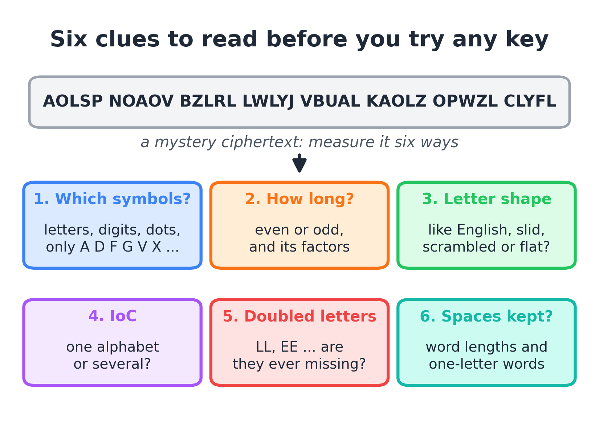
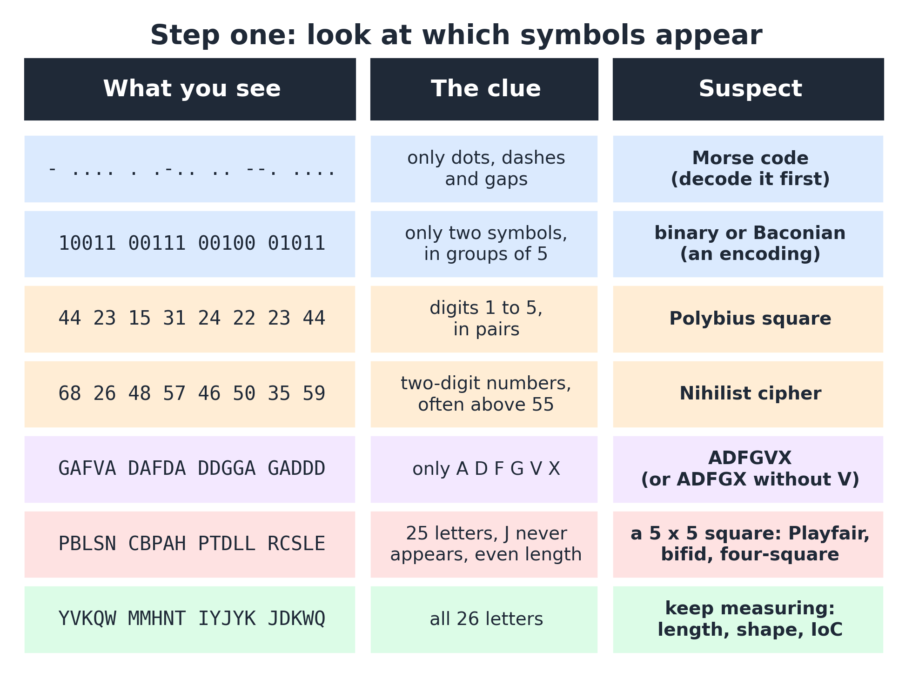
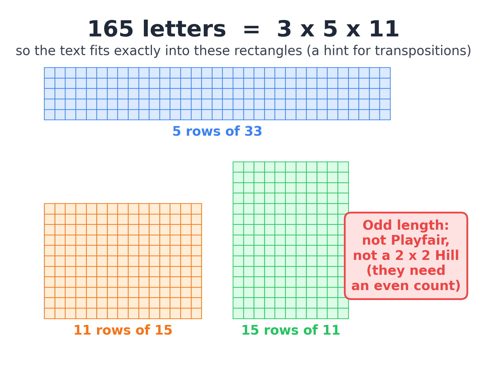
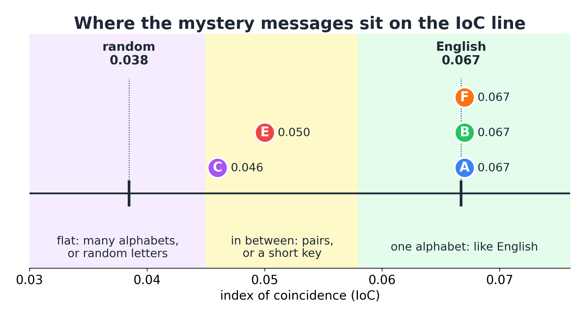

# Reading the clues

**By the end you can look at a ciphertext, take six quick measurements, and say which family of cipher made it, before you try a single key.**

## The big idea

A detective does not arrest the first person they meet. They look at the footprints, the mud on the boots, the time on the stopped clock, and only then do they name a suspect. Codebreakers work the same way. Every cipher changes a message, but no cipher changes everything. Some keep the letters and only move them. Some keep the shape of English but rename every letter. Some need the message to have an even number of letters. Some never use the letter J. These leftovers are clues, and you can read them without knowing the key. Taking five minutes to read them saves you hours of trying the wrong attack.



## Which ciphers it helps with

Reading the clues does not break any cipher by itself. It tells you which attack to use next, so it helps with every cipher.

| Cipher family | What the clues tell you | Which clue gives it away |
|---|---|---|
| Morse, binary, Baconian | It is an encoding, not a cipher: decode it, then start again | Only two or three different symbols |
| Polybius, Nihilist, ADFGVX | Letters were turned into pairs of symbols | Digits, or only the letters A D F G V X |
| Transposition (rail fence, columns) | Letters kept, only their order changed | Letter counts look exactly like English |
| Caesar | One alphabet, slid along | Counts look like English moved sideways |
| Affine, keyword substitution | One alphabet, scrambled | Counts as bumpy as English, but on the wrong letters |
| Vigenère, Beaufort | Several alphabets taking turns | Counts flatter than English; all 26 letters appear |
| Playfair and other 5 x 5 squares | Letters encrypted two at a time | Even length, J never appears, no pair is a double |
| Hill | Letters mixed in blocks | Even length (or a multiple of 3), very flat counts |

What the clues cannot do: tell you the key, or tell apart two ciphers that leave the same leftovers (an affine cipher and a keyword substitution look the same from the outside). For that you need the attacks in the later guides.

## Why it works

Think about what each kind of cipher actually does to a message.

A **transposition** shuffles the letters, like shaking the tiles of a word game in a bag. The tiles are still the same tiles. If the message had 24 copies of E before, it still has 24 copies of E after.

A **substitution** keeps every letter in its place but gives it a new name. Every E becomes, say, L. So the ciphertext has 24 copies of L. The pattern of "one letter very common, a few fairly common, some rare" survives, only on different letters.

A **polyalphabetic** cipher like Vigenère uses several alphabets in turn. The first E might become L, the next E might become S, the next one K. The 24 copies of E get spread over several letters, and the tall bars get flattened.

Here is a pencil-and-paper experiment. Take any paragraph from a book and count how many times each letter appears. You will find E near the top, then T, A, O, I, N, and you will find almost no J, Q, X or Z. That pattern is a fingerprint of English. Ciphers smudge the fingerprint in different ways, and the way it is smudged tells you which cipher did it.


## The six clues, one by one

### Clue 1: which symbols appear?

Look before you count. Write down every different symbol the ciphertext uses.

- **Two or three symbols** (dots and dashes, zeros and ones, A and B in groups of five) mean an **encoding** such as Morse code, binary or the Baconian code. An encoding has no secret key. Decode it, and then start the clue-reading again on what comes out, because a setter often hides a real cipher under an encoding.
- **Digits 1 to 5 in pairs** mean a **Polybius square**: a 5 x 5 grid where each letter is named by its row and column. The pair `15` means row 1, column 5.
- **Larger two-digit numbers**, often above 55, suggest the **Nihilist cipher**, which adds a key to Polybius numbers.
- **Only A, D, F, G and X** (or A, D, F, G, V and X) is the famous signature of the **ADFGX** and **ADFGVX** ciphers from World War I.
- **25 letters, with J never appearing** suggests a cipher built on a 5 x 5 square, which only has room for 25 letters (usually I and J share a cell). Playfair, bifid and four-square all do this.
- **More than 26 different symbols** suggests a **homophonic** cipher, where common letters get several symbols each.
- **Pictures or odd marks** are usually a plain substitution in disguise: give each symbol a letter of your own and solve it as a substitution.
- **Ordinary letters A to Z**: keep measuring.



### Clue 2: how long is it?

Count the letters, then break the count into its **factors** (the whole numbers that divide it exactly).

- An **odd** length rules out Playfair, four-square and the 2 x 2 Hill cipher. All three work on pairs of letters, so their ciphertexts always have an even length.
- A length that divides neatly into a rectangle is a hint for a **columnar transposition**, which writes the message into a grid. If the length is 165, the grid might be 5 by 33, 11 by 15 or 15 by 11.
- A length that is a multiple of 3 allows a 3 x 3 Hill cipher. A multiple of 25 suggests a cipher called Cadenus.



### Clue 3: the shape of the letter counts

Draw a bar chart: one bar for each letter, as tall as the number of times it appears. Then ask which of these four shapes you see.

1. **Exactly like English.** E tallest, then T, A, O, I, N; J, Q, X, Z almost absent. The letters are real; only their order changed. Suspect a **transposition**.
2. **English slid sideways.** The same skyline of tall and short bars, but moved along the alphabet. Suspect a **Caesar** cipher. A good landmark: English has a run of rare letters at the end, V W X Y Z. In a Caesar ciphertext, that run of near-empty bars appears somewhere else.
3. **Bumpy, but on the wrong letters.** A few very tall bars and several empty ones, like English, but the tall bars sit on letters such as B or U, and no slid pattern fits. Suspect an **affine** or **keyword substitution**.
4. **Flattened.** No tower stands far above the rest, and almost every letter appears. Suspect **several alphabets** (Vigenère and its cousins) or a cipher that works on pairs.

### Clue 4: the index of coincidence

Shape is easy to see but hard to compare. The **index of coincidence** (IoC) turns the shape into one number. It answers a simple question: if you pick two letters from the text at random, what is the chance they are the same letter?

In English, letters repeat a lot (so many E's and T's), so the chance is about 0.067, roughly 1 in 15. If every letter were equally likely, the chance would be 1 in 26, about 0.038. A substitution or a transposition does not change how often letters repeat, so they keep the English value. Several alphabets spread the repeats out, so the IoC drops toward 0.038. Guide 04, The index of coincidence, explains how to use this number to find a Vigenère key's length.

### Clue 5: doubled letters

English is full of doubled letters: LL, EE, SS, OO, TT. A substitution keeps them (LL becomes ZZ). A transposition breaks most of them up but makes new ones by chance. The interesting clue is a double that **never** appears where you would expect it.

Playfair cannot encrypt a pair of identical letters, so the setter splits doubles with an X before encrypting. The result: if you cut a Playfair ciphertext into pairs (letters 1 and 2, letters 3 and 4, and so on), **no pair is ever two copies of the same letter**. Doubles can still appear across the boundary between two pairs. In a long text with no in-pair doubles at all, Playfair is the prime suspect.

### Clue 6: are the spaces kept?

If the ciphertext keeps its word breaks, you have a gift. One-letter words are almost always A or I. The commonest three-letter word is THE. A word like `XYZZX` has the same letter pattern as a real word you can search for. Most competition ciphers remove the spaces or group the letters in fives, precisely to hide these clues. When they are left in, start there (Guide 02, Frequency analysis, and Guide 06, Cribs and patterns, show how).

> **In the app:** [Counts](https://apps.thorwhalen.com/cryptology/#/workbench/counts) measures a ciphertext for you: its length, every letter's count beside English's, the commonest letters and the IoC. [The method, step by step](https://apps.thorwhalen.com/cryptology/#/guide) asks the same questions one at a time and says where each answer leads.

## The grown-up version

Codebreakers have names for these measurements.

**Letter frequency.** The frequency of a letter is how often it appears, usually as a fraction or percentage of all letters. If E appears 24 times in 165 letters, its frequency is $24/165 \approx 0.145$, or 14.5%. The sign $\approx$ means "is approximately equal to".

**Factorization.** Writing a number as a product of primes, such as $165 = 3 \times 5 \times 11$ or $168 = 2 \times 2 \times 2 \times 3 \times 7$. Every rectangle that holds the text exactly has sides made from these factors.

**Index of coincidence.** If a text has $N$ letters, and a particular letter appears $f$ times, then the number of ways to pick two copies of that letter is $f(f-1)/2$, and the number of ways to pick any two letters is $N(N-1)/2$. Add up the first count over all 26 letters and divide by the second (the halves cancel):

$$\text{IoC} = \frac{\sum f(f-1)}{N(N-1)}$$

The symbol $\sum$ (the Greek capital letter sigma) means "add this up for every letter". So for each letter you work out $f(f-1)$, add the 26 results, and divide by $N(N-1)$.

Here is a tiny example you can check in your head: the text `AABB` has $N = 4$, $f = 2$ for A and $f = 2$ for B. So the IoC is $\frac{2 \times 1 + 2 \times 1}{4 \times 3} = \frac{4}{12} \approx 0.333$. One time in three, two letters picked from `AABB` match.

The two numbers to remember:

$$\kappa_{\text{English}} \approx 0.067 \qquad \kappa_{\text{random}} = \tfrac{1}{26} \approx 0.038$$

The Greek letter $\kappa$ (kappa) is the traditional name for these benchmark values. They are guides, not sharp lines: a short text wobbles. Below about 100 letters, trust the overall shape more than the third decimal place.

**Monoalphabetic and polyalphabetic.** A monoalphabetic cipher uses one cipher alphabet for the whole message (Caesar, affine, substitution). A polyalphabetic cipher switches between several (Vigenère, Beaufort). The IoC is the quickest way to tell them apart.

## Worked example: a lineup of six suspects

Here is an original message, written for this guide:

`the lighthouse keeper counted the ships every evening and wrote their names in a small green book one night a ship with no name and no lights slipped past the rocks and vanished into the fog before dawn`

It has 165 letters. I encrypted it six different ways. Pretend you do not know which is which. Here are the first 50 symbols of each.

```text
A: AOLSP NOAOV BZLRL LWLYJ VBUAL KAOLZ OPWZL CLYFL CLUPU NHUKD
B: ETEEN HPRNN TIESG BNHIH MNHIP HKVHT FFALH KRTES YIDER SMROE
C: YVKQW MMHNT IYJYK JDKWQ UZBZJ RZMSY MWVXS BJFEJ JKSWT LOTIK
D: 44 23 15 31 24 22 23 44 23 34 45 43 15 25 15 15 35 15 42 13 34 45 33 44 15
E: PBLSN CBPAH PTDLL RCSLE GHZUS FFQRC PRPVX LXCBX CXGLK IDOKG
F: IUEYV SUIUC JHEXE EDEGN CJBIE TIUEH UVDHE KEGPE KEBVB SLBTM
```

Now take the measurements. These are the real counts for the whole of each message.

| | Symbols used | Length | Missing letters | Commonest letters | IoC | Doubles inside pairs |
|---|---|---|---|---|---|---|
| A | 22 letters | 165 | E G Q X | L 24, U 17, A 13, O 13 | 0.067 | (odd length) |
| B | 22 letters | 165 | J Q X Z | E 24, N 17, T 13, H 13 | 0.067 | (odd length) |
| C | all 26 | 165 | none | T 16, K 14 | 0.046 | (odd length) |
| D | digits 1 to 5 | 165 pairs | | `15` appears 24 times | | |
| E | 25 letters | 168 | J | L 17, C 15 | 0.050 | 0 out of 84 |
| F | 22 letters | 165 | F O Q W | E 24, B 17, I 13, U 13 | 0.067 | (odd length) |

Now read the clues, one suspect at a time.

**Message D** is the easiest. It uses only the digits 1 to 5, always in pairs. That is a Polybius square. Notice that the pair `15` appears 24 times, exactly as often as E appears in the plaintext: Polybius is really a substitution that writes each letter as two digits. Replace each pair with a letter of your choice and solve it as a substitution.

**Message E** has an even length (168, when the plaintext had 165: the setter added padding), uses 25 letters with no J, and has an IoC of 0.050, between English and random. Cut it into pairs and look for doubles: there are five doubled letters in the text (`LL`, `FF`, `EE`, `CC`, `CC`), but every one of them straddles the boundary between two pairs. Not one of the 84 pairs is a double. Prime suspect: **Playfair**.

**Message C** uses all 26 letters, its bars are flat (no letter appears more than 16 times in 165), and its IoC is 0.046, well below English. That points to **several alphabets**. As a test, take every third letter, then every third letter starting from the second, then from the third. The average IoC of these three slices jumps to 0.068, right at the English value. For slices of 2, 4, 5 and 7 it stays between 0.042 and 0.051. So this is a **Vigenère-type cipher with a key of length 3** (guides 04 and 05 show how to finish it).

That leaves A, B and F. All three have an IoC of exactly 0.067: one alphabet each. So which is which?

**Message B**'s commonest letters are E, N, T, H, and J, Q, X, Z never appear. That is just what English looks like. Its bar chart is identical to the plaintext's. The letters are all real; only the order is scrambled. Suspect: **transposition**. The length, $165 = 3 \times 5 \times 11$, says to try grids that are 3, 5, 11 or 15 columns wide. (It was, in fact, a 5-column transposition.)

**Message A**'s commonest letter is L, and E and G never appear. Compare its bar chart with English, slid along. English's tallest bar is E. If E moved to L, that is a slide of 7 places: count them, F, G, H, I, J, K, L. Check the landmarks: under a slide of 7, English's rare letters X and Z would move to E and G. Those are exactly the two letters missing from message A. English's common T would move to A, and A has 13 copies, one of its tallest bars. The whole skyline fits. Suspect: **Caesar, shift 7**. Try it: moving every letter back 7 turns `AOLSP NOAOV` into `theli ghtho`. Solved.

**Message F**'s commonest letter happens to be E, but its second-tallest bar is B, and O, a very common English letter, never appears at all. No slide of the English skyline fits. Bumpy bars on the wrong letters: suspect a **keyword substitution** (or an affine cipher). Use frequency analysis and common words to finish (Guide 02).

Six suspects, six different ciphers, and you named every family without trying a single key.



## A decision flowchart

Here is the whole routine on one page. Start at the top and answer each question in order.


> **In the app:** The [family tree](https://apps.thorwhalen.com/cryptology/#/tree) shows every family of cipher, how they are related, and the clues each one leaves.

## When to use it, and when not to

**Always use it first.** Every time you meet a new ciphertext, before you guess anything. It takes five minutes and points you at the right attack.

**Use it again when you are stuck.** If you have been trying Vigenère keys for half an hour with no luck, go back and remeasure. Did you check that the IoC was actually low? Did you assume the length was even without counting?

**Do not treat it as a verdict.** The clues narrow down the suspects; they do not convict. A short message can fool any measurement, and a clever setter can add a twist (see below). If the clues say "Caesar" and none of the 26 shifts reads, the clues were not wrong about everything, but something else is going on.

## Traps and tips

- **Short texts wobble.** With 50 letters, an English text might easily show T above E, or have an IoC of 0.055 instead of 0.067. Lean on the shape and the missing letters more than on exact numbers.
- **Unusual texts.** A message about "jazz quizzes" has lots of Z and Q. A list of names or a text written to avoid the letter E will throw off the counts. Read the story or context that comes with the cipher.
- **Padding.** Setters often add X's or random letters to fill the last row of a grid or to make the length even. A length one or two more than you expect is not a disaster.
- **Reversed text.** Writing the message backwards does not change any count. If every clue says "transposition", try reading it backwards before anything clever.
- **Layers.** A message might be encoded in Morse and then enciphered, or substituted and then transposed. If you decode one layer and get gibberish, measure the gibberish: it is a new ciphertext with its own clues.

## By hand or by computer

Reading the clues is mostly measuring, and measuring is what computers are for. The judgement, which family the measurements point to, is the part worth keeping. Do each job by hand once, on a short text, so you know what it involves; then hand it over (the chapter *Brain, pencil or computer?* explains why[^g01-why]). Times are rough, for a practiced reader and a ciphertext of about 300 letters. In a live competition round, its rules decide: the National Cipher Challenge bans online solvers and AI.

| Job | By hand | Learn with | Just do it |
|---|---|---|---|
| Note the symbols, the length and its factors | 2 to 5 minutes | Counts[^g01-counts] | dCode identifier[^g01-dcode-id] |
| Count every letter | 10 to 15 minutes | Counts[^g01-counts], letter-count sheet[^g01-sheet-letters] | dCode[^g01-dcode-freq] |
| Work out the IoC from the counts | 10 to 15 minutes, with a calculator | Counts[^g01-counts], letter-count sheet[^g01-sheet-letters] | dCode[^g01-dcode-ioc] |
| Name the likely cipher | a minute of thinking, once you have the numbers | n/a | dCode identifier[^g01-dcode-id], Boxentriq[^g01-boxentriq] |

[^g01-why]: [Brain, pencil or computer?](https://apps.thorwhalen.com/cryptology/#/guides/00-brain-pencil-or-computer), the chapter before Guide 1.
[^g01-counts]: Counts, in the cryptology app: [apps.thorwhalen.com/cryptology/#/workbench/counts](https://apps.thorwhalen.com/cryptology/#/workbench/counts). Letter counts beside English's, the IoC, the length and its factors.
[^g01-dcode-id]: dCode's cipher identifier: [dcode.fr/cipher-identifier](https://www.dcode.fr/cipher-identifier).
[^g01-sheet-letters]: Letter counts and IoC, a spreadsheet: SHEET:letters.
[^g01-dcode-freq]: dCode's frequency analysis: [dcode.fr/frequency-analysis](https://www.dcode.fr/frequency-analysis).
[^g01-dcode-ioc]: dCode's index of coincidence: [dcode.fr/index-coincidence](https://www.dcode.fr/index-coincidence).
[^g01-boxentriq]: Boxentriq's cipher identifier: [boxentriq.com/code-breaking/cipher-identifier](https://www.boxentriq.com/code-breaking/cipher-identifier).

## Try it yourself

1. A ciphertext uses only the letters A, D, F, G, V and X, always an even number of them. What is your first suspect?
2. A ciphertext of 120 letters has an IoC of 0.066, and its four commonest letters are E, T, O and A. Which family is it, and which grid widths would you try first?
3. A ciphertext's commonest letter is H, and the letters A, C and M never appear. Assuming it is a Caesar cipher, what is the shift? (Hint: which English letter is commonest, and how far is it from H?)

> **In the app:** [Spot the cipher](https://apps.thorwhalen.com/cryptology/#/ex/spot/1) gives you texts to diagnose from their counts and IoC. The [Family tree quiz](https://apps.thorwhalen.com/cryptology/#/ex/family-quiz/1) and the [Strategy quiz](https://apps.thorwhalen.com/cryptology/#/ex/strategy-quiz/1) check the order of the clues.

## Answers

1. ADFGVX. The six letters are its signature. (It writes each letter as two of these symbols and then only rearranges them, so the length stays even.)
2. A transposition: the IoC is English and so are the commonest letters. $120 = 2 \times 2 \times 2 \times 3 \times 5$, so it fits many grids: try widths 4, 5, 6, 8, 10 and 12 first.
3. If H stands for E, the shift is 3 (E to F, G, H). Check: a shift of 3 sends English's rare letters X, Z and J to A, C and M, which explains why exactly those three are missing. Now try the shift and see if words appear.

## Words to know

- **Ciphertext**: the scrambled message. **Plaintext**: the original message.
- **Encoding**: a fixed way of rewriting letters (Morse, binary) with no secret key.
- **Frequency**: how often a letter appears, as a count or a percentage.
- **Factor**: a whole number that divides another exactly; 5 is a factor of 165.
- **Index of coincidence (IoC)**: the chance that two letters picked at random from a text are the same; about 0.067 for English and 0.038 for random letters.
- **Monoalphabetic**: using one cipher alphabet throughout. **Polyalphabetic**: switching between several.
- **Transposition**: a cipher that moves letters without changing them. **Substitution**: a cipher that changes letters without moving them.
- **Padding**: extra letters added to make the length fit a grid.

## Going further

- Video: [How to Break an Unknown Cipher](https://www.youtube.com/watch?v=td-mS7jkOy8), Cryptography for Everybody (CrypTool), 15 minutes.
- [Index of coincidence](https://en.wikipedia.org/wiki/Index_of_coincidence) on Wikipedia.
- [Frequency analysis](https://en.wikipedia.org/wiki/Frequency_analysis) on Wikipedia.
- [Practical Cryptography: English letter frequencies](http://practicalcryptography.com/cryptanalysis/letter-frequencies-various-languages/english-letter-frequencies/).
- [The National Cipher Challenge resources](https://www.cipherchallenge.org/resources-media/), including the BOSS training lessons.
- Simon Singh, *The Code Book* (1999), and his [Black Chamber](https://simonsingh.net/The_Black_Chamber/) site with interactive cipher tools.
