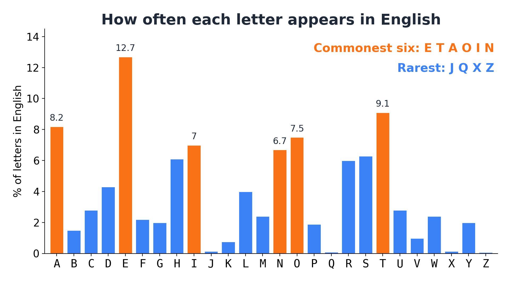
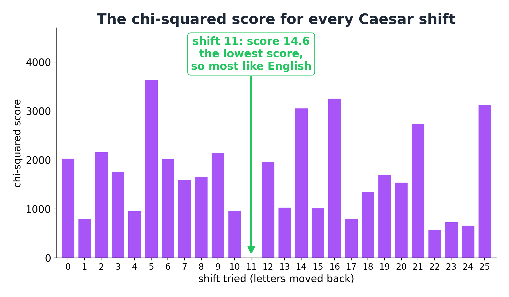
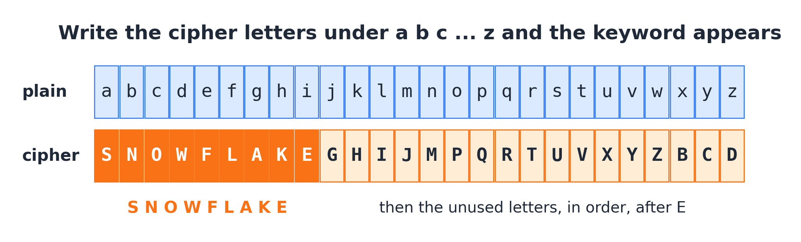

# Frequency analysis

**By the end you can break a Caesar cipher by sliding a bar chart, score how English a text looks with one number, and crack a full substitution cipher using letter counts and common words.**

## The big idea

In English, letters do not appear equally often. E turns up about once in every eight letters. Z turns up about once in every 1,300. A simple cipher swaps each letter for another, but it swaps it the same way every time. So if E was the commonest letter in the message, then whatever E turned into is now the commonest letter in the ciphertext. Count the letters in the ciphertext, compare the counts with English, and the disguise starts to slip. This is **frequency analysis**, and it is the oldest serious codebreaking method there is.



## A thousand years ago in Baghdad

The first person known to have written this method down was **al-Kindi**, a scholar who worked in Baghdad in the 800s. His book, *A Manuscript on Deciphering Cryptographic Messages*, was lost for centuries and rediscovered in an archive in Istanbul in 1987. His instructions were roughly: take a long text in the same language, count how often each letter appears, then count the letters of the secret message, and match the commonest with the commonest, the second with the second, and so on. That idea broke every simple substitution cipher for the next several hundred years.

## Which ciphers it breaks

| Cipher family | Does frequency analysis help? | How |
|---|---|---|
| Caesar | Yes, completely | Slide the ciphertext's bar chart until it matches English. Only 26 positions to try |
| Affine | Yes | Guess which letters are E and T, then solve for the key (see Guide 03, Keys and brute force) |
| Keyword substitution | Yes | Frequencies give the first few letters; common words and the keyword finish it |
| General substitution | Yes, with more work | Frequencies, then common words, then letter patterns |
| Vigenère, Beaufort | Only after splitting | Each slice of the ciphertext is a Caesar cipher; use frequency analysis on each slice (see Guide 05) |
| Transposition | No | The letter counts are already exactly English; only the order changed. (That fact itself tells you it is a transposition) |
| Playfair, Hill | No, not on single letters | These encrypt pairs of letters, so you count pairs instead (see Guide 09) |
| Homophonic substitution | Weakly | Common letters get several symbols each, which flattens the counts on purpose |

## Why it works

Try this experiment. Take a page of any book and count every letter on it, making a tally mark under A, B, C and so on. It takes about twenty minutes. Then do the same with a different page from a different book. The two tallies will look remarkably alike. E will be at or near the top. T, A, O, I and N will follow. J, Q, X and Z will have only a few marks. Codebreakers remember the order of the top dozen as a nonsense phrase: **ETAOIN SHRDLU**.

Now imagine the page had been put through a substitution cipher, where every e was written as F, every t as V, and so on. Your tally for the ciphertext would have the same tall bars and short bars. They would just be standing over different letters. The tall bar over F is the clue that F means e.

This works because a simple substitution is **consistent**: the same plaintext letter always becomes the same ciphertext letter. That consistency is the weakness.

## The grown-up version

### Frequencies

The **frequency** of a letter is the number of times it appears, divided by the total number of letters. In a text of 152 letters where t appears 18 times, its frequency is $18 / 152 \approx 0.118$, or 11.8%. (The sign $\approx$ means "approximately equal to".)

The **expected count** of a letter is how many times it would appear if the text were perfectly average English. If English uses e 12.7% of the time, then in 152 letters you would expect $152 \times 0.127 \approx 19.3$ copies of e.

### Fitting a Caesar shift

A Caesar cipher slides every letter the same number of places along the alphabet. So its bar chart is the English bar chart slid along by the same number of places. To find the shift, slide the ciphertext's bar chart back one place at a time until its tall bars sit on top of English's tall bars. With paper, you can draw the ciphertext's counts on a strip and literally slide it along a printed English chart.

### Chi-squared: how English is this?

Looking at two bar charts and saying "those match well" is a judgment. A computer, or a tired codebreaker at midnight, needs a number. The standard one is called **chi-squared** (say "kai squared"; $\chi$ is the Greek letter chi).

For each letter, compare the count you **observed** ($O$) with the count you **expected** ($E$) for English. Then:

$$\chi^2 = \sum \frac{(O - E)^2}{E}$$

Read it from the inside out:

- $O - E$ is how far off this letter's count is.
- Squaring it, $(O - E)^2$, makes every difference positive (too many and too few both count as bad) and makes big misses count much more than small ones.
- Dividing by $E$ makes the miss relative to what was expected. Being 3 short of an expected 19 is a small surprise; seeing 3 copies when you expected 0.1 is a huge one.
- The symbol $\sum$ (capital sigma) means "add this up over all 26 letters".

A **low** score means the counts look like English. A **high** score means they do not. A perfect, impossible match would score 0. The exact value of a good score depends on the length of the text; what matters is that the right answer scores far lower than all the wrong ones.

To use it on a Caesar cipher, try all 26 shifts. For each one, shift the ciphertext back, count the letters, and work out $\chi^2$. The shift with the lowest score is almost always the key.

## Worked example 1: a Caesar cipher, by sliding and by scoring

Here is a ciphertext I made from an original sentence:

```text
PGPCJ XZCYT YRESP MLVPC ZYZFC DECPP EDPWW DESPQ TCDEW ZLQZQ
ESPOL JEZLW LCRPM WLNVN CZHES PNCZH HLTED ZYESP HTYOZ HDTWW
LYOAL JDHTE SLDST YJMFE EZYES LETEQ ZFYOD ZXPHS PCPTY ESPEZ
HY
```

**Step 1: count.** There are 152 letters. The commonest are E (18 times), P (16), Z (14), then Y, L (11 each), and C, S (10 each).

**Step 2: the obvious guess, and why it fails.** The commonest ciphertext letter is E. If E stands for e, the shift is 0, and the ciphertext would already be English. It is not. So in this message, e is not the commonest letter. That happens in short texts: here, as you will see, the message has more t's than e's.

**Step 3: try the next guess.** Suppose P stands for e. From e to P is 11 places (f, g, h, i, j, k, l, m, n, o, P). Then E would stand for the letter 11 places before E, which is t. And Z would stand for o. Commonest letters t, e, o: that sounds like English.

**Step 4: check with the bar charts.** The picture below shows the ciphertext moved back by 0, 4 and 11 places, laid over English. Only the shift of 11 puts the ciphertext's tall bars on English's tall bars.


**Step 5: score every shift.** Here is the chi-squared calculation for the shift of 11, letter by letter. The text has 152 letters, so the expected count of each letter is 152 times its English frequency.

| Letter | Observed $O$ | Expected $E$ | $(O-E)^2/E$ |
|---|---|---|---|
| a | 11 | 12.46 | 0.17 |
| b | 3 | 2.28 | 0.23 |
| c | 3 | 4.26 | 0.37 |
| d | 4 | 6.54 | 0.98 |
| e | 16 | 19.30 | 0.57 |
| f | 4 | 3.34 | 0.13 |
| g | 2 | 3.04 | 0.36 |
| h | 10 | 9.27 | 0.06 |
| i | 9 | 10.64 | 0.25 |
| j | 0 | 0.23 | 0.23 |
| k | 2 | 1.17 | 0.59 |
| l | 7 | 6.08 | 0.14 |
| m | 2 | 3.65 | 0.74 |
| n | 11 | 10.18 | 0.07 |
| o | 14 | 11.40 | 0.59 |
| p | 1 | 2.89 | 1.23 |
| q | 0 | 0.14 | 0.14 |
| r | 10 | 9.12 | 0.08 |
| s | 9 | 9.58 | 0.03 |
| t | 18 | 13.83 | 1.26 |
| u | 3 | 4.26 | 0.37 |
| v | 1 | 1.49 | 0.16 |
| w | 8 | 3.65 | 5.19 |
| x | 0 | 0.23 | 0.23 |
| y | 4 | 3.04 | 0.30 |
| z | 0 | 0.11 | 0.11 |

The last column adds up to 14.58, which rounds to $\chi^2 \approx 14.6$. The biggest single contribution is w (5.19): this message happens to mention a crow, a windowsill and somewhere, so it has more w's than average English.

Compare the shift of 0. Then the ciphertext letter Z, which appears 14 times, would have to be the plaintext letter z, which English expects only $152 \times 0.00074 \approx 0.11$ times in a text this long. That one letter contributes $(14 - 0.11)^2 / 0.11 \approx 1715$ to the score. Wrong shifts are punished hard.

Doing this for all 26 shifts gives the chart below. Shift 11 scores 14.6. The next-best shift, 22, scores 586.9. It is not close.



**Step 6: decrypt.** Moving every letter back 11 places gives:

`every morning the baker on our street sells the first loaf of the day to a large black crow the crow waits on the windowsill and pays with a shiny button that it found somewhere in the town`

## Worked example 2: a substitution cipher, by counts and common words

A keyword substitution scrambles the alphabet, so there is no single shift to find: each letter has its own disguise. There are far too many possible keys to try them all (Guide 03 explains just how many). Frequency analysis lets you find them one letter at a time. Here is a ciphertext that kept its spaces and punctuation, which makes it a good first one to break:

```text
EV ZSU S OPIW SMW RXEFV MEAKV ZKFM VKF PIW OIPOH EM VKF VPZFT
UVPQQFW SV FBSOVIC MEMF. MPNPWC EM VKF YEIISAF OPXIW TFJFJNFT S
VEJF ZKFM VKF OIPOH KSW NFFM ZTPMA, UP VKF QFPQIF ASVKFTFW EM VKF
URXSTF VP UVSTF SV EV. VKF NSHFT USEW VKSV VKF VPZFT ZSU KSXMVFW.
VKF VFSOKFT USEW VKSV VKF AFSTU ZFTF UEJQIC LTPDFM. NXV S UJSII
AETI ZEVK S ISMVFTM OIEJNFW VKF UVSETU SMW LPXMW S MPVF VXOHFW
NFVZFFM VKF ZKFFIU. EV USEW VKSV VKF OIPOH ZPXIW UVSTV SASEM ZKFM
UPJFPMF EM VKF YEIISAF VPIW VKF VTXVK.
```

**Step 1: count the letters.** There are 389 letters. The ten commonest are F (57), V (50), S (34), K (29), M (24), E (22), P (22), I (21), W (18) and T (18). The letter G never appears.

**Step 2: match by rank, but only as a first guess.** English's commonest letters are e, t, a, o, i, n. So F is probably e, V is probably t, S might be a. Beyond the top three, the ranks get unreliable: in a few hundred letters, letters with similar frequencies easily swap places. The picture shows how the true answers line up. The top three match exactly; the rest are close but shuffled.


**Step 3: use the commonest word.** The three-letter word `VKF` appears 15 times. The commonest three-letter word in English is "the". And V and F are the two commonest letters, which fits t and e perfectly. So **V = t, K = h, F = e**.

**Step 4: one-letter words.** The word `S` stands alone 5 times. One-letter English words are "a" and "I". S is also the third commonest letter, like a. So **S = a**. Check it: the word `VKSV`, which appears 3 times, now reads t-h-a-t. "That." It fits.

**Step 5: short words.** Two-letter words `EV` (3 times) and `EM` (4 times) both start with E. With V = t, `EV` is "?t", so it could be "it" or "at". Since a is taken, E = i. Then `EM` is "i?": "in" or "is". The four-letter word `ZKFM` appears 3 times and reads "?he?". Words that fit are "when", "then", "them", "they". If M = n (from "in"), then `ZKFM` is "?hen", and since t is already taken, it must be "when". So **E = i, M = n, Z = w**.

**Step 6: more words fall.** Now `ZSU` reads "wa?", which is surely "was": **U = s**. `SMW` reads "an?", most likely "and": **W = d**. Check: `USEW` now reads "said", a real word, so both guesses hold up. The word `PIW` now reads "??d", with two letters you have not found yet, in the phrase `VKF PIW OIPOH`: "the ??d ?????". A common three-letter word ending in d is "old": **P = o, I = l**. Then `OIPOH` reads "?lo??" with its first and fourth letters the same: "clock". So **O = c, H = k**.


**Step 7: finish by reading.** The first sentence now reads "it was a cold and ??iet ni?ht when the old clock in the towe? ..." and your brain fills the gaps. "quiet" gives **R = q, X = u**; "night" gives **A = g**. The rest fall the same way: `VPZFT` is "tower" (T = r), `MPNPWC` is "nobody" (N = b, C = y), `TFJFJNFT` is "remember" (J = m), `UVPQQFW` is "stopped" (Q = p), `YEIISAF` is "village" (Y = v), `LTPDFM` is "frozen" (L = f, D = z), and `FBSOVIC` is "exactly" (B = x). That is 25 letters. The 26th, G, never appears because the message has no j.

**Step 8: recover the key.** Write down the cipher letter for each plaintext letter, in alphabetical order. A keyword substitution starts its cipher alphabet with a keyword, then lists the unused letters in order. Here the keyword jumps out:



The keyword was SNOWFLAKE. Once you spot a keyword, you can fill in any letters you were unsure about, and check every one.

The full message: `it was a cold and quiet night when the old clock in the tower stopped at exactly nine. nobody in the village could remember a time when the clock had been wrong, so the people gathered in the square to stare at it. ...`

## When to try it

- The IoC is near English (about 0.067), so there is one cipher alphabet (see Guide 01, Reading the clues).
- The letter counts are bumpy, with a few very common letters and a few missing ones, but not on the English letters.
- The ciphertext keeps its spaces: then common words make it fast.
- You suspect a Caesar or affine cipher, and want to score the candidates rather than read 26 or 312 attempts by eye.
- You have split a Vigenère ciphertext into slices: each slice is a Caesar cipher, and chi-squared finds each slice's shift.

## When not to

- The letter counts already look exactly like English. Then the letters are untouched and only their order has changed: it is a transposition, and no letter swap will help.
- The counts are flat (IoC near 0.040). Several alphabets are mixing the counts, so first find the key length (guides 04 and 05).
- The text is very short (under about 50 letters). Counts that small are unreliable. Look for cribs instead (Guide 06).

## Traps and tips

- **The commonest letter is not always e.** In worked example 1, t beat e. Never stake everything on one letter; match the whole shape, or use chi-squared.
- **Ranks below the top few are a mess.** Use frequencies to get started, then switch to words as soon as you can.
- **Unusual texts.** A message about a zoo full of zebras, or a text full of names, has strange counts. A message written without the letter e (it has been done, as a whole novel) would fool you completely.
- **Missing spaces.** Most competition ciphers remove spaces or group letters in fives. Then look for common letter groups instead of words: TH, HE, IN, ER, AN are the commonest pairs, and THE, AND, ING are the commonest triples. A ciphertext triple that appears many times is probably THE.
- **Double letters.** A substitution keeps doubles: LL stays a double, just of a different letter. English doubles are usually LL, EE, SS, OO, TT.
- **Write in pencil.** Every guess might be wrong. Keep a table of which cipher letter maps to which plaintext letter, and when a guess produces nonsense, undo it.
- **Look for the keyword.** After a dozen letters, write the cipher alphabet out in order. A keyword substitution leaves a recognizable word at the start, and a long run of the alphabet in order after it. Spotting it fills in the rest.

## Try it yourself

1. A long Caesar ciphertext has commonest letters X, M, T and H, in that order. What is the shift? Check your answer using all four letters.
2. A text has 200 letters. The letter e appears 30 times and the letter z appears 2 times. Using English frequencies of 12.7% for e and 0.074% for z, work out each letter's contribution $(O - E)^2 / E$ to the chi-squared score. Which letter makes the score worse, and why?
3. A substitution ciphertext with spaces contains the word `ZIT` nine times, the word `ZIQZ` twice, and the word `Q` on its own three times. What do these three words probably say?

## Answers

1. If X is e, the shift is 19 (e is letter 4 and X is letter 23, counting A as 0; $23 - 4 = 19$). Check: t is letter 19, and $19 + 19 = 38$, which goes past Z, so subtract 26 to get 12, which is M. a moves to T, and o moves to H. All four fit, so the shift is 19.
2. For e: $E = 200 \times 0.127 = 25.4$, so the contribution is $(30 - 25.4)^2 / 25.4 = 21.16 / 25.4 \approx 0.83$. For z: $E = 200 \times 0.00074 = 0.148$, so the contribution is $(2 - 0.148)^2 / 0.148 \approx 23.2$. The two z's make the score much worse, because z is so rare that even two of them are a big surprise, while 30 e's is only a little more than expected.
3. `ZIT` = the, `ZIQZ` = that, `Q` = a. The letters agree: Z = t and I = h in both words, and Q = a in both "that" and "a".

## Words to know

- **Frequency analysis**: breaking a cipher by comparing its letter counts with those of the language.
- **Frequency**: how often a letter appears, as a fraction of all the letters.
- **Expected count**: how many times a letter would appear in this many letters of average English.
- **Chi-squared** ($\chi^2$): a score of how far a set of counts is from English; lower means more English-like.
- **Monoalphabetic substitution**: a cipher that replaces each letter with another, the same way every time.
- **Keyword substitution**: a substitution whose cipher alphabet starts with a keyword, followed by the unused letters in order.
- **ETAOIN SHRDLU**: the approximate order of the twelve commonest letters in English.

## Going further

- [Frequency analysis](https://en.wikipedia.org/wiki/Frequency_analysis) on Wikipedia.
- [Al-Kindi](https://en.wikipedia.org/wiki/Al-Kindi) on Wikipedia.
- [Practical Cryptography: chi-squared statistic](http://practicalcryptography.com/cryptanalysis/text-characterisation/chi-squared-statistic/) and [English letter frequencies](http://practicalcryptography.com/cryptanalysis/letter-frequencies-various-languages/english-letter-frequencies/).
- [The National Cipher Challenge resources](https://www.cipherchallenge.org/resources-media/), whose BOSS lessons build up to cracking keyword ciphers.
- Simon Singh, *The Code Book* (1999), chapter 1, tells the story of al-Kindi and of Mary Queen of Scots, whose substitution cipher was broken by frequency analysis.
