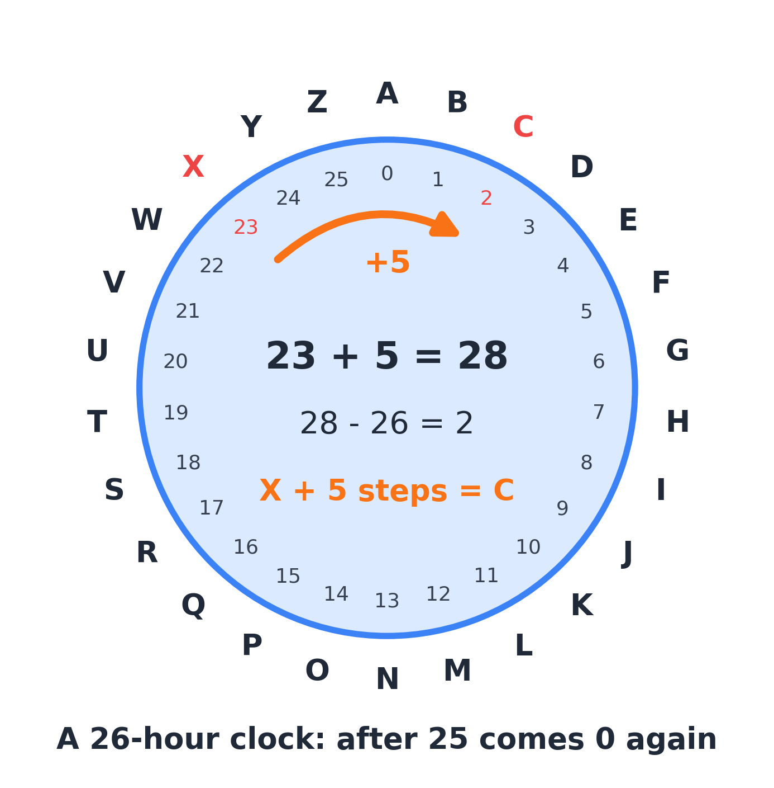
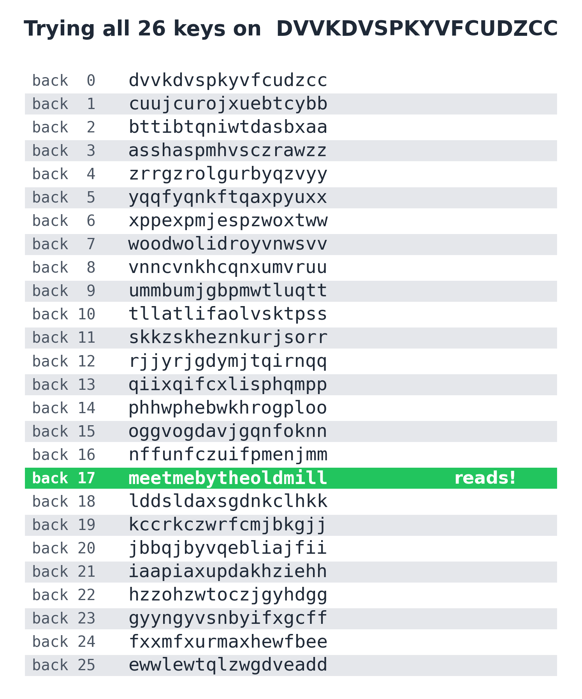

# Keys and brute force

**By the end you can count how many keys a cipher has, decide whether trying them all is possible, do arithmetic on a 26-hour clock, and recover an affine cipher's key from just two letters.**

## The big idea

Every cipher has a **key**: the secret setting that both the sender and the receiver know. For a Caesar cipher the key is one number, the shift. If you can list every possible key and try each one, you will certainly find the right one. That is called a **brute-force attack**, and it is the most reliable attack there is, when it is possible. So the first question to ask about any cipher is: **how many keys does it have?** If the answer is 26, you can try them all before lunch. If the answer has 27 digits, you cannot, and you need to be cleverer.


## Which ciphers it breaks

| Cipher family | Number of keys | Can you try them all? |
|---|---|---|
| Caesar | 26 | Yes, by hand in minutes |
| Atbash (A to Z, B to Y, ...) | 1 | There is nothing to try: it is always the same |
| Affine | 312 | Yes by computer, instantly; by hand, use two equations instead (this guide) |
| Keyword or general substitution | $26!$, about $4 \times 10^{26}$ | No. Use frequency analysis (Guide 02) or hill climbing (Guide 08) |
| Vigenère with a 5-letter key | $26^5 = 11{,}881{,}376$ | By computer, yes; but splitting into slices is much faster (Guide 05) |
| Columnar transposition, 6 columns | $6! = 720$ orders | Yes by computer; by hand, rearrange columns until words appear (Guide 07) |

The method also tells you something important about the ciphers it cannot break: a cipher with too many keys to try forces you to find a weakness, like uneven letter frequencies.

## Why it works

### Counting keys

Counting keys is a counting puzzle, the same kind you meet in math competitions.

**Caesar.** The key is a shift from 0 to 25. That is 26 keys (and a shift of 0 does nothing, so really 25 useful ones).

**Substitution.** The key is a scrambled alphabet. How many scrambled alphabets are there? The letter a can become any of 26 letters. Then b can become any of the 25 left. Then c any of the 24 left, and so on down to z, which gets the 1 letter remaining. So the number of keys is

$$26 \times 25 \times 24 \times \dots \times 2 \times 1$$

Mathematicians write this as $26!$ and call it "26 factorial". It equals 403,291,461,126,605,635,584,000,000. That is about $4 \times 10^{26}$, a 4 followed by 26 zeros. Imagine a computer that tries a billion keys every second. Trying all of them would take about 12.8 billion years, nearly the age of the universe (about 13.8 billion years). Brute force is hopeless. And yet you broke one in Guide 02 with a pencil, because frequency analysis does not need to try keys at all.

**Affine.** This guide's main cipher. Its key is two numbers. Before you can count them, you need a new kind of arithmetic.

### Clock arithmetic

Number the letters from 0 to 25: A = 0, B = 1, C = 2, and so on up to Z = 25. A Caesar shift of 5 adds 5 to each letter's number. But what is X + 5? X is 23, and $23 + 5 = 28$, and there is no letter 28. The alphabet wraps around: after Z comes A again. So 28 should mean 2, which is C.

This is exactly how a clock works. On a 12-hour clock, 5 hours after 9 o'clock is 2 o'clock, not 14 o'clock. Our alphabet is a 26-hour clock: whenever you go past 25, you subtract 26.



The same works for subtraction and multiplication:

- **Subtraction:** $3 - 8 = -5$. A negative number means you went backwards past 0, so add 26: $-5 + 26 = 21$, which is V. (Check: 8 steps back from D lands on V.)
- **Multiplication:** $7 \times 8 = 56$. Take away 26 as many times as you can: $56 - 26 - 26 = 4$, which is E.

> **In the app:** [Caesar](https://apps.thorwhalen.com/cryptology/#/workbench/caesar) has a Disk view: a cipher wheel you turn one step at a time, through all 26 shifts.

## The grown-up version

### Modular arithmetic

This clock arithmetic has a proper name: **modular arithmetic**, and 26 is called the **modulus**. Mathematicians write

$$28 \equiv 2 \pmod{26}$$

and read it "28 is congruent to 2, mod 26". The symbol $\equiv$ (three lines) means "lands on the same spot on the clock". Two numbers are congruent mod 26 when they differ by a whole number of 26s: 28 and 2 differ by 26, and $-5$ and 21 differ by 26, so $-5 \equiv 21 \pmod{26}$.

When we write $x \bmod 26$ we mean the remainder when $x$ is divided by 26, a number from 0 to 25. So $56 \bmod 26 = 4$.

Here is a very useful fact: you can reduce mod 26 at any point in a calculation and the final answer comes out the same. That keeps the numbers small.

### The affine cipher

The Caesar cipher adds a number. The affine cipher multiplies **and** adds. With the letters numbered 0 to 25, its rule for encrypting a plaintext letter $x$ is

$$E(x) = a x + b \bmod 26$$

The key is the pair of numbers $(a, b)$. For example, with $a = 11$ and $b = 6$, the letter t (19) becomes $11 \times 19 + 6 = 215$, and $215 = 8 \times 26 + 7$, so $215 \bmod 26 = 7$, which is H. Likewise h (7) becomes $77 + 6 = 83 \equiv 5$, F, and e (4) becomes $44 + 6 = 50 \equiv 24$, Y. So "the" encrypts to `HFY`.

Notice that a Caesar cipher is just an affine cipher with $a = 1$.

### Why $a$ must share no factor with 26

Can $a$ be any number? Try $a = 2$. Then a (0) becomes $2 \times 0 = 0$ and n (13) becomes $2 \times 13 = 26 \equiv 0$. Two different letters both encrypt to A! The person receiving the message would have no way to tell which was meant. A key that does this is useless.


The problem is that 2 shares a factor with 26 (because $26 = 2 \times 13$). Whenever $a$ and 26 share a factor, some multiple of $a$ is a whole number of 26s, and letters collide. So $a$ must **share no factor with 26** except 1. Mathematicians say $a$ and 26 are **coprime**, and write $\gcd(a, 26) = 1$, where gcd stands for "greatest common divisor".

Since $26 = 2 \times 13$, that rules out all even numbers and 13. The allowed values are

$$a \in \{1, 3, 5, 7, 9, 11, 15, 17, 19, 21, 23, 25\}$$

That is 12 choices for $a$ (the symbol $\in$ means "is one of"). The shift $b$ can be anything from 0 to 25: 26 choices. So the affine cipher has $12 \times 26 = 312$ keys. One of them, $a = 1, b = 0$, leaves the message unchanged.

### Multiplicative inverses: undoing a multiplication

To decrypt a Caesar cipher you subtract the shift. To decrypt an affine cipher you must subtract $b$ and then undo the multiplication by $a$. But you cannot simply divide: $7 \div 3$ is not a whole number, and there are no fractions on a clock.

Instead, you multiply by a number that undoes it. Look: $3 \times 9 = 27 \equiv 1 \pmod{26}$. So multiplying by 9 cancels out multiplying by 3, the way dividing by 3 would. We call 9 the **multiplicative inverse** of 3 mod 26, and write $3^{-1} \equiv 9 \pmod{26}$.

A quick way to find an inverse: list the numbers that are 1 more than a multiple of 26: 27, 53, 79, 105, 131, 157, 183, 209, 235, ... and look for one that $a$ divides exactly. For $a = 15$: $105 = 15 \times 7$, so $15^{-1} \equiv 7$. For $a = 11$: $209 = 11 \times 19$, so $11^{-1} \equiv 19$.


Only the 12 allowed values of $a$ have inverses. The even numbers and 13 do not, which is the same fact as before seen from the other side.

With the inverse, the decryption rule is

$$D(y) = a^{-1}(y - b) \bmod 26$$

where $y$ is a ciphertext letter's number.

> **In the app:** [Affine](https://apps.thorwhalen.com/cryptology/#/workbench/affine) has a dial for $a$ and one for $b$. Its wheel shows what multiplying does to the alphabet, and why 2 and 13 make letters collide.

## Worked example 1: brute force on a Caesar cipher

Here is a short Caesar ciphertext: `DVVKDVSPKYVFCUDZCC`. It is only 18 letters, too short for reliable letter counts. But a Caesar cipher has only 26 keys, so just try them all. Write the ciphertext moved back by 0, 1, 2, ... places, one per line, and read down the list.



Row 17 reads `meetmebytheoldmill`: "meet me by the old mill". No other row comes close. That is a brute-force attack: no cleverness, just certainty.

## Worked example 2: an affine cipher from two letters

Here is a ciphertext I made with an affine cipher from an original message:

```text
HFYWY CLYHI YYHQT UQWWY HJELH YTHET QUFHG HHFYY GWHUG HYRLQ
TUHFY XYHHY LHFYH ELCFG TNHFY WHLYY HIGPG TNHYX XTERE NKOFY
LYOYG LYUEQ TU
```

You could try all 312 keys by computer and score each result with chi-squared (Guide 02). By hand, there is a much faster way: **guess two letters and solve for the key**.

**Step 1: count.** The message has 112 letters. The commonest is Y (22 times), then H (20 times). Nothing else comes close: the next letters appear 8 times each.

**Step 2: guess.** The two commonest letters in English are e and t. So guess that Y stands for e and H stands for t. In numbers: Y = 24, e = 4, H = 7, t = 19.

**Step 3: write two equations.** The rule is $E(x) = ax + b$. The guess "e becomes Y" says $E(4) = 24$, and "t becomes H" says $E(19) = 7$:

$$4a + b \equiv 24 \pmod{26}$$
$$19a + b \equiv 7 \pmod{26}$$

Two unknowns, two equations: the same kind of puzzle as "two numbers add to 10 and differ by 4", only on a clock.

**Step 4: subtract to get rid of $b$.** Take the first equation from the second:

$$15a \equiv 7 - 24 = -17 \equiv -17 + 26 = 9 \pmod{26}$$

**Step 5: undo the 15.** The inverse of 15 is 7, because $15 \times 7 = 105 = 4 \times 26 + 1$. Multiply both sides by 7:

$$a \equiv 7 \times 9 = 63 = 2 \times 26 + 11 \equiv 11 \pmod{26}$$

**Step 6: find $b$.** Put $a = 11$ back into the first equation:

$$b \equiv 24 - 4 \times 11 = 24 - 44 = -20 \equiv -20 + 26 = 6 \pmod{26}$$

So the key is $a = 11$, $b = 6$. And 11 is on the list of allowed values, which is a good sign. (If you had got an even number or 13, your guess would have been wrong.)


**Step 7: decrypt.** The inverse of 11 is 19 (since $11 \times 19 = 209 = 8 \times 26 + 1$). So the decryption rule is $D(y) = 19(y - 6) \bmod 26$. Apply it to the first few ciphertext letters:

| Cipher letter | $y$ | $y - 6$ | $19(y-6)$ | mod 26 | Plain letter |
|---|---|---|---|---|---|
| H | 7 | 1 | 19 | 19 | t |
| F | 5 | $-1$ | $-19$ | 7 | h |
| Y | 24 | 18 | 342 | 4 | e |
| W | 22 | 16 | 304 | 18 | s |
| C | 2 | $-4$ | $-76$ | 2 | c |
| L | 11 | 5 | 95 | 17 | r |

(For example, $342 = 13 \times 26 + 4$, and $-76 + 3 \times 26 = 2$.)

"thesecr...". It works. The whole message reads:

`the secret meeting is set for ten tonight at the east gate. bring the letter, the torch and the street map, and tell nobody where we are going.`

## When to try it

- **Brute force:** whenever the number of keys is small: Caesar (26), affine (312, by computer), short transposition keys, or any cipher where you can narrow the key down to a few hundred possibilities.
- **Two equations:** whenever the IoC says one alphabet (about 0.067) and the letter counts are bumpy but not a slid copy of English (see Guide 01). An affine cipher looks exactly like a keyword substitution from the outside, so try the two-equation attack first: it takes five minutes, and if it gives a sensible key, you are done.
- **Counting keys:** before you start any attack, to decide whether brute force is even an option.

## When not to

- **Substitution ciphers.** $26!$ keys is far too many. Use frequency analysis.
- **When the two-equation attack gives a bad key.** If $a$ comes out even or 13, or if the decryption is gibberish, your guess about which letters are e and t was wrong. Do not force it.
- **Very short texts and brute force by eye.** With only a few letters, two different keys might both give something that looks like a word. Prefer longer stretches of text, or score with chi-squared.

## Traps and tips

- **The guess might be wrong, so have a plan.** In a short text, t or a might beat e. If the first guess fails, keep Y = e and try the third-commonest letter as t, or swap the two guesses. There are only a handful of sensible pairs to try.
- **Negative numbers.** When a subtraction goes below 0, add 26. Forgetting this is the commonest mistake.
- **Agree on A = 0.** Some books number the letters from A = 1. Either works, but everyone on the team must use the same convention, or your keys will not match.
- **Not every number can be divided.** If you end up with an equation like $2a \equiv 6 \pmod{26}$, you cannot just halve it: both $a = 3$ and $a = 16$ satisfy it. This happens when you subtract equations whose letters differ by an even number. Choose a different pair of letters whose difference is odd and not 13, or try both answers.
- **Keep an inverse table handy.** 3 and 9, 5 and 21, 7 and 15, 11 and 19, 17 and 23, 25 and 25 (and 1 and 1). Memorizing these saves time.
- **Check with a third letter.** Once you have a key, test it on a third common letter before decrypting everything. If that letter decrypts sensibly, you are on track.

## By hand or by computer

Brute force is the clearest case of all: trying every key is exactly the job a machine does best. Do each job by hand once, on a short text, so you know what it involves; then hand it over (the chapter *Brain, pencil or computer?* explains why[^g03-why]). Times are rough, for a practiced reader and a ciphertext of about 300 letters.

| Job | By hand | Learn with | Just do it |
|---|---|---|---|
| Try all 26 Caesar shifts | 25 to 50 minutes | Caesar[^g03-caesar], Caesar sheet[^g03-sheet-caesar] | dCode[^g03-dcode-caesar] |
| Try all 312 affine keys | many hours | Affine[^g03-affine], affine sheet[^g03-sheet-affine] | dCode[^g03-dcode-affine] |
| Solve the two equations for an affine key | 5 to 10 minutes | Affine[^g03-affine], affine sheet[^g03-sheet-affine] | dCode[^g03-dcode-affine] |
| Find an inverse mod 26 | 2 to 5 minutes | affine sheet[^g03-sheet-affine] | n/a |

[^g03-why]: [Brain, pencil or computer?](https://apps.thorwhalen.com/cryptology/#/guides/00-brain-pencil-or-computer), the chapter before Guide 1.
[^g03-caesar]: Caesar, in the cryptology app: [apps.thorwhalen.com/cryptology/#/workbench/caesar](https://apps.thorwhalen.com/cryptology/#/workbench/caesar). Its Scores view scores all 26 shifts at once.
[^g03-sheet-caesar]: Caesar shifts and chi-squared, a spreadsheet: SHEET:caesar.
[^g03-dcode-caesar]: dCode's Caesar solver: [dcode.fr/caesar-cipher](https://www.dcode.fr/caesar-cipher).
[^g03-affine]: Affine, in the cryptology app: [apps.thorwhalen.com/cryptology/#/workbench/affine](https://apps.thorwhalen.com/cryptology/#/workbench/affine). Dials for a and b, and the multiplier wheel.
[^g03-sheet-affine]: Affine keys and inverses, a spreadsheet: SHEET:affine.
[^g03-dcode-affine]: dCode's affine solver: [dcode.fr/affine-cipher](https://www.dcode.fr/affine-cipher).

## Try it yourself

1. Work out each of these mod 26: (a) $17 + 15$, (b) $7 \times 8$, (c) $5 - 9$.
2. Find the inverse of 5 mod 26. (Hint: look through 27, 53, 79, 105, ...)
3. An affine ciphertext's commonest letter is C and its second commonest is Z. Guess that C is e and Z is t. Find the key $(a, b)$, then decrypt the word `GCYU`.

> **In the app:** Try [Caesar: match the bars](https://apps.thorwhalen.com/cryptology/#/ex/caesar/1) and the [Affine](https://apps.thorwhalen.com/cryptology/#/ex/affine/1) exercise, where you solve for the multiplier and the shift. The [affine](https://apps.thorwhalen.com/cryptology/#/tree/affine) page of the family tree shows its relatives, Caesar and decimation.

## Answers

1. (a) $17 + 15 = 32$, and $32 - 26 = 6$. (b) $7 \times 8 = 56$, and $56 - 26 - 26 = 4$. (c) $5 - 9 = -4$, and $-4 + 26 = 22$.
2. $105 = 5 \times 21$, and $105 = 4 \times 26 + 1$. So $5 \times 21 \equiv 1$, and the inverse of 5 is 21.
3. C = 2, Z = 25, e = 4, t = 19. The equations are $4a + b \equiv 2$ and $19a + b \equiv 25$. Subtracting: $15a \equiv 23$. Multiply by 7 (the inverse of 15): $a \equiv 161 = 6 \times 26 + 5 \equiv 5$. Then $b \equiv 2 - 4 \times 5 = -18 \equiv 8$. The key is $(5, 8)$. To decrypt, use the inverse of 5, which is 21: $D(y) = 21(y - 8) \bmod 26$. G (6) gives $21 \times (-2) = -42 \equiv 10$, k. C (2) gives $21 \times (-6) = -126 \equiv 4$, e. Y (24) gives $21 \times 16 = 336 \equiv 24$, y. U (20) gives $21 \times 12 = 252 \equiv 18$, s. The word is "keys".

## Words to know

- **Key**: the secret setting of a cipher that the sender and receiver share.
- **Key space**: the set of all possible keys; its size is the number of keys.
- **Brute force**: trying every possible key.
- **Factorial** ($n!$): $n \times (n - 1) \times \dots \times 1$; $26!$ counts the scrambled alphabets.
- **Modular arithmetic**: arithmetic on a clock; mod 26, after 25 comes 0.
- **Congruent** ($\equiv$): landing on the same spot on the clock; $28 \equiv 2 \pmod{26}$.
- **Coprime**: sharing no factor except 1; $\gcd(a, 26) = 1$.
- **Affine cipher**: $E(x) = ax + b \bmod 26$, with $a$ coprime to 26.
- **Multiplicative inverse** ($a^{-1}$): the number that multiplies with $a$ to give 1 mod 26.

## Going further

- [Affine cipher](https://en.wikipedia.org/wiki/Affine_cipher) on Wikipedia.
- [Modular arithmetic](https://en.wikipedia.org/wiki/Modular_arithmetic) on Wikipedia.
- [Brute-force attack](https://en.wikipedia.org/wiki/Brute-force_attack) on Wikipedia.
- [Practical Cryptography: the affine cipher](http://practicalcryptography.com/ciphers/classical-era/affine/).
- [The National Cipher Challenge resources](https://www.cipherchallenge.org/resources-media/), including the BOSS training lessons.
- Simon Singh, *The Code Book* (1999), on why a huge number of keys is not the same as a secure cipher.
