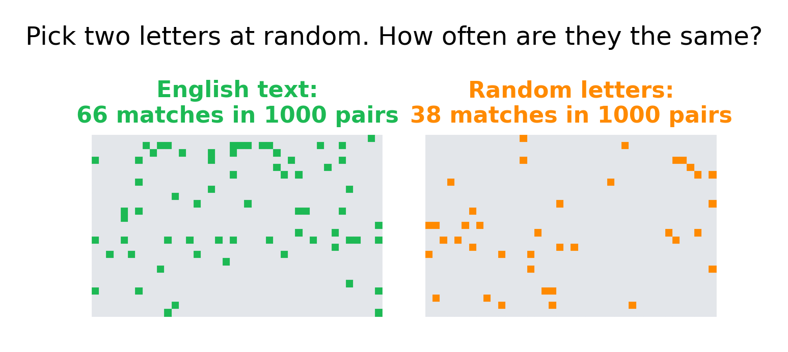
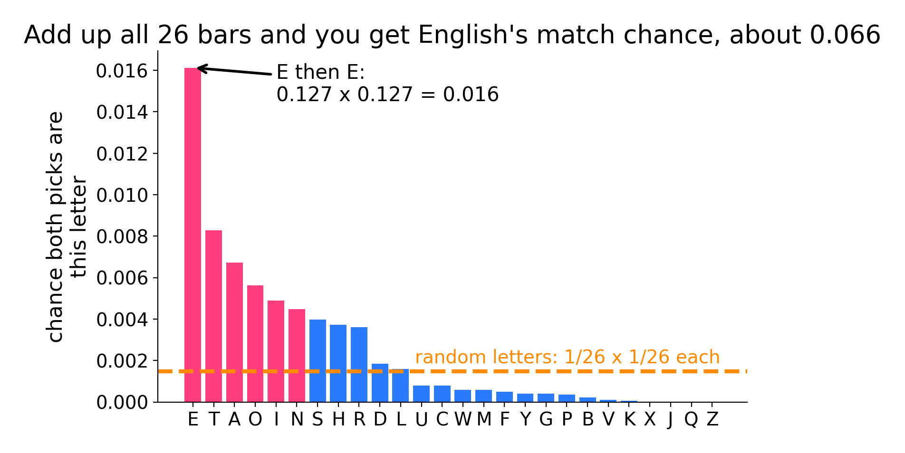
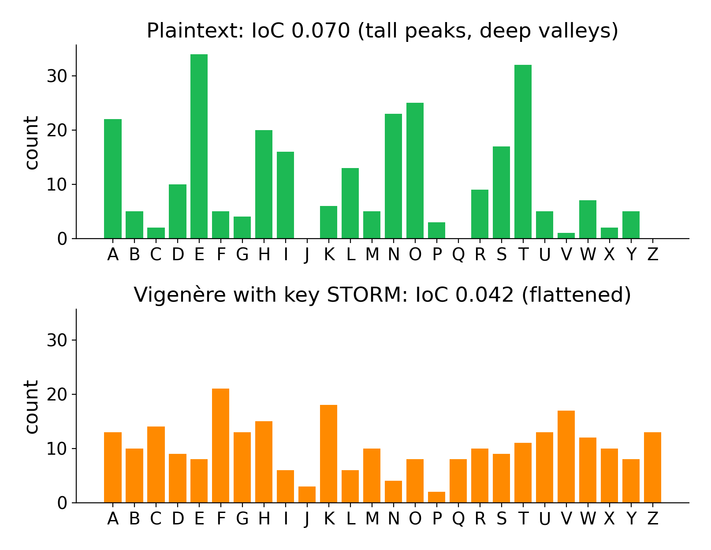
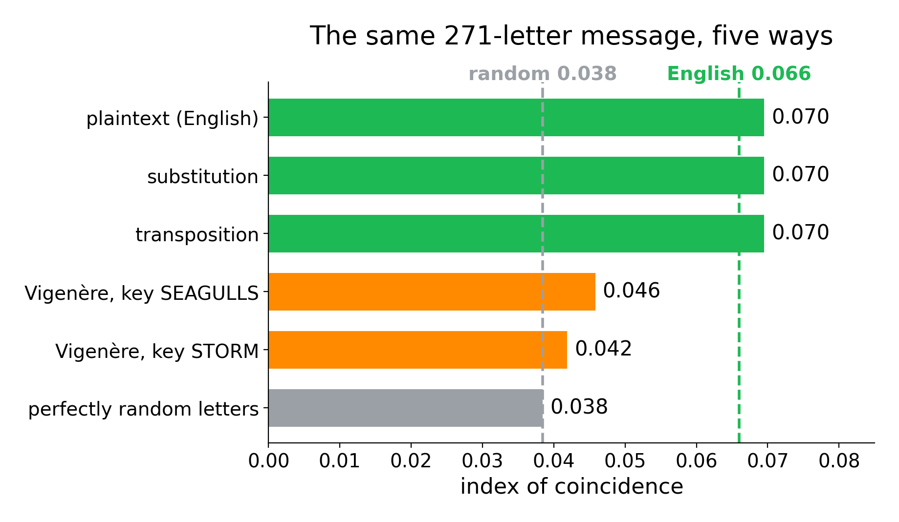
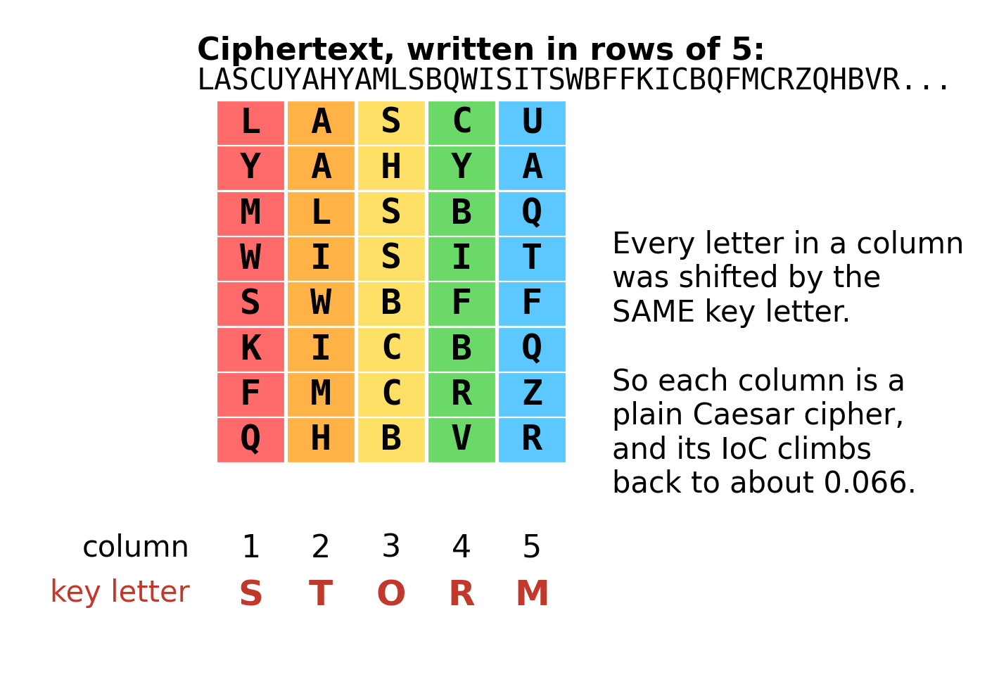
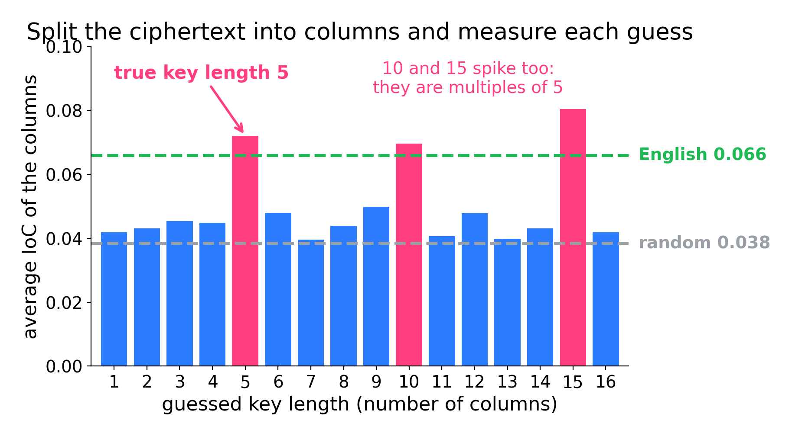
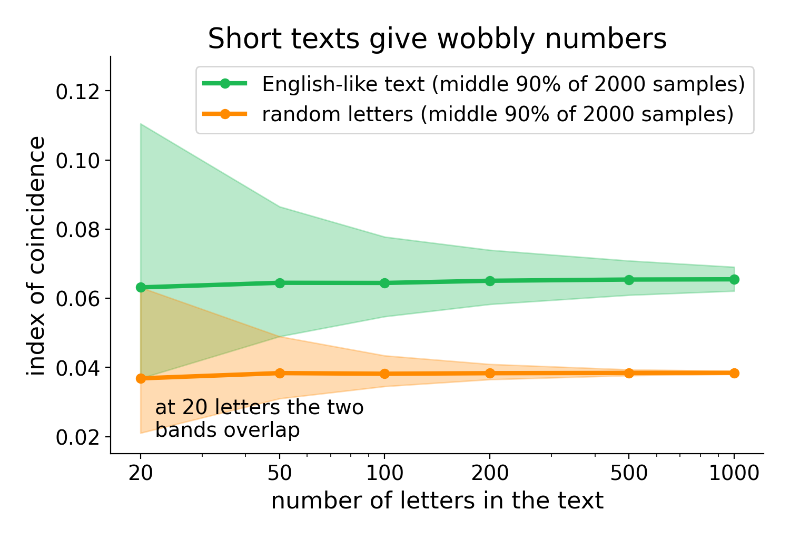

# The index of coincidence

**By the end you can tell, from counting letters alone, whether a message uses one alphabet or several, and if several, how many.**

## The big idea

Take a page of English. Close your eyes, put your finger on a letter, then put your finger on another letter somewhere else. How often are the two letters the same? In English it happens about 66 times in every 1000 tries. In a jumble of random letters it happens only about 38 times in 1000. That one number, the chance that two letters picked at random match, is called the **index of coincidence**. It survives some kinds of encryption and is destroyed by others. So it tells you which kind of cipher you are facing before you have read a single word.



## Which ciphers it breaks

The index of coincidence (IoC for short) does not usually hand you the key. It tells you what kind of cipher you have, and for the Vigenère family it tells you the length of the key. That is often the hardest step.

| Cipher family | Does the IoC help? | How |
|---|---|---|
| Caesar, affine, keyword, any simple substitution | Yes, as an identifier | IoC stays near 0.066, like English. Tells you "one alphabet": go to frequency analysis (Guide 02). |
| Transposition (rail fence, columnar) | Yes, as an identifier | IoC stays near 0.066, and the letter counts themselves look exactly like English. |
| Vigenère, Beaufort, variant Beaufort | Yes, strongly | IoC drops toward 0.038. Splitting into columns finds the key length. |
| Autokey, running key | Partly | IoC is low, but no key length makes the columns look like English. That itself is a clue. |
| Playfair, Hill (two letters at a time) | A little | IoC lands in between (around 0.045 to 0.055). Other tests settle it (Guide 09). |
| Enigma and other machines | No | The alphabet changes every letter and never repeats in a short message. |

> **In the app:** The family tree shows the [polyalphabetic](https://apps.thorwhalen.com/cryptology/#/tree/polyalphabetic) family, where the [Vigenère cipher](https://apps.thorwhalen.com/cryptology/#/tree/vigenere) lives.

## Why it works

### A tiny experiment

Write the word `BANANA` on six slips of paper and put them in a hat. Pull out one slip, keep it out, then pull a second slip. What is the chance that both slips show the same letter?

Count the ways. There are 6 slips for your first pick and 5 left for your second pick, so there are $6 \times 5 = 30$ ways to pull two slips in order. Now count the ways that give a match:

- Two A's: there are 3 A's for the first pick and 2 A's left for the second, so $3 \times 2 = 6$ ways.
- Two N's: $2 \times 1 = 2$ ways.
- Two B's: there is only one B, so $1 \times 0 = 0$ ways.

That gives $6 + 2 + 0 = 8$ matching ways out of 30, so the chance of a match is $8/30 \approx 0.267$. `BANANA` is a very "repetitive" word, so its matching chance is high.

### Why English is lumpy

English uses its letters very unevenly. About 12.7% of the letters in ordinary English are E, about 9.1% are T, and fewer than 1 in 1000 are Z. When you pick two letters at random, the chance that both are E is $0.127 \times 0.127 \approx 0.016$. The chance that both are T is $0.091 \times 0.091 \approx 0.008$. Do this for all 26 letters and add the answers: you get about **0.066**.

Now imagine a language in which every letter is equally common, so each one is 1/26 of the text. The chance that both picks are A is $\frac{1}{26} \times \frac{1}{26}$, and the same for B, and so on. Twenty-six of those add up to exactly $\frac{1}{26} \approx$ **0.038**.



So the IoC measures **how lumpy** the letter counts are. Tall peaks and deep valleys give a high IoC. A flat spread gives a low one.

### What encryption does to the lumps

Here is the key insight, and it is worth reading twice.

- **Substitution renames letters.** If every e becomes `X`, then `X` is now the most common letter. The peaks move to new letters, but they are just as tall. The IoC does not care which letter is tall, only how tall the peaks are. So the IoC stays the same.
- **Transposition moves letters around.** The letters are all still there, just in a different order. The counts do not change at all, so the IoC does not change at all.
- **Vigenère uses several alphabets.** In a Vigenère cipher, each letter is shifted by an amount that depends on its position. With the key `STORM`, the 1st, 6th, 11th... letters are shifted by S, the 2nd, 7th, 12th... by T, and so on. So the plaintext e's turn into five different ciphertext letters. Each tall peak gets chopped into five smaller peaks spread across the alphabet. The counts flatten out, and the IoC drops toward 0.038.



## The grown-up version

### Naming the pieces

Mathematicians use a few short symbols here. Each one is just a name for something you already did with `BANANA`.

- $N$ is the total number of letters in the text. For `BANANA`, $N = 6$.
- $f_A$ is the number of times A appears (the "frequency" of A). For `BANANA`, $f_A = 3$, $f_B = 1$, $f_N = 2$, and every other letter has $f = 0$.
- $f_i$ means "the count of letter number $i$", where $i$ runs through the alphabet: $i = 1$ for A, $i = 2$ for B, up to $i = 26$ for Z.

### The sigma sign

The Greek capital letter sigma, $\sum$, means "add up". Writing

$$\sum_{i=1}^{26} f_i$$

means "work out $f_i$ for every letter from $i = 1$ (A) to $i = 26$ (Z), and add all 26 answers together". That sum is just $N$, the total number of letters. Sigma is shorthand that saves you writing a sum with 26 terms.

### The formula

In `BANANA` you worked out "count times (count minus one)" for each letter, added them up, and divided by "total times (total minus one)". With the symbols above, that is:

$$\mathrm{IoC} = \frac{\sum_{i=1}^{26} f_i\,(f_i - 1)}{N\,(N - 1)}$$

Read it out loud like this: "For every letter, multiply its count by one less than its count. Add those up. Divide by the total number of letters times one less than the total." The top counts the ordered pairs of slips that match. The bottom counts all ordered pairs of slips. Check it on `BANANA`: the top is $3 \times 2 + 1 \times 0 + 2 \times 1 = 8$, the bottom is $6 \times 5 = 30$, and $8/30 \approx 0.267$.

### Kappa: the numbers to remember

Cryptographers write the expected IoC of a language with the Greek letter kappa, $\kappa$.

- $\kappa_{\text{English}} \approx 0.066$. (Different counts of English give values from 0.065 to 0.067. Any of these is fine.)
- $\kappa_{\text{random}} = \frac{1}{26} \approx 0.038$.

If $p_i$ is the fraction of English text that is letter $i$ (so $p_E = 0.127$), then $\kappa_{\text{English}} = \sum_{i=1}^{26} p_i^2$, which is exactly the "add up all 26 bars" calculation from the chart above.

Some books multiply the IoC by 26, so English becomes about 1.73 and random text becomes 1.00. It is the same measurement on a different scale. Check which scale a tool uses before comparing numbers.

## A worked example

Here is a 271-letter message, encrypted with a Vigenère cipher. We will pretend we do not know the key.

```
LASCU YAHYA MLSBQ WISIT SWBFF KICBQ FMCRZ QHBVR GKHYD WXKVQ
CLKYQ FMVVN GTHWU FTZCK UTAVU LUFFG YAHWX GNFFU DTGKM UDCWX
WMHVD KTBUM KFOCX OHCUQ FUCOI AMVEA FTAVA FBHZZ KBRVF ZXPFJ
OTGRN JTGJW WROEP SGCKQ LAOKE SBRFZ DRHYU KMVVX AZVKU KGCKI
ZTHZF KXSDE DHCBG FWSIF ZXGVH WGHYE LXDRF EBREU YAHRZ VMSCX
FHCEQ OAOKK GNTZZ VMVVD W
```

(The spaces every five letters are only there to make it easier to read. They are not word breaks.)

### Step 1: the IoC of the whole message

Count every letter. The most common are F (21 times), K (18), V (17) and H (15). The rarest are P (2) and J (3). Now work out $f(f-1)$ for each of the 26 letters and add them up. For example F gives $21 \times 20 = 420$ and K gives $18 \times 17 = 306$. All 26 together come to 3064. The bottom of the fraction is $271 \times 270 = 73170$. So:

$$\mathrm{IoC} = \frac{3064}{73170} \approx 0.042$$

That is far below English (0.066) and close to random (0.038). It is not a substitution and not a transposition. Something has flattened the letter counts: our first suspect is the Vigenère family.

For comparison, the plaintext (the message before encryption) has an IoC of $5086/73170 \approx 0.070$. That is a little above 0.066, which is normal for a short text with lots of t's and e's. If we encrypt the same plaintext with a keyword substitution, or shuffle it with a columnar transposition, the IoC stays at exactly 0.070.



### Step 2: split into columns

If the key has 5 letters, then every 5th letter was shifted by the same amount. Write the ciphertext in rows of 5. Each column is then a plain Caesar cipher: one alphabet, shifted. A Caesar cipher keeps the lumps of English, so each column should have an IoC near 0.066.



We do not know the key length yet, so we try them all. For each guess $L$ (for "length"), split the ciphertext into $L$ columns, work out the IoC of each column, and take the average. For the guess $L = 5$, the five columns have 55, 54, 54, 54 and 54 letters, and their IoCs are:

| Column | 1 | 2 | 3 | 4 | 5 |
|---|---|---|---|---|---|
| IoC | 0.063 | 0.072 | 0.089 | 0.076 | 0.060 |

The average is $(0.063 + 0.072 + 0.089 + 0.076 + 0.060) / 5 \approx 0.072$. That looks like English.

### Step 3: compare all the guesses

| Guess $L$ | 1 | 2 | 3 | 4 | **5** | 6 | 7 | 8 | 9 | **10** | 11 | 12 | 13 | 14 | **15** |
|---|---|---|---|---|---|---|---|---|---|---|---|---|---|---|---|
| Average IoC | .042 | .043 | .045 | .045 | **.072** | .048 | .040 | .044 | .050 | **.070** | .041 | .048 | .040 | .043 | **.080** |



Three guesses jump up: 5, 10 and 15. Why three? If the key is `STORM`, then splitting into 10 columns also puts only same-shifted letters together: column 1 holds the 1st, 11th, 21st... letters, which were all shifted by S. Any multiple of the true length works. So **choose the smallest length that jumps**: 5.

Notice that 15 scored even higher than 5. With 15 columns, each column holds only 18 letters, and short columns give jumpy numbers (more on that below). Never pick the tallest bar blindly.

### Step 4: what next?

Now you know you are facing five Caesar ciphers, side by side. Solve each column with frequency analysis (see Guide 02, Frequency analysis, and Guide 05, Repeats and key length, which finishes this kind of example). For the record, the key was `STORM`, and the message begins `the lighthouse keeper had not spoken to anyone...`.

> **In the app:** [Counts](https://apps.thorwhalen.com/cryptology/#/workbench/counts) shows the IoC of any text, with English (0.067) and random letters (0.038) marked. [Vigenère](https://apps.thorwhalen.com/cryptology/#/workbench/vigenere) cuts a text into slices for each key length and shows each slice's IoC.

## Friedman's estimate

William Friedman, the American cryptologist who invented the index of coincidence around 1920, also found a way to guess the key length straight from the IoC of the whole message, with no splitting at all.

Here is the idea. Pick two letters at random from a Vigenère message with a key of length $L$. Either they are in the same column, or they are not.

- They land in the same column about $\frac{1}{L}$ of the time. Then they were shifted by the same amount, so they match as often as English letters do: $\kappa_{\text{English}}$.
- The rest of the time, $1 - \frac{1}{L}$, they were shifted by different amounts, and they match about as often as random letters: $\kappa_{\text{random}}$.

So we expect

$$\mathrm{IoC} \approx \frac{1}{L}\,\kappa_{\text{English}} + \left(1 - \frac{1}{L}\right)\kappa_{\text{random}}$$

Solve that for $L$ and you get **Friedman's estimate**:

$$L \approx \frac{\kappa_{\text{English}} - \kappa_{\text{random}}}{\mathrm{IoC} - \kappa_{\text{random}}} = \frac{0.066 - 0.038}{\mathrm{IoC} - 0.038}$$

Try it on our message, where the IoC was 0.0419:

$$L \approx \frac{0.066 - 0.0385}{0.0419 - 0.0385} = \frac{0.0275}{0.0034} \approx 8$$

The true answer is 5, so Friedman's guess is rough. Look at the bottom of that fraction: it is a tiny difference, 0.0034. A wobble of 0.002 in the IoC (perfectly normal for 271 letters) changes the answer a lot. Treat Friedman's estimate as a ballpark ("small key, not a huge one") and let the column test give the exact length. Longer texts make it more reliable. (There is a more exact version of the formula that also uses $N$, but for a few hundred letters it gives nearly the same answer, here 7.9.)

## When to try it

- **Always, early.** The IoC takes a few minutes by hand and seconds with a spreadsheet. Work it out for every new ciphertext, right after counting the letters.
- **IoC near 0.066 and the counts look like English** (e, t, a, o at the top): a transposition. The letters are right, only their order is wrong.
- **IoC near 0.066 but the wrong letters are common**: a substitution of some kind (Caesar, affine, keyword, general).
- **IoC between 0.038 and about 0.055**: several alphabets. Run the column test. A clear jump at some length means Vigenère, Beaufort or a relative.
- **Low IoC and no length jumps**: think autokey, running key, or a cipher that works on pairs of letters.

### When not to

- **Very short messages** (under about 50 letters). The numbers wobble too much to trust.
- **Messages made of digits or symbols** that stand for pairs of letters (such as a Polybius square). Turn them back into single symbols first, or the IoC measures the wrong thing.
- When you already know the cipher type from the story or from a hint. Use the IoC to check, not to waste time.

## Traps and tips



- **Short texts give wobbly numbers.** In the chart above, 20-letter samples of English-like text land anywhere between 0.037 and 0.11, and random ones between 0.021 and 0.063. The two ranges overlap. By 200 letters, English-like text stays between about 0.058 and 0.074, and random text between about 0.037 and 0.041. So the longer the text, the more you can trust the IoC.
- **Columns are shorter than the whole text.** A 271-letter message split into 15 columns gives columns of only 18 letters. Their IoCs are noisy, which is why a multiple of the key length can score even higher than the key length itself.
- **Unusual texts have unusual IoCs.** A list of names, a text full of numbers spelled out, or a message that avoids the letter e can sit well away from 0.066. Use 0.060 to 0.075 as "English-like", not exactly 0.066.
- **Strip spaces and punctuation first.** Count only letters, and make capitals and small letters the same.
- **Two layers of cipher.** A substitution followed by a transposition still has an English-like IoC, because neither step flattens the counts. If the IoC says "one alphabet" but nothing reads, suspect two steps.
- **Do not round too early.** Keep at least four decimal places while you work. The differences that matter are in the third decimal place.

## Try it yourself

1. Work out the IoC of the word `LETTERS`. (Hint: $N = 7$.)
2. A 400-letter ciphertext has an IoC of 0.067. When you count the letters, the most common are E, T, A and O, in about the right amounts for English. What kind of cipher is it most likely to be, and why?
3. A ciphertext has an IoC of 0.044. Use Friedman's estimate (with 0.066 and 0.038) to guess the key length. Then the column test gives averages of 0.044 for length 3, 0.068 for length 6, 0.045 for length 7 and 0.069 for length 12. What key length do you choose?

> **In the app:** [Spot the cipher](https://apps.thorwhalen.com/cryptology/#/ex/spot/1) asks you to tell one alphabet from several by the IoC. The [Vigenère](https://apps.thorwhalen.com/cryptology/#/ex/vigenere/1) exercise takes you from the key length to the answer.

## Words to know

- **Index of coincidence (IoC)**: the chance that two letters picked at random from a text are the same letter.
- **Kappa ($\kappa$)**: the IoC you expect from a language or from random letters: about 0.066 for English and $1/26 \approx 0.038$ for random letters.
- **Sigma ($\sum$)**: a sign that means "add up all of these".
- **Frequency ($f$)**: how many times a letter appears in a text.
- **Monoalphabetic**: using one cipher alphabet for the whole message (Caesar, substitution).
- **Polyalphabetic**: switching between several cipher alphabets (Vigenère, Beaufort).
- **Period or key length**: how many letters the key has before it repeats.
- **Column test**: splitting a ciphertext into $L$ columns and averaging their IoCs to test whether the key length is $L$.
- **Friedman's estimate**: a formula that guesses the key length from the IoC of the whole message.

## Going further

- [Index of coincidence (Wikipedia)](https://en.wikipedia.org/wiki/Index_of_coincidence)
- [Index of coincidence (Practical Cryptography)](http://practicalcryptography.com/cryptanalysis/text-characterisation/index-coincidence/)
- [William F. Friedman (Wikipedia)](https://en.wikipedia.org/wiki/William_F._Friedman)
- [Vigenère cipher (Wikipedia)](https://en.wikipedia.org/wiki/Vigen%C3%A8re_cipher)
- Simon Singh, *The Code Book* (1999), chapter 2, on how the Vigenère cipher was finally broken.
- [The National Cipher Challenge: hints, tips and cribs](https://www.cipherchallenge.org/hints-tips-and-cribs-etc/)

## Answers

1. `LETTERS` has L 1, E 2, T 2, R 1, S 1. The top is $0 + 2 + 2 + 0 + 0 = 4$ (from E: $2 \times 1$ and T: $2 \times 1$). The bottom is $7 \times 6 = 42$. IoC $= 4/42 \approx 0.095$.
2. A transposition. The IoC is English-like, so only one alphabet is in play. And the common letters are the right ones (E, T, A, O), so the letters have not been renamed, only moved.
3. Friedman: $(0.066 - 0.038)/(0.044 - 0.038) = 0.028/0.006 \approx 4.7$, so "around 5". The column test jumps at 6 and 12, and 12 is a multiple of 6. Choose **6**, the smallest length that jumps. (Friedman was close, but not exact, as usual.)
