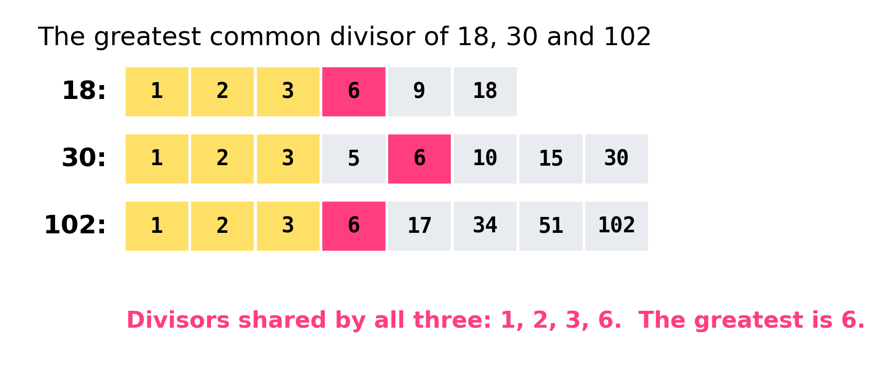
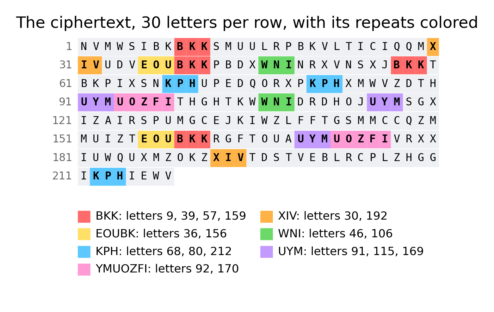

# Repeats and key length

**By the end you can find repeated fragments in a Vigenère ciphertext, turn the gaps between them into the length of the key, and then break the cipher one column at a time.**

## The big idea

A Vigenère cipher hides a message by shifting each letter by a different amount, following a keyword that repeats over and over. That sounds unbreakable, and for 300 years many people thought it was. But English repeats itself. Words like "the" and "and" come up again and again. Every so often, a repeated word happens to sit under the same part of the keyword, and then it is encrypted the same way both times. The ciphertext shows a repeat. The gap between the two copies must then be a whole number of keywords long. Collect a few gaps, find the number that divides them all, and you have the length of the key. This trick was published by the Prussian army officer Friedrich Kasiski in 1863 (Charles Babbage seems to have found it earlier but never published it), and it is called the **Kasiski examination**.


## Which ciphers it breaks

| Cipher family | Does Kasiski help? | How |
|---|---|---|
| Vigenère | Yes | Gaps between repeats are multiples of the key length. Then solve each column as a Caesar shift. |
| Beaufort, variant Beaufort | Yes | Same repeats, same gaps. Only the rule for each column is different. |
| Porta, Gronsfeld, other repeating-key ciphers | Yes | Anything whose key repeats with a fixed length leaves the same kind of repeats. |
| Autokey, running key | No | The key never repeats, so repeats are accidents. The gaps have no common factor. |
| Caesar, substitution | Not needed | Repeats appear, but every gap "works", because the key length is 1. |
| Transposition | No | Repeats of plaintext words are broken up when the letters move. |

## Why it works

### A quick reminder of the Vigenère cipher

Number the letters from A = 0 to Z = 25. To encrypt, write the keyword over and over above the message. Shift each message letter forward by the number of the key letter above it, and wrap around from Z back to A. With the key `BRIDGE`:

```
key:     B R I D G E B R I D G E B R ...
plain:   m e e t m e a t t h e o l d ...
cipher:  N V M W S I B K B K K S M U ...
```

The first letter m (12) is shifted by B (1) to give N (13). The second letter e (4) is shifted by R (17) to give V (21). And so on. Notice that the plaintext e becomes V, then M, then I, then K: the same plaintext letter turns into different ciphertext letters. That is what makes Vigenère harder than a Caesar cipher.

### When repeats happen

The key `BRIDGE` has 6 letters, so the key letters line up again every 6 letters. Letters 1, 7, 13, 19, ... are all shifted by B. Letters 2, 8, 14, ... are all shifted by R. And so on.

Now suppose the word "the" appears at letter 9 and again at letter 39. The gap is $39 - 9 = 30$, and 30 is $5 \times 6$. So both copies sit under exactly the same key letters (I, D, G), and both become `BKK`. The ciphertext shows a repeat.

If "the" appears at letter 30, the gap from 9 is 21, which is not a multiple of 6. That copy sits under different key letters (E, B, R) and becomes `XIV`. No repeat.

So the rule is: **a repeat in the ciphertext usually means the same plaintext under the same key letters, so the gap is a multiple of the key length.** "Usually", because two different pieces of plaintext can now and then produce the same three ciphertext letters by accident. We will deal with those accidents below.

### A pencil-and-paper experiment

Write any sentence that uses "the" several times. Write the keyword `CAT` over and over above it, and encrypt only the letters of each "the". Circle the copies of "the" that come out the same. Number the letters of the sentence (ignoring spaces) and subtract the starting positions of two circled copies: every such gap will be a multiple of 3.

> **In the app:** [Repeats](https://apps.thorwhalen.com/cryptology/#/workbench/repeats) lists the runs of letters that repeat in your text, the gaps between them, and how often each number divides a gap. Its Comb view finds the key length another way, by sliding the text against itself.

## The grown-up version

### Factors and multiples

A **factor** (or **divisor**) of a number is a whole number that divides it with nothing left over. The factors of 18 are 1, 2, 3, 6, 9 and 18. A **multiple** of 6 is any number you get by multiplying 6 by a whole number: 6, 12, 18, 24, 30, ...

If every gap is a multiple of the key length, then the key length is a factor of every gap. So we are looking for a number that is a factor of all the gaps at once: a **common factor**.

### The greatest common divisor

The biggest number that divides all of a set of numbers is their **greatest common divisor**, written $\gcd$. For example:

- Factors of 18: 1, 2, 3, **6**, 9, 18
- Factors of 30: 1, 2, 3, 5, **6**, 10, 15, 30
- Factors of 102: 1, 2, 3, **6**, 17, 34, 51, 102

The factors that appear in all three lists are 1, 2, 3 and 6. The greatest is 6, so $\gcd(18, 30, 102) = 6$.



Listing factors gets slow for big numbers. Euclid, the Greek mathematician, found a faster way more than 2000 years ago: **replace the bigger number by the remainder when you divide it by the smaller one, and repeat until the remainder is 0.** The last number that is not 0 is the gcd. For 102 and 30:

- $102 = 3 \times 30 + 12$, so the remainder is 12. Now find $\gcd(30, 12)$.
- $30 = 2 \times 12 + 6$, so the remainder is 6. Now find $\gcd(12, 6)$.
- $12 = 2 \times 6 + 0$. The remainder is 0, so the answer is **6**.

To find the gcd of three or more numbers, find the gcd of the first two, then the gcd of that answer with the next number, and so on.

### Why the gcd might be too big or too small

If every gap you found happened to be a multiple of 12 while the key has 6 letters, the gcd says 12. That is harmless: the key `BRIDGEBRIDGE` still breaks the message. The real danger is the opposite: one accidental repeat can drag the gcd down to 1. So careful codebreakers do not just take the gcd of everything. They make a **factor table** and count.

## A worked example

Here is a 218-letter ciphertext. It was made with a Vigenère cipher, and we will pretend we do not know the key.

```
NVMWS IBKBK KSMUU LRPBK VLTIC IQQMX IVUDV EOUBK KPBDX WNINR
XVNSX JBKKT BKPIX SNKPH UPEDQ ORXPK PHXMW VZDTH UYMUO ZFITH
GHTKW WNIDR DHOJU YMSGX IZAIR SPUMG CEJKI WZLFF TGSMM CCQZM
MUIZT EOUBK KRGFT OUAUY MUOZF IVRXX IUWQU XMZOK ZXIVT DSTVE
BLRCP LZHGG IKPHI EWV
```

(The spaces every five letters are only to help your eyes. Count letters, not groups.)

### Step 1: find the repeats

Look for groups of three or more letters that appear more than once. Three is a good minimum: pairs repeat by accident far too often. Number the letters from 1, and write down where each repeat starts.



| Repeat | Starts at letter | Gaps between neighbors |
|---|---|---|
| `BKK` | 9, 39, 57, 159 | 30, 18, 102 |
| `XIV` | 30, 192 | 162 |
| `EOUBK` | 36, 156 | 120 |
| `WNI` | 46, 106 | 60 |
| `KPH` | 68, 80, 212 | 12, 132 |
| `UYM` | 91, 115, 169 | 24, 54 |
| `YMUOZFI` | 92, 170 | 78 |

Long repeats like `YMUOZFI` (7 letters) are the most trustworthy: seven letters almost never match by accident.

### Step 2: build a factor table

For each gap, check which of the numbers 2 to 10 divide it. A table makes the pattern jump out.


Factors 2, 3 and 6 each divide all 11 gaps. So the key length could be 2, 3 or 6. When several factors tie, the biggest of them is the best guess, because any key length that works makes all of its own factors work too. A 6-letter key makes every gap a multiple of 2 and of 3 as well. Here, $\gcd(30, 18, 102, 162, 120, 60, 12, 132, 24, 54, 78) = 6$.

**Our guess: the key has 6 letters.** If you know about the index of coincidence (Guide 04), you can double-check: splitting this ciphertext into 6 columns gives an average column IoC of 0.067, like English, while 3 columns give only 0.055 and 2 columns 0.048.

### Step 3: split into columns

Write the ciphertext in rows of 6. Column 1 holds letters 1, 7, 13, 19, ...; column 2 holds letters 2, 8, 14, 20, ...; and so on. Every letter in one column was shifted by the same key letter, so **each column is a Caesar cipher**. Columns 1 and 2 have 37 letters each; columns 3 to 6 have 36.

### Step 4: solve each column as a Caesar shift

Now we use frequency analysis (Guide 02, Frequency analysis, explains it fully). In plain English, e is the most common letter, then t and a. In a Caesar column, the same pattern of tall and short bars appears, just slid along the alphabet. So slide the English pattern along until its peaks line up with the column's peaks.

Here is column 2. Its most common letters are K (8 times), U (6) and V (5).


A tempting shortcut is "the most common letter is e". That would make K = e, a shift of 6 (key letter G). But then the next most common letters U and V would stand for o and p, and p is rare in English. Try instead K = t: that is a shift of 17 (key letter R), and then U = d and V = e. All three are common. Comparing the whole pattern, not just one letter, picks R clearly. (A score called **chi-squared**, explained in Guide 02, does this comparison with numbers: for column 2 it gives 29 for R and 95 for the next best shift.)

Doing this for all six columns:

| Column | Most common letters | Best shift | Key letter |
|---|---|---|---|
| 1 | I (5), B (4), M (4) | 1 | **B** |
| 2 | K (8), U (6), V (5) | 17 | **R** |
| 3 | M (5), B (5), P (4), T (4) | 8 | **I** |
| 4 | H (6), K (5), W (4) | 3 | **D** |
| 5 | K (4), R (4), S (3), T (3) | 6 | **G** |
| 6 | X (6), I (4), S (4), E (4) | 4 | **E** |

The key letters spell `BRIDGE`. "Most common letter = e" would have got only four of the six columns right (columns 2 and 6 fail), which is why you compare whole patterns. Shift every letter back by its key letter and the message appears:

`meet me at the old mill at nine. bring the map and the lamp. the map shows the path from the old mill to the river...`

When the key letters spell a real word, you almost certainly have it right. If one column gives a strange letter (`BRIDXE`), re-check that column.

> **In the app:** Once you have a key length, [Vigenère](https://apps.thorwhalen.com/cryptology/#/workbench/vigenere) splits the text into slices and lets you solve each slice as a Caesar, one at a time or all side by side.

## A variant: the Beaufort cipher

The Beaufort cipher, named after Admiral Francis Beaufort (the same man as the Beaufort wind scale), uses a repeating keyword just like Vigenère, but with a different rule. Instead of "plain plus key", it is "key minus plain":

$$\text{cipher} = \text{key} - \text{plain}$$

If the answer is below 0, add 26. For example, with key letter B (1) and plain letter t (19): $1 - 19 = -18$, and $-18 + 26 = 8$, which is I. To decrypt you do exactly the same thing, $\text{plain} = \text{key} - \text{cipher}$: $1 - 8 = -7$, and $-7 + 26 = 19$, which is t. The same operation locks and unlocks. That makes Beaufort a **reciprocal** cipher.

Here is the same message encrypted with Beaufort and the key `BRIDGE`:

```
PNEKU ABYPW CQQOW VVTBY VVTAA AAQAL UNWDR EOOPW CTBFT KZAPR
TLZQF ZPWCP BYBYP QPYBZ STYFA SVLNY BZPWG NRDTB IKEMY JXAXZ
GBJYU KZAZR NZYZI KEOGL UJQYV QNOEA KETYI KNXXD XAUWQ GOQNW
QOIHT EOOPW CRWDX SSIIK EMYJX AVPPL UOUQS LQJCW NLUNX DUPHE
PVVGN XRZGC UYBZE EGN
```

**Kasiski still works.** The key still repeats every 6 letters, so the same plaintext under the same key letters still gives the same ciphertext. The repeats are at the same places as before (`PWC` at letters 9, 39, 57 and 159, and so on), with the same gaps.

**This time there are accidents.** Four extra repeats turn up that are not the same plaintext at all: `BYP` (gap 56), `VVT` (gap 5), `AAA` (gap 1) and `ZPW` (gap 26). If you took the gcd of all 15 gaps you would get 1, which is useless. The factor table saves you: 6 still divides 11 of the 15 gaps, and the loners (5 and 1) stand out as accidents. **Throw out the gaps that disagree with everything else.**

**Solving a column is slightly different.** In a Beaufort column, $\text{key} = \text{cipher} + \text{plain}$. Column 2's most common letter is Y (24). If Y stands for t (19), the key letter is $24 + 19 = 43$, and $43 - 26 = 17$, which is R. Once again the key comes out as `BRIDGE`.

How do you know it is Beaufort and not Vigenère? Solve the columns with both rules: the rule whose key letters spell a word is the right one. There is also a third cousin, **variant Beaufort** ($\text{cipher} = \text{plain} - \text{key}$), which is the same as Vigenère decryption, so a Vigenère solver breaks it with a "backwards" key.

## Why autokey resists Kasiski

The **autokey** cipher starts with a short keyword (the **primer**) and then uses *the message itself* as the rest of the key. With primer `BRIDGE`, the first six letters are shifted by B, R, I, D, G, E, and from then on each letter is shifted by the plaintext letter six places earlier. The key never repeats with a fixed length, so there is no length to find.

Here is our message in autokey:

```
NVMWS IMXXA QSLWF PPZLW ZQYPB KVVTX IVUNV TUHFH TLNPI ALPMM
ELOSI SIZLD WLAMV DMMOJ FZPFP PZERF PPCBJ XYEEL OLVRV YXYPV
IYWKZ XHHUT JXPJV HZTIY APWUL HVLWI HOWWE WPHMH LWFPP ZFQFQ
WOUJG IYGTD RNSRE SSJYV PCWRX YRFZO LUBBF MSLUU HMSMR HFIBR
EIXNI HKMLA VNYIC CCX
```

It has far fewer repeats: `LWFP` at 13 and 141, `FPP` at 15, 74, 80 and 143, `PPZ` at 16, 75 and 144, and `ELO` at 51 and 89. The gaps are 128, 59, 6, 63, 59, 69 and 38. Their gcd is 1, and 6 divides only one of them.


Why do any repeats appear at all? In autokey, a ciphertext repeat needs both the plaintext *and* the key under it to repeat. The key under letter 13 is the plaintext at letter 7. So `LWFP` repeats because the whole phrase "at the old mi" appears twice in the message ("meet me **at the old mi**ll" and "wait **at the old mi**ll"). The gap of 128 is just the distance between two copies of a phrase. It has nothing to do with the primer's length.

So when Kasiski gives gaps with no common factor, and splitting into columns never makes the letter counts look like English, suspect autokey or a running key. Those need a different attack: guessing a probable word and working out the key it implies (see Guide 06, Cribs and patterns).

## When to try it

- The index of coincidence of the whole message is low (between about 0.038 and 0.055): several alphabets are in play.
- You can see repeated groups of three or more letters by eye.
- The message is reasonably long (150 letters or more) and the key is short compared to the message. Kasiski needs each part of the key to be reused many times.
- You want an answer you can check by hand with a pencil, without a computer.

### When not to

- The IoC is near 0.066. One alphabet is in play: use frequency analysis instead.
- The message is short and the key is long. A 60-letter message with a 12-letter key may show no true repeats at all.
- The ciphertext has an even length, no doubled letters inside pairs, and no J: that smells like Playfair (Guide 09), which also makes repeats, but for different reasons.

## Traps and tips

- **Use trigrams or longer.** Two-letter repeats happen by chance all the time. Count three-letter and longer repeats, and trust long ones most.
- **Count, do not just take the gcd.** One accidental repeat can drag the gcd down to 1. A factor table shows which factor nearly all the gaps share.
- **Prefer the largest factor that almost every gap shares**, then check it with the index of coincidence (Guide 04). If the key length is 6, the gaps are also all multiples of 2 and 3, so those small factors always score at least as well.
- **Key letters that spell a word are your best check.** `BRIDGEBRIDGE` just means your length was double the true one.
- **A column that will not fit** usually has too few letters. Use the neighboring columns and the half-decrypted text to guess it: if the message reads `meet me at the olX mill`, the X column is off.

## By hand or by computer

Finding repeats by eye is slow and easy to get wrong; a program finds every one. Do each job by hand once, on a short text, so you know what it involves; then hand it over (the chapter *Brain, pencil or computer?* explains why[^g05-why]). Times are rough, for a practiced reader and a ciphertext of about 300 letters.

| Job | By hand | Learn with | Just do it |
|---|---|---|---|
| Find repeated runs of three or more letters | 20 to 40 minutes | Repeats[^g05-repeats] | dCode[^g05-dcode-kasiski] |
| Factor the gaps and tally the factors | 5 to 10 minutes | Repeats[^g05-repeats], factors sheet[^g05-sheet-kasiski] | dCode[^g05-dcode-kasiski] |
| Solve each slice as a Caesar | about 10 minutes a slice | Vigenère[^g05-vigenere], Vigenère sheet[^g05-sheet-vigenere] | Guballa[^g05-guballa-vig], dCode[^g05-dcode-vigenere] |

[^g05-why]: [Brain, pencil or computer?](https://apps.thorwhalen.com/cryptology/#/guides/00-brain-pencil-or-computer), the chapter before Guide 1.
[^g05-repeats]: Repeats, in the cryptology app: [apps.thorwhalen.com/cryptology/#/workbench/repeats](https://apps.thorwhalen.com/cryptology/#/workbench/repeats). Repeated runs, their gaps, and the factor tally.
[^g05-dcode-kasiski]: dCode's Kasiski test: [dcode.fr/kasiski-test](https://www.dcode.fr/kasiski-test).
[^g05-sheet-kasiski]: Repeats and factors, a spreadsheet: [apps.thorwhalen.com/cryptology/#/tools/sheet-repeats-and-factors](https://apps.thorwhalen.com/cryptology/#/tools/sheet-repeats-and-factors), to copy into Google Sheets or download for Excel.
[^g05-vigenere]: Vigenère, in the cryptology app: [apps.thorwhalen.com/cryptology/#/workbench/vigenere](https://apps.thorwhalen.com/cryptology/#/workbench/vigenere). Slices for any key length, with each slice's IoC.
[^g05-sheet-vigenere]: Vigenère slices and IoC by key length, a spreadsheet: [apps.thorwhalen.com/cryptology/#/tools/sheet-vigenere-slices](https://apps.thorwhalen.com/cryptology/#/tools/sheet-vigenere-slices), to copy into Google Sheets or download for Excel.
[^g05-guballa-vig]: Guballa's Vigenère solver: [guballa.de/vigenere-solver](https://www.guballa.de/vigenere-solver).
[^g05-dcode-vigenere]: dCode's Vigenère solver: [dcode.fr/vigenere-cipher](https://www.dcode.fr/vigenere-cipher).

## Try it yourself

1. Find $\gcd(42, 70)$ using Euclid's method. Then find $\gcd(42, 70, 98)$.
2. A Vigenère ciphertext has repeats with gaps 24, 36, 60, 84 and 17. What key length do you guess, and what do you do with the 17?
3. In a Vigenère column, the most common letters are W, J and S. If W stands for e, what is the key letter for that column? Do J and S then make sense?

> **In the app:** The [Vigenère](https://apps.thorwhalen.com/cryptology/#/ex/vigenere/1) exercise walks the whole path: key length, slices, then each slice as a Caesar. Its place in the family tree: [Vigenère](https://apps.thorwhalen.com/cryptology/#/tree/vigenere).

## Words to know

- **Kasiski examination**: finding repeated groups in a ciphertext and using the gaps between them to find the key length.
- **Trigram**: a group of three letters in a row.
- **Gap (or distance)**: how many letters separate the start of one copy of a repeat from the start of the next.
- **Factor (or divisor)**: a whole number that divides another with nothing left over.
- **Multiple**: a number you get by multiplying a number by a whole number (12 is a multiple of 6).
- **Greatest common divisor (gcd)**: the largest number that divides every number in a list.
- **Euclid's algorithm**: a fast way to find the gcd by taking remainders over and over.
- **Factor table**: a grid that shows which small numbers divide which gaps.
- **Beaufort cipher**: a repeating-key cipher with the rule cipher = key minus plain; it is its own inverse.
- **Autokey**: a cipher whose key is a short primer followed by the message itself, so the key never repeats.
- **Primer**: the short keyword that starts an autokey key.

## Going further

- [Kasiski examination (Wikipedia)](https://en.wikipedia.org/wiki/Kasiski_examination)
- [Vigenère cipher (Wikipedia)](https://en.wikipedia.org/wiki/Vigen%C3%A8re_cipher)
- [Cryptanalysis of the Vigenère cipher (Practical Cryptography)](http://practicalcryptography.com/cryptanalysis/stochastic-searching/cryptanalysis-vigenere-cipher/)
- [Beaufort cipher (Wikipedia)](https://en.wikipedia.org/wiki/Beaufort_cipher)
- [Autokey cipher (Wikipedia)](https://en.wikipedia.org/wiki/Autokey_cipher)
- [Euclidean algorithm (Wikipedia)](https://en.wikipedia.org/wiki/Euclidean_algorithm)
- Simon Singh, *The Code Book* (1999), chapter 2, "Le Chiffre Indéchiffrable", on Babbage and Kasiski.
- [The National Cipher Challenge: hints, tips and cribs](https://www.cipherchallenge.org/hints-tips-and-cribs-etc/)

## Answers

1. $70 = 1 \times 42 + 28$, then $42 = 1 \times 28 + 14$, then $28 = 2 \times 14 + 0$, so $\gcd(42, 70) = 14$. Then $98 = 7 \times 14 + 0$, so $\gcd(14, 98) = 14$, and $\gcd(42, 70, 98) = 14$.
2. 24, 36, 60 and 84 are all multiples of 12 (and so of 2, 3, 4 and 6 too); their gcd is 12. The 17 shares no factor with them, so it is almost certainly an accidental repeat: throw it out. Guess 12, then check whether the key turns out to be a 6-letter word written twice (or a 4-letter word written three times). The index of coincidence of the columns will tell you which length is smallest.
3. W is 22 and e is 4, so the shift is $22 - 4 = 18$: key letter **S**. Then J (9) stands for $9 - 18 = -9$, plus 26 is 17, which is r; and S (18) stands for $18 - 18 = 0$, which is a. Both r and a are common in English, so S is a good guess.
