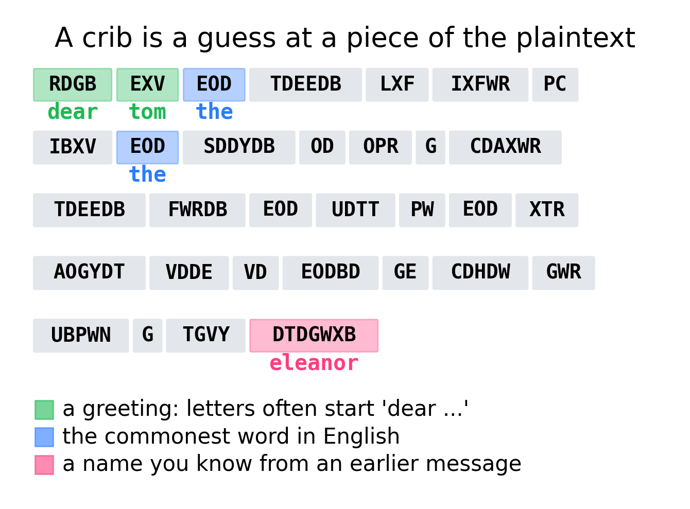
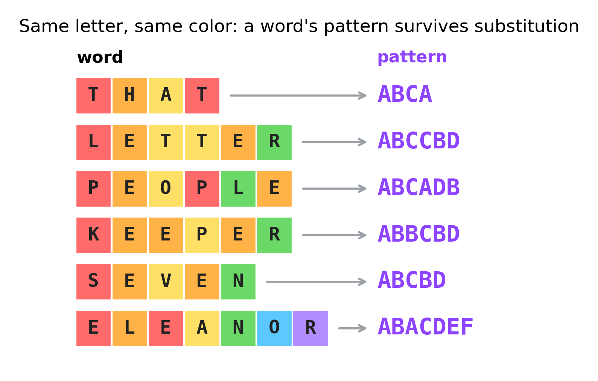
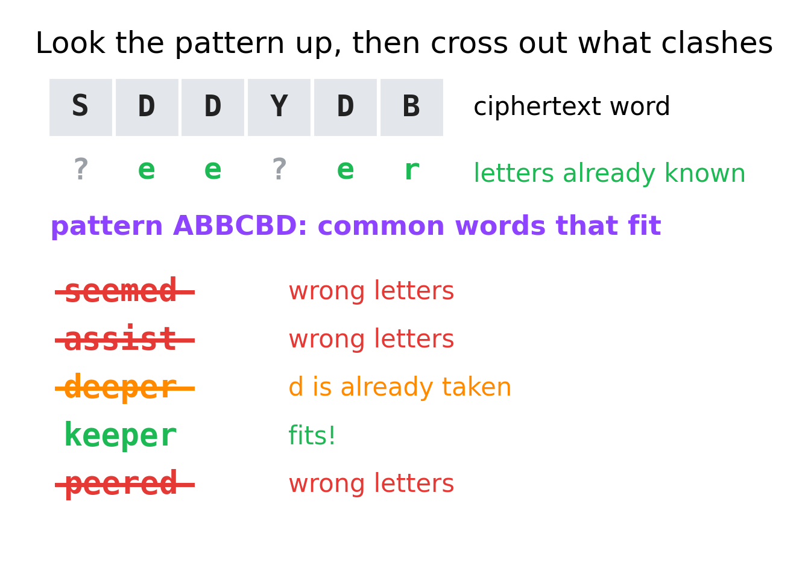
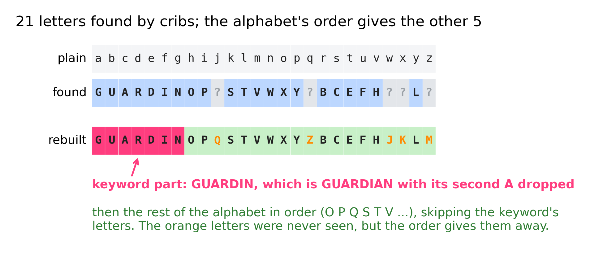
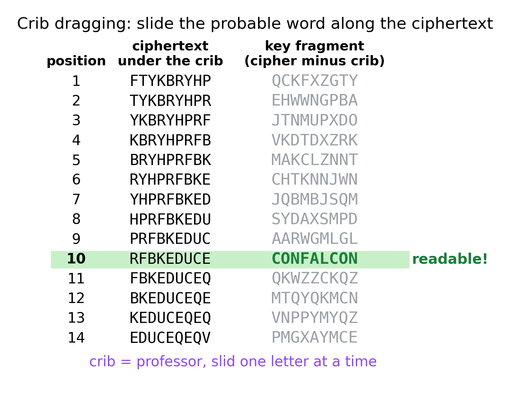
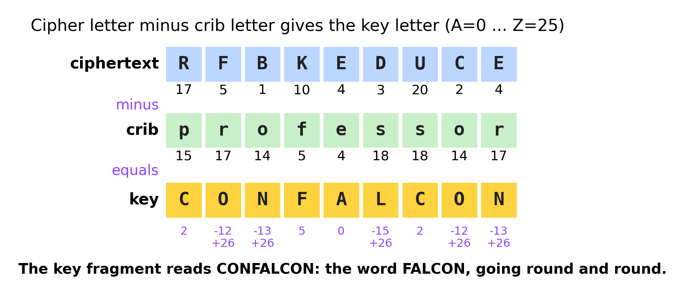
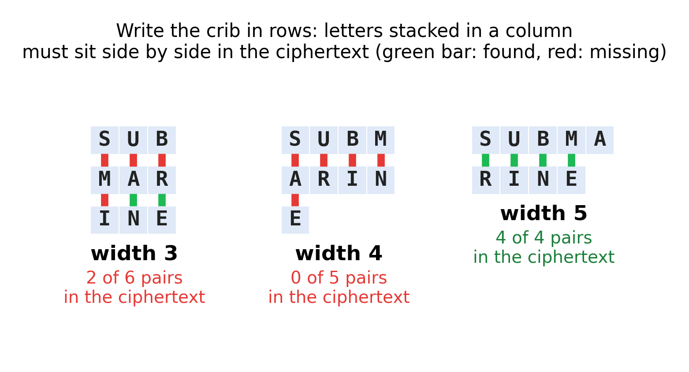
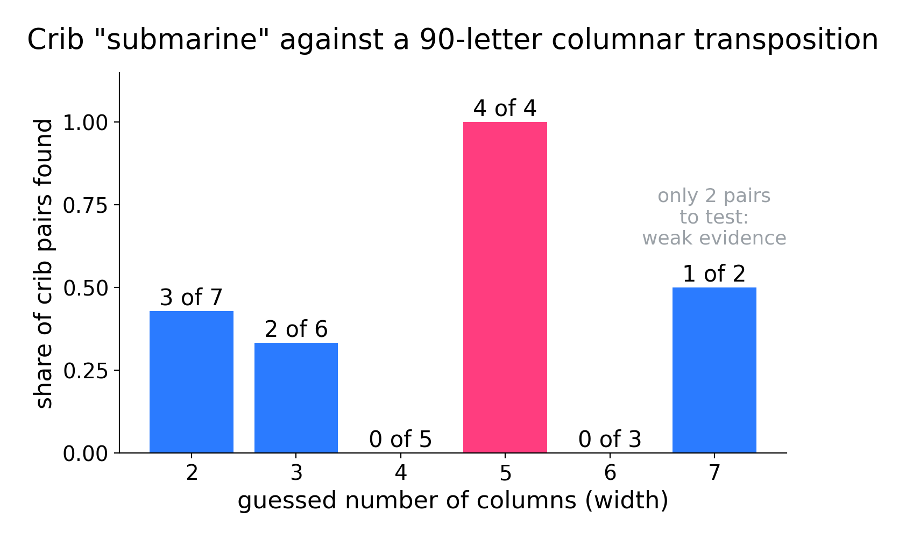
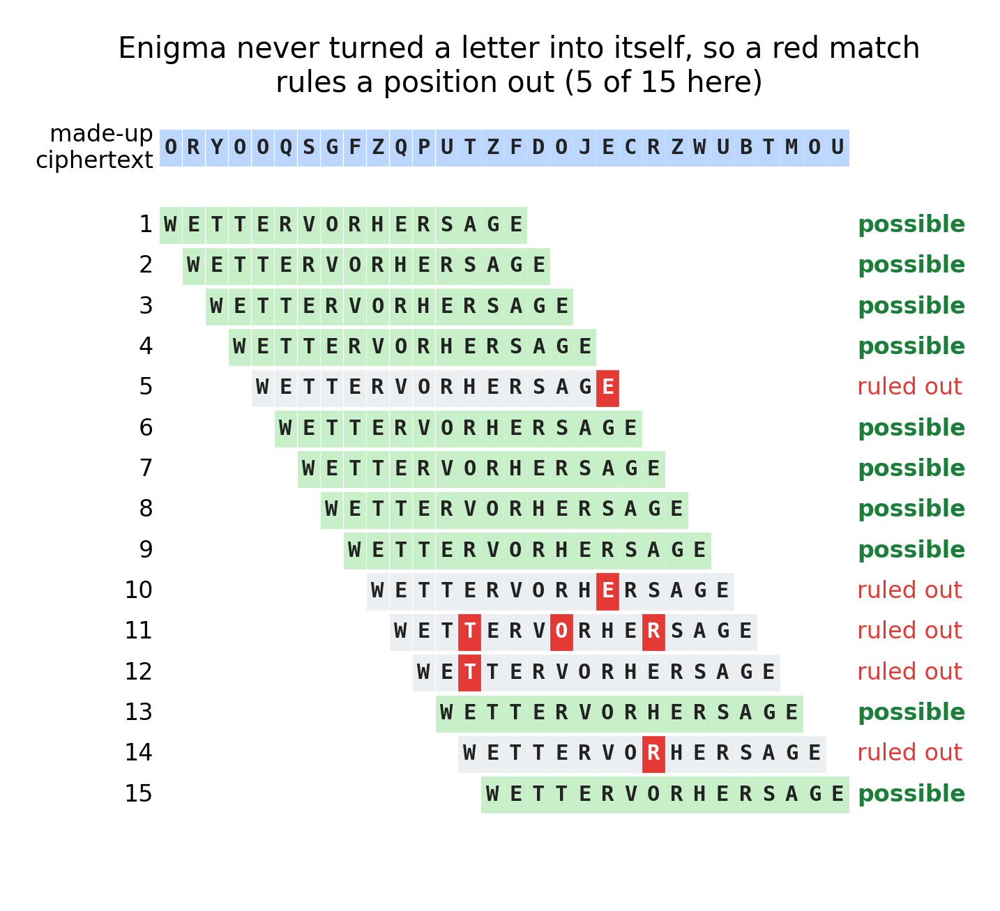

# Cribs and patterns

**By the end you can use one guessed word to unlock a substitution, rebuild a keyword alphabet, find a Vigenère key, and measure the width of a transposition.**

## The big idea

Codebreakers rarely start from nothing. A letter probably begins with a greeting. A report probably mentions the weather. A message in a story probably names someone you met in the last message. A word you expect to find in the plaintext is called a **crib** (or a **probable word**). If you can guess where the crib sits in the ciphertext, you can line the two up and read off part of the key. And part of the key is usually enough to get the rest.



## Which ciphers it breaks

Cribs are the most general tool in this whole series. What changes from cipher to cipher is how you "line up" the crib.

| Cipher family | Do cribs help? | How |
|---|---|---|
| Caesar, affine | Yes, instantly | One crib letter gives a Caesar shift. Two crib letters usually give both numbers of an affine key. |
| Simple or keyword substitution, with word breaks | Yes, strongly | Word **patterns** find where a crib fits. Each crib fills in several letters at once. |
| Keyword substitution | Yes, and more | A part of the cipher alphabet lets you guess the keyword and fill in the rest. |
| Substitution without word breaks | Yes, more slowly | Slide the crib's pattern along the text, looking for letters that repeat in the right places. |
| Vigenère, Beaufort | Yes | **Crib dragging**: slide the crib along, subtract, and look for a readable piece of key. |
| Autokey | Yes, with a twist | Dragging gives a piece of the key, and in autokey the key *is* earlier plaintext. |
| Columnar transposition, rail fence | Yes | Where the crib's letters land tells you the number of columns. |
| Playfair, Hill | Yes | A crib is the classic way into a Hill cipher (see Guide 09, Two letters at a time). |
| Enigma | Yes, historically | Bletchley Park's machines were driven by cribs (see the history section). |

## Where good cribs come from

A crib is only useful if it is likely to be right. Good sources, from strongest to weakest:

- **Names and words from earlier messages.** In a puzzle series, characters, places and objects come back. If the last message was signed by Eleanor, this one may be too.
- **Openings and closings.** Letters start with "dear ..." and end with a name. Reports start with a date or a place.
- **Words the story makes likely.** A message about a stolen painting probably contains `painting`, `museum` or `gallery`.
- **The commonest words.** `the`, `and`, `that`, `of`. Weak on their own, because they fit almost anywhere, but strong once you have a few other letters.
- **Habits of the sender.** Spelled-out numbers, a favorite sign-off, the same phrase at the start of every message.

A long crib beats a short one. A crib with repeated letters (like `letter` or `keeper`) beats one without, because repeats show up in the ciphertext as a pattern you can spot.

## Why it works: word patterns

### Patterns survive substitution

A substitution cipher replaces each letter with another letter, always the same one. So if a word has two letters the same, its ciphertext also has two letters the same, in the same places. The letters change; the **shape** does not.

To write that shape down, label the letters of a word in the order they first appear: the first new letter is A, the next new letter is B, and so on. A letter that comes back gets its old label again.

- `that`: t is A, h is B, a is C, and t comes back as A. Pattern **ABCA**.
- `letter`: l is A, e is B, t is C, t again is C, e again is B, r is D. Pattern **ABCCBD**.
- `people`: p A, e B, o C, p A, l D, e B. Pattern **ABCADB**.



The ciphertext word `TDEEDB` has pattern ABCCBD, the same as `letter`. The ciphertext word `EOD` has pattern ABC, which tells you very little: 198 of the 5,000 commonest English words have three different letters.

### Pattern lists

Cryptographers keep **pattern lists**: every common word, filed under its pattern. You look up a ciphertext word's pattern and get a short list of candidates. Some patterns are rare, and those are gold. In a list of the 5,000 commonest English words (counted from a large collection of books):

| Pattern | How many common words | Some of them |
|---|---|---|
| ABCD | 528 | with, have, from, what, your, time |
| ABCA | 15 | that, says, dead, else, high, edge |
| ABCCBD | 13 | better, letter, common, follow, bottom, cotton |
| ABCBD | 14 | never, state, visit, seven, fever, motor |
| ABBCBD | 5 | seemed, assist, deeper, keeper, peered |
| ABACDEF | 7 | against, moments, suspect, alarmed, elegant |

So a ciphertext word with pattern ABBCBD has only five common candidates. Once you know even one or two of its letters, usually only one candidate survives.



> **In the app:** [Pattern words](https://apps.thorwhalen.com/cryptology/#/ex/patterns/1) trains you to recognize a word from the shape of its repeated letters.

## A worked example: a keyword substitution

Here is a message, with its word breaks kept. In the previous puzzle, a girl called Eleanor wrote to her friend Tom.

```
RDGB EXV, EOD TDEEDB LXF IXFWR PC IBXV EOD SDDYDB. OD OPR G
CDAXWR TDEEDB FWRDB EOD UDTT PW EOD XTR AOGYDT. VDDE VD EODBD
GE CDHDW GWR UBPWN G TGVY. DTDGWXB
```

### Step 1: the name

The last word, `DTDGWXB`, stands alone after the final full stop, just where a signature goes. Its pattern is ABACDEF, and so is the pattern of `eleanor`. Try it. That gives six letters at once: cipher D = e, T = l, G = a, W = n, X = o, B = r.

### Step 2: the greeting

The first word `RDGB` now reads `?ear`. A letter that starts "?ear Tom" can only be `dear`, so R = d. The second word `EXV` reads `?o?`, and `tom` fits: E = t, V = m.

### Step 3: the commonest word

`EOD` appears four times. With E = t and D = e it reads `t?e`, which must be `the`. So O = h.

### Step 4: patterns check the guesses

`TDEEDB` now reads `letter`. It has pattern ABCCBD, as `letter` should, so the guesses agree with each other. `SDDYDB` reads `?ee?er`. Its pattern is ABBCBD, and of the five common words with that pattern only `deeper` and `keeper` match `?ee?er`. But plain d is already taken (cipher R), so it is `keeper`: S = k, Y = p.

### Step 5: the rest falls out

With 12 letters known, every word is nearly readable: `LXF` is `you`, `IBXV` is `from`, `CDAXWR` is `second`, `CDHDW` is `seven`, and so on. The message is:

`dear tom, the letter you found is from the keeper. he hid a second letter under the bell in the old chapel. meet me there at seven and bring a lamp. eleanor`

You have now found 21 of the 26 letters of the cipher alphabet. The message never used j, q, w, x or z, so those five are still missing. For this message that does not matter, but if the next message uses the same key, it will. That is where the keyword comes in.

## Rebuilding a keyword alphabet

### How a keyword alphabet is made

A random cipher alphabet is hard to remember, so people build one from a **keyword**:

1. Write the keyword, crossing out any letter you have already written. `GUARDIAN` becomes `GUARDIN`.
2. Carry on with the rest of the alphabet in order, starting from the letter after the keyword's last letter, skipping letters already used, and wrapping round from Z to A.

After `GUARDIN` the alphabet carries on from O: O, P, Q, (R is used), S, T, (U is used), V, W, X, Y, Z, then round to (A is used) B, C, (D is used) E, F, (G is used) H, (I is used) J, K, L, M.

```
plain:   a b c d e f g h i j k l m n o p q r s t u v w x y z
cipher:  G U A R D I N O P Q S T V W X Y Z B C E F H J K L M
```

Some puzzle makers start the second part from A instead of from the letter after the keyword. That gives `GUARDINBCEFHJ...`. Either way, the idea below works.

### Seeing part of it is enough

Write the 21 letters you found under the plain alphabet, with a `?` for the five you are missing:

```
plain:   a b c d e f g h i j k l m n o p q r s t u v w x y z
found:   G U A R D I N O P ? S T V W X Y ? B C E F H ? ? L ?
```

Two things jump out:

- **The start spells a word.** G U A R D I N looks like `guardian` with its repeated A crossed out.
- **The rest is in alphabetical order.** From O onward the found letters climb through the alphabet: O P ? S T V W X Y ? B C E F H ? ? L ?. The only letters that ever get skipped are letters of the keyword.

So the gaps fill themselves. Between P and S the only unused letter is Q, so j = Q. After Y comes Z, so q = Z. Between H and L the unused letters are J and K, so w = J and x = K. After L the only letter left is M, so z = M.



This works even if you only see the tail. The letters missing from the alphabetical run (here R, U, D, G, I, N and A) must be the keyword's letters. Unscramble them and you often have the keyword.

> **In the app:** [Substitution](https://apps.thorwhalen.com/cryptology/#/workbench/substitution) shows your key as you fill it in, so a keyword alphabet's giveaway run, such as STUVWXYZ, stands out. More on the cipher: [keyword substitution](https://apps.thorwhalen.com/cryptology/#/tree/keyword).

## The grown-up version

### Letters as numbers

To work with the Vigenère cipher you need letters as numbers: A = 0, B = 1, C = 2, and so on up to Z = 25. Encryption **adds** the key letter to the plain letter. If the sum goes past 25, you take away 26 so that it wraps back round to the start of the alphabet.

Mathematicians write "wrap round after 26" as $\pmod{26}$, read "modulo 26" or "mod 26". The Vigenère rule is

$$c \equiv p + k \pmod{26}$$

where $p$ is the plain letter, $k$ the key letter and $c$ the cipher letter. The sign $\equiv$ means "is the same, once you have wrapped round". For example, plain s (18) with key letter L (11) gives $18 + 11 = 29$, and $29 - 26 = 3$, which is D.

### Turning the rule round

If you know the cipher letter and you have *guessed* the plain letter, you can work out the key letter by subtracting:

$$k \equiv c - p \pmod{26}$$

If the answer is negative, add 26. That one line is the whole of crib dragging.

For the **Beaufort** cipher the rule is $c \equiv k - p$, so the key is $k \equiv c + p \pmod{26}$. Same method, different sum.

## A worked example: crib dragging a Vigenère

Here is a 115-letter Vigenère ciphertext. The story tells us it is about a professor, so `professor` is a good crib.

```
FTYKB RYHPR FBKED UCEQE QVHUJ MFUSH RBJVV RJADV RBTRE JSZFP
TUVVI DPPWA XIOGH UJCWQ QXNNS KGFYU OATVS DTVPR KOCGH UJGFC
FQXRP VIESA EFOJS
```

(The groups of five are only for reading. They are not word breaks.)

### Step 1: slide and subtract

Put the crib under the first nine ciphertext letters and subtract, letter by letter. Then move the crib one place to the right and do it again. At each position you get a nine-letter "key fragment". At a wrong position the fragment is gibberish. At the right position it is a piece of the real key, so it should look like part of a word, or a word repeating.



At position 10 the ciphertext is `RFBKEDUCE`. Subtract `professor`:

| | R | F | B | K | E | D | U | C | E |
|---|---|---|---|---|---|---|---|---|---|
| cipher $c$ | 17 | 5 | 1 | 10 | 4 | 3 | 20 | 2 | 4 |
| crib $p$ | 15 | 17 | 14 | 5 | 4 | 18 | 18 | 14 | 17 |
| $c - p$ | 2 | $-12$ | $-13$ | 5 | 0 | $-15$ | 2 | $-12$ | $-13$ |
| add 26 if negative | 2 | 14 | 13 | 5 | 0 | 11 | 2 | 14 | 13 |
| key letter | C | O | N | F | A | L | C | O | N |



### Step 2: read the key

`CONFALCON` is the word `falcon`, starting partway through and going round again. The fragment repeats after six letters (C O N F A L, then C O N), so the key has **6** letters. Position 10 used key letter C. Counting back, position 9 used L, 8 used A, 7 used F, and position 1 used the same key letter as position 7. So the key, read from the start, is `FALCON`.

### Step 3: check

Decrypt the whole message with `FALCON`: `at nine the professor left the museum by the east door. the map is hidden inside the clock in his study. find it before the guards return at dawn`. Done, and you never needed to find the key length first.

### Why a short crib is risky

Try the same thing with the crib `the`. There are 113 positions, and only one gives a common three-letter word as its fragment: position 4 gives `RUN`. But that is a false alarm! The first real `the` is at position 7, and its fragment is `FAL`, which is not a word at all, just the start of `falcon`. Short cribs give too many accidents and too few clues. Use the longest crib you trust.

## Cribs for transposition

A transposition keeps every letter and only moves them. So you cannot subtract anything. Instead, a crib tells you **where letters must end up next to each other**.

In a columnar transposition with $w$ columns, you write the message in rows of $w$ letters and read the ciphertext down the columns. Two plaintext letters that are $w$ places apart sit one above the other in the same column. When that column is read out, they come out **side by side**. So if the width is $w$, then for every letter of the crib, the letter $w$ places later must appear right after it somewhere in the ciphertext.

Here is a 90-letter columnar transposition. The story says a submarine is involved.

```
SRIRN HTRAD RHNMW YLNTB NLAAN POTRN SLAIH CUILF EEHSF AIEAP
ATDEH MESCR OIOEK GILNT EREAW UETRE NRBTG ADBOA
```

(Again, the groups of five are only for reading. A pair can be split across two groups, so look across the gaps.)

Write `submarine` in rows of 5: `s u b m a` above `r i n e`. The stacked pairs are `SR`, `UI`, `BN` and `ME`. All four appear in the ciphertext (it even starts with `SR`). In rows of 4 the stacked pairs are `SA`, `UR`, `BI`, `MN`, `AE`, and none of them appears. Notice that it does not matter where in the message the crib starts: the pairs are the same.



Do this for every width you think possible and compare the share of pairs found:

| Width | 2 | 3 | 4 | **5** | 6 | 7 |
|---|---|---|---|---|---|---|
| Pairs found | 3 of 7 | 2 of 6 | 0 of 5 | **4 of 4** | 0 of 3 | 1 of 2 |



Only width 5 finds every pair. Some wrong widths find a few pairs by luck, because common pairs like `AN` and `RE` turn up anywhere. Then the crib helps again: the pairs tell you which ciphertext columns hold which plaintext letters, and that helps you put the columns in order. Guide 07, Transposition detective work, finishes the job.

## History: cribs at Bletchley Park

During the Second World War the German armed forces encrypted their radio messages with **Enigma**, an electric machine with rotating wheels. Polish mathematicians Marian Rejewski, Jerzy Różycki and Henryk Zygalski first broke it in the 1930s and, in July 1939, shared their methods with Britain and France. At Bletchley Park, the British codebreaking center, Alan Turing designed an electro-mechanical machine called the **bombe** to search for the day's Enigma settings, and Gordon Welchman improved it. Bombes were working from 1940.

A bombe could not start from nothing. It needed a crib: a guess at a stretch of plaintext and where it sat in the message. Military messages were full of routine. Weather reports contained words like `WETTERVORHERSAGE` ("weather forecast"). Some stations sent "nothing special to report" day after day. When the routine was not enough, the RAF sometimes laid mines in a chosen spot, so that German warnings would name that spot. This was called "gardening".

One quirk of Enigma made placing a crib much easier: **it never turned a letter into itself**. So if you slide a crib along a ciphertext and any crib letter lands on the same ciphertext letter, that position is impossible.



In this made-up example, 5 of the 15 positions are ruled out at once. On real messages, codebreakers did this by hand before giving a crib to the bombes.

## When to try it

- **You know something about the message.** A story, a sender, a subject, an earlier message. Make a list of likely words before you start counting letters.
- **The ciphertext keeps its word breaks.** Look up the patterns of the longest words and the words with repeated letters first.
- **A substitution is half solved.** Write out the cipher alphabet in plain-alphabet order and look for a keyword and an alphabetical run.
- **You know it is a Vigenère but the key length is unclear.** A good crib finds the key without Kasiski or the index of coincidence (Guides 04 and 05).
- **You know it is a transposition** (the letter counts look like English, but nothing reads). A crib finds the width.

### When not to

- **No context at all.** With no story, only weak cribs like `the` are left. Start with frequency analysis (Guide 02) or a fitness score (Guide 08) instead.
- **Very short messages.** With 30 letters, almost any guess can be made to fit somewhere.
- When a crib leads to letters that clash. **Drop it at once.** A wrong crib, defended stubbornly, wastes more time than anything else.

## Traps and tips

- **Test, do not trust.** A crib is a guess. Every guess must agree with every other: if two cribs give two different cipher letters for the same plain letter, one of them is wrong.
- **Short cribs give false alarms.** Dragging `the` along 115 letters produced `RUN` by accident, while the real position gave `FAL`. Prefer cribs of six letters or more.
- **Expect the fragment to be part of a word, not a whole word.** A key fragment usually starts partway through the keyword (`CONFALCON`, not `FALCON`).
- **No word breaks?** Slide the crib's *pattern* along the text. For `letter`, look for any six letters where the 3rd and 4th match and the 2nd and 5th match. Rare patterns are found quickly this way.
- **Names and odd words.** A name like `eleanor` is not in a word list, so a pattern list will not suggest it. That is exactly why names from earlier messages make such good cribs.
- **Two keyword conventions.** If the alphabetical run seems to break oddly, the second part of the alphabet may start from A instead of after the keyword. Try both.
- **Which way round?** Some puzzles write the keyword alphabet as the *plain* row instead of the cipher row. If no keyword appears in the cipher row, look in the other direction.
- **Padding in transpositions.** Extra letters like `X` at the end can create stray pairs. Do not let a single pair decide the width.

## By hand or by computer

A good crib comes from thinking about the message; checking it at every position is mechanical. Do each job by hand once, on a short text, so you know what it involves; then hand it over (the chapter *Brain, pencil or computer?* explains why[^g06-why]). Times are rough, for a practiced reader and a ciphertext of about 300 letters.

| Job | By hand | Learn with | Just do it |
|---|---|---|---|
| Look up a word's letter pattern | 5 to 15 minutes a word, with a word list | Pattern words[^g06-patterns] | quipqiup[^g06-quipqiup] |
| Drag a crib along a Vigenère text | about a minute a position, for hundreds of positions | Vigenère[^g06-vigenere] | dCode[^g06-dcode-vigenere] |
| Rebuild a keyword alphabet from the key | 10 minutes | Substitution[^g06-substitution], substitution sheet[^g06-sheet-substitution] | dCode[^g06-dcode-sub] |

[^g06-why]: [Brain, pencil or computer?](https://apps.thorwhalen.com/cryptology/#/guides/00-brain-pencil-or-computer), the chapter before Guide 1.
[^g06-patterns]: Pattern words, an exercise in the cryptology app: [apps.thorwhalen.com/cryptology/#/ex/patterns/1](https://apps.thorwhalen.com/cryptology/#/ex/patterns/1).
[^g06-quipqiup]: quipqiup, a substitution solver: [quipqiup.com](https://quipqiup.com/).
[^g06-vigenere]: Vigenère, in the cryptology app: [apps.thorwhalen.com/cryptology/#/workbench/vigenere](https://apps.thorwhalen.com/cryptology/#/workbench/vigenere). Slices for any key length, with each slice's IoC.
[^g06-dcode-vigenere]: dCode's Vigenère solver: [dcode.fr/vigenere-cipher](https://www.dcode.fr/vigenere-cipher).
[^g06-substitution]: Substitution, in the cryptology app: [apps.thorwhalen.com/cryptology/#/workbench/substitution](https://apps.thorwhalen.com/cryptology/#/workbench/substitution). You choose the letters; it fills in the text.
[^g06-sheet-substitution]: Substitution key and partial decrypt, a spreadsheet: [apps.thorwhalen.com/cryptology/#/tools/sheet-substitution](https://apps.thorwhalen.com/cryptology/#/tools/sheet-substitution), to copy into Google Sheets or download for Excel.
[^g06-dcode-sub]: dCode's substitution solver: [dcode.fr/monoalphabetic-substitution](https://www.dcode.fr/monoalphabetic-substitution).

## Try it yourself

1. Write the pattern of `bookkeeper`. Then find the odd one out: `moon`, `seen`, `took`, `noon`, `look`.
2. This Vigenère ciphertext hides the crib `secret` at letters 4 to 9: `HDPGANFAERKZFEDPASWJOHDPQHZQG`. Find the key fragment, then the key.
3. This columnar transposition contains the word `garden`: `MTIHAEENHLOENNEMNERNHDEDUAOXEETGDBITOHSTOX`. Is the width 3 or 4?
4. Here is part of a keyword cipher alphabet. Fill in the missing letters and name the keyword.

```
plain:   a b c d e f g h i j k l m n o p q r s t u v w x y z
cipher:  P U M ? I N O ? R S T V W X Y ? A B C D E F ? ? J L
```

> **In the app:** [Substitution with word breaks](https://apps.thorwhalen.com/cryptology/#/ex/substitution-spaces/1) is a keyword cipher to crack by hand: start from a crib and the common words.

## Words to know

- **Crib** (or **probable word**): a word or phrase you expect to find in the plaintext.
- **Word pattern**: the shape of a word's repeated letters, written with A, B, C... in order of first appearance (`that` is ABCA).
- **Pattern list**: a list of common words grouped by their patterns.
- **Keyword alphabet**: a cipher alphabet made from a keyword (repeats removed) followed by the rest of the alphabet in order.
- **Crib dragging**: sliding a crib along a ciphertext, subtracting at each position, and looking for a readable piece of key.
- **Key fragment**: the piece of key you get by subtracting a crib from the ciphertext.
- **Modulo 26** ($\bmod 26$): wrapping round the alphabet, so that 26 counts as 0 again.
- **Bombe**: the machine designed by Alan Turing at Bletchley Park that used cribs to find Enigma settings.

## Going further

- Video: [Flaw in the Enigma Code](https://www.youtube.com/watch?v=V4V2bpZlqx8), Numberphile, 11 minutes: why a crib can only sit where no letter matches.
- [Known-plaintext attack (Wikipedia)](https://en.wikipedia.org/wiki/Known-plaintext_attack)
- [Cryptanalysis of the Enigma: cribs (Wikipedia)](https://en.wikipedia.org/wiki/Cryptanalysis_of_the_Enigma)
- [Bombe (Wikipedia)](https://en.wikipedia.org/wiki/Bombe)
- [Keyword cipher (Wikipedia)](https://en.wikipedia.org/wiki/Keyword_cipher)
- [Cryptanalysis of the Vigenère cipher (Practical Cryptography)](http://practicalcryptography.com/cryptanalysis/stochastic-searching/cryptanalysis-vigenere-cipher/)
- Simon Singh, *The Code Book* (1999), chapter 4, on Enigma, cribs and Bletchley Park.
- [The National Cipher Challenge: hints, tips and cribs](https://www.cipherchallenge.org/hints-tips-and-cribs-etc/)

## Answers

1. `bookkeeper`: b A, o B, o B, k C, k C, e D, e D, p E, e D, r F, so **ABBCCDDEDF**. The odd one out is `noon` (ABBA). The other four are all ABBC.
2. Letters 4 to 9 of the ciphertext are `GANFAE`. Subtract `secret`: G (6) minus s (18) is $-12$, plus 26 is 14, which is O. A (0) minus e (4) is $-4 + 26 = 22$, W. N (13) minus c (2) is 11, L. Carrying on gives the fragment `OWLOWL`. It repeats after three letters, and position 4 used key letter O, so position 1 did too: the key is **OWL**. The message reads `the secret door is behind the clock`.
3. In rows of 3, `garden` stacks as `g a r` above `d e n`, giving the pairs `GD`, `AE` and `RN`. All three are in the ciphertext. In rows of 4 the pairs are `GE` and `AN`, and neither is there. The width is **3**. (The sender added two `X`s to fill the last row, which is why the ciphertext has 42 letters.)
4. After `N` the run goes O, then Q: so P is in the keyword, and h = **Q**. After Y comes Z, so p = **Z**. After F come G and H, so w = **G** and x = **H**. The run ends J, L, skipping K, so K is a keyword letter, and d = **K**. The keyword part is `PUMKIN`, which is **PUMPKIN** with its repeated P crossed out.
