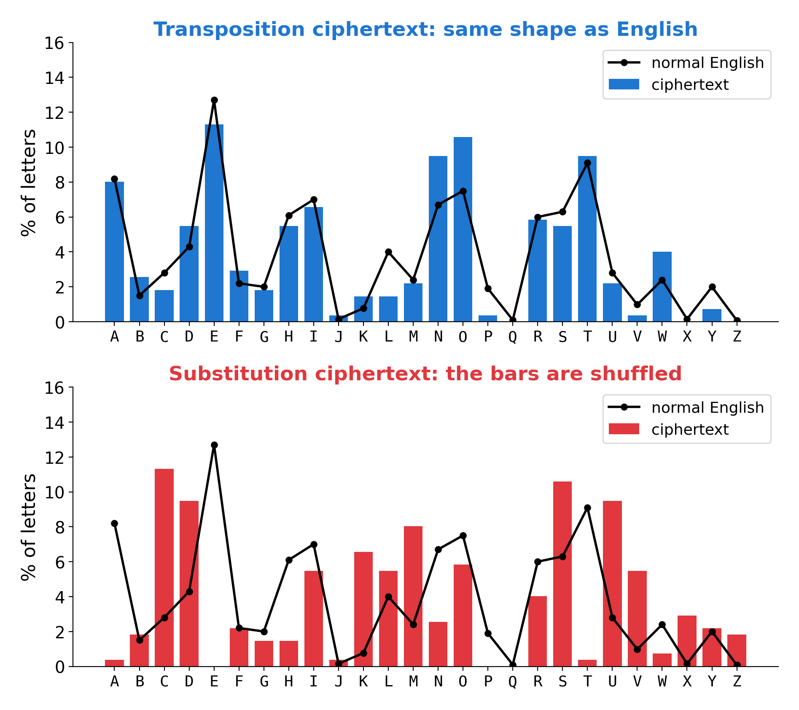
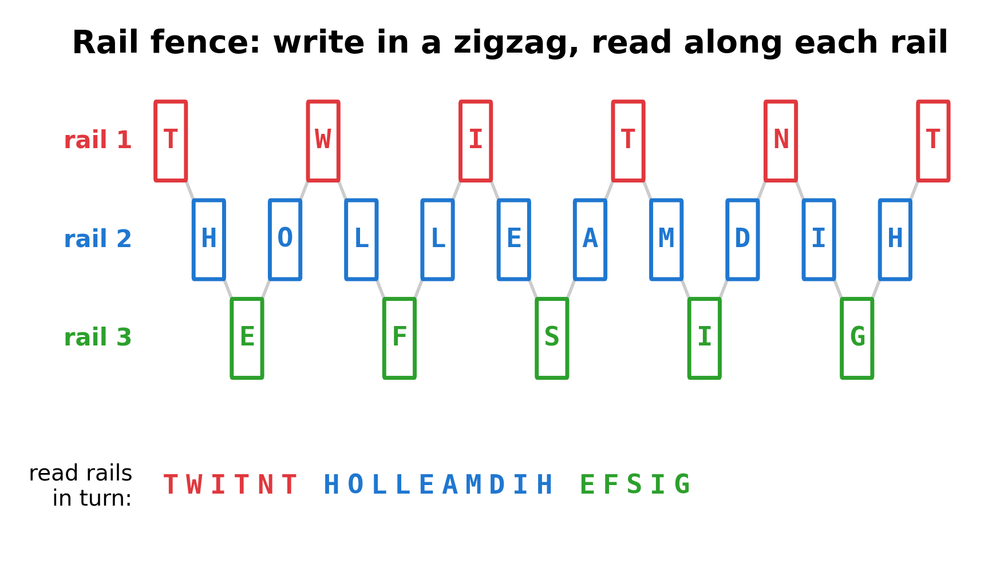
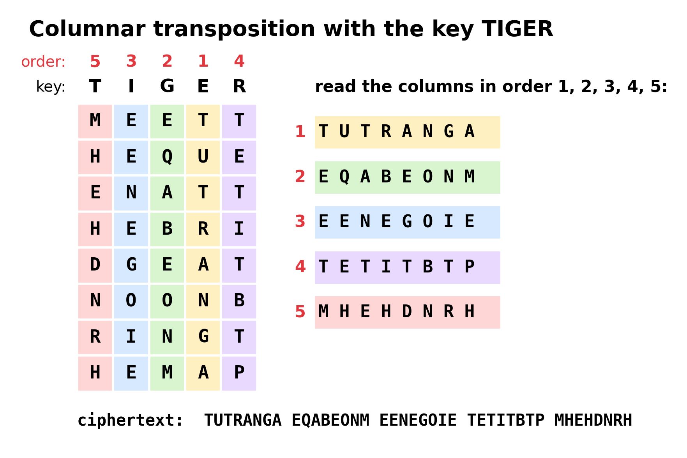
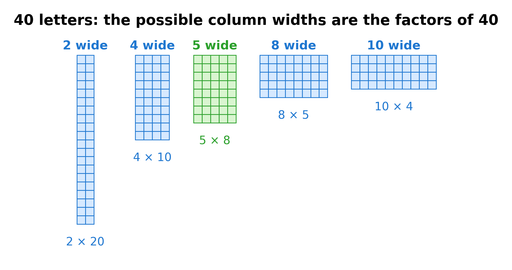
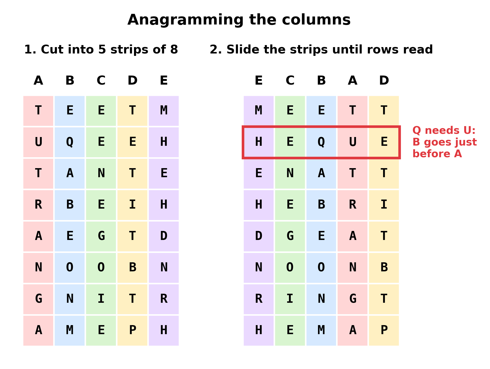

**By the end you can tell, from counting letters, that a message has been scrambled rather than disguised, and you can unscramble the common kinds by hand: reversal, rail fence, columnar and block transposition.**

## The big idea

There are two basic ways to hide a message. A **substitution** cipher swaps each letter for a different one, but leaves it in its place. A **transposition** cipher keeps every letter exactly as it is, but moves it somewhere else. It is an anagram of the whole message, made by following a rule. So a transposition leaves a giveaway fingerprint: the letter counts are exactly the counts of ordinary English. Lots of E and T, a few Z and Q. The ciphertext "looks English" letter by letter, but no words appear anywhere.



Once you know it is a transposition, your job is detective work: work out the **rule** that moved the letters, and run it backward.

## Which ciphers it breaks

| Cipher | Do these methods help? | How |
|---|---|---|
| Reversal | Yes | Read it backward. |
| Rail fence | Yes | Try 2, 3, 4... rails; work out how many letters sit on each rail. |
| Columnar transposition | Yes | Try widths that divide the length; cut into columns; slide them until rows read. |
| Block (permutation) transposition | Yes | Same grid, but cut into rows instead of columns. |
| Double transposition | Partly | Much harder: a computer search is usually needed. |
| Substitution, Caesar, affine | No | The letter counts give them away as *not* transpositions (Guide 02, Frequency analysis). |
| Vigenère, Playfair, Hill | No | Their letter counts are flatter than English (Guide 04 and Guide 09). |
| A substitution and a transposition together | Partly | Counts look like a substitution; solve that part with a computer search (Guide 08). |

## Why it works

### Spotting a transposition

Since a transposition only moves letters, anything you can measure by **counting** single letters stays exactly the same as in English. Here are the four tells.

1. **The letter counts match English.** E is the most common, then T, A, O, I, N, S, H, R. J, Q, X and Z are rare or missing.
2. **About 40 percent of the letters are vowels** (A, E, I, O, U), as in English.
3. **The index of coincidence** (the chance that two letters picked at random from the text are the same) is about 0.067, the value for English. (Guide 04 explains it. A substitution also keeps this number, but a Vigenère cipher pushes it down toward 0.038.)
4. **But nothing reads.** No THE, no AND, no words at all. Or sometimes it reads backward.

A neat extra clue: in English, Q is almost always followed by U. A transposition moves them apart, but it cannot remove the U. If the ciphertext has three Qs, it will have at least three Us.

### The family of scrambles

**Reversal.** The simplest of all: write the message backward. `THGINOTSELDNACEROMDNES` is "send more candles tonight" backward. The tell: you see THE backward, as EHT, and common word endings such as ING appear as GNI.

**Rail fence.** Write the message in a zigzag across a few horizontal lines (the **rails**), then read each rail from left to right.



The key is just the number of rails, so there are only a handful to try. To undo it, you need to know how many letters landed on each rail. With 3 rails the zigzag repeats every 4 letters (down, down, up, up). Of our 21 letters, positions 1, 5, 9, 13, 17 and 21 are on rail 1 (6 letters), positions 3, 7, 11, 15 and 19 are on rail 3 (5 letters), and the other 10 are on rail 2. So split the ciphertext `TWITNTHOLLEAMDIHEFSIG` into 6, 10 and 5 letters: `TWITNT`, `HOLLEAMDIH`, `EFSIG`. Write them back on their rails and read the zigzag.

**Columnar transposition.** Pick a keyword, such as TIGER. Write the message in rows under it, as many letters per row as the keyword has. Number the keyword's letters in alphabetical order (E is 1, G is 2, I is 3, R is 4, T is 5). Then read down each column, in that number order.



**Block transposition** (also called a **permutation cipher**). Cut the message into blocks, say of 4 letters, and shuffle the letters inside every block the same way. With the shuffle "2nd, 4th, 1st, 3rd", `LOOK UNDE RTHE BIGS TONE` becomes `OKLO NEUD TERH ISBG OETN`. Notice that this is really the same grid as columnar: write the message in rows of 4, and the shuffle moves whole columns. The only difference is that you read the result row by row instead of column by column.

> **In the app:** The family tree shows the [transposition](https://apps.thorwhalen.com/cryptology/#/tree/transposition) family: [rail fence](https://apps.thorwhalen.com/cryptology/#/tree/railfence), [columnar](https://apps.thorwhalen.com/cryptology/#/tree/columnar), [block](https://apps.thorwhalen.com/cryptology/#/tree/block) and [reversal](https://apps.thorwhalen.com/cryptology/#/tree/reversal).

## The grown-up version

### Width from factors

For a columnar or block transposition, the number of columns is called the **width** (or **period**). If the sender filled the grid completely (often adding filler letters such as X at the end), then the width times the number of rows equals the length of the message. So the width must be a **factor** (or **divisor**) of the length: a number that divides it with nothing left over.



Write the length $n$ as a product of primes: $40 = 2 \times 2 \times 2 \times 5$. Every factor is built from some of those primes: 2, 4, 5, 8, 10, 20. Widths of 1 or 40 would not scramble anything, and 20 would leave just two rows, so in practice you try 4, 5, 8 and 10 first. A prime length (such as 37 or 41) is a strong hint that the grid was **not** filled completely, and then the columns have two different heights (see Traps and tips).

### Letter contacts

Once the letters are in a grid of the right width, the columns are in the wrong order. Anagramming them uses **contacts**: pairs of letters that sit next to each other in English.

- **Q is followed by U.** This is the strongest contact there is.
- Common pairs (**digraphs**): TH, HE, IN, ER, AN, RE, ON, AT, EN, ND, ST, ES.
- Impossible or very rare pairs: QX, JZ, HQ, any consonant tripled.
- Rare letters (J, K, Q, V, X, Z) are excellent anchors because they have very few partners.

## A worked example

You receive this ciphertext (40 letters):

```
TUTRANGA EQABEONM EENEGOIE TETITBTP MHEHDNRH
```

**Step 1. Is it a transposition?** Count the letters: E 8, T 6, N 4, A 3, H 3, and B, G, I, M, O, R twice each, then D, P, Q and U once. E and T are the most common, as in English. There is no J, X or Z. The vowels are A (3), E (8), I (2), O (2), U (1): 16 of 40, exactly 40 percent. The index of coincidence is 0.078, close to English's 0.067 (short texts wobble). And there is one Q and one U. Everything says English letters, but nothing reads. It is a transposition.

**Step 2. Which widths?** The length is 40, so try widths 4, 5, 8 and 10. Start with 5.

**Step 3. Cut into strips.** For a columnar transposition the ciphertext is the columns one after another. With width 5, there are 8 rows, so cut the ciphertext into 5 strips of 8 letters. Call them A to E and stand them side by side.

| A | B | C | D | E |
|---|---|---|---|---|
| T | E | E | T | M |
| U | Q | E | E | H |
| T | A | N | T | E |
| R | B | E | I | H |
| A | E | G | T | D |
| N | O | O | B | N |
| G | N | I | T | R |
| A | M | E | P | H |

**Step 4. Use the Q.** Strip B has Q in row 2. The only strip with U in row 2 is A. So strip A goes immediately to the right of strip B. Reading B then A down the rows gives the pairs ET, QU, AT, BR, EA, ON, NG, MA. Several of those are common English pairs. Good sign.

**Step 5. Grow the chain to the right.** What comes after A? Try each remaining strip:

| B A + C | B A + D | B A + E |
|---|---|---|
| ETE | ETT | ETM |
| QUE | QUI | QUH |
| ATN | ATT | ATH |
| BRE | BRI | BRH |
| EAG | EAT | EAD |
| ONO | ONB | ONN |
| NGI | NGT | NGR |
| MAE | MAP | MAH |

QUH is impossible, which rules out E. Between C and D, D gives QUI, BRI, EAT and MAP, which look like pieces of words, so try D.

**Step 6. Place the last two.** C and E are left, and they go on the left. Try E then C, then C then E:

- E C B A D: MEETT, HEQUE, ENATT, HEBRI, DGEAT, NOONB, RINGT, HEMAP
- C E B A D: EMETT, EHQUE, ... which puts H before Q, impossible.

So the order is E C B A D. Read the rows: `meett hequee natth ebrid geatn oonbr ingth emap`, which is "meet the queen at the bridge at noon bring the map".



**Step 7 (bonus). Recover the key.** The strips were read in the order A, B, C, D, E, which were columns 4, 3, 2, 5, 1 of the plaintext grid. So the column numbers across the top were 5, 3, 2, 1, 4. A keyword with that alphabetical order is TIGER. You do not need the keyword to read the message, but finding it can help with the next message, which might use the same one.

> **In the app:** [Columns](https://apps.thorwhalen.com/cryptology/#/workbench/columns) writes your text into a grid of the width you choose; tap one column, then another, to swap them. [Blocks](https://apps.thorwhalen.com/cryptology/#/workbench/blocks) does the same for short blocks, and [Rail fence](https://apps.thorwhalen.com/cryptology/#/workbench/rail) reads the text along a zigzag of the rails you choose.

## Double transposition: a harder note

A **double transposition** does a columnar transposition and then another one on the result, often with a second keyword. The letter counts still match English, so the tells are the same. But after two scrambles, the strips no longer line up into simple rows, and anagramming by hand becomes very hard. Armies used it for exactly that reason, into the Second World War. To break it you usually need a long message and a computer search over both keys at once, scored the way Guide 08 (Scoring and hill climbing) explains.

## When to try it

- The letter counts look like English, but nothing reads.
- The ciphertext has a Q with no U next to it, or THE appears backward as EHT.
- The length has handy factors (40, 48, 60, 72...), especially if it ends in a few Xs.
- Reach for the rail fence first (only a few keys), then reversal, then columnar widths in order.

**When not to:** if E and T are not near the top of your counts, or Z or Q are suspiciously common, it is not a pure transposition. Try substitution first.

## Traps and tips

- **Short texts wobble.** In 40 letters, E might come third instead of first. Look at the overall shape (common letters common, rare letters rare), not the exact order.
- **Incomplete grids.** If the last row was not filled, the leftmost columns of the plaintext grid are one letter longer than the rest. Then the strips are not all the same length. With 42 letters in width 5, two columns have 9 letters and three have 8: you must guess which strips are the long ones.
- **Filler letters.** Senders often pad the last row with X or other nulls. A few Xs in a row near the end of a decryption are padding, not a mistake.
- **Columnar or block?** Try both: cut the ciphertext into columns (vertical strips) and also into rows of the same width. Only one will anagram into English.
- **Use squared paper and scissors.** Write the strips on squared paper, cut them out and slide them around. It is much faster than rewriting.
- **Start from rare letters.** Q, J, X, Z and V have few partners, so they pin down neighbors quickly.
- **Word spaces are gone.** Real messages lose their spaces and punctuation before being scrambled, so read through the gaps: `MEETTHEQUEEN` is three words.

## By hand or by computer

With transposition, the counts say what you face in seconds; the rearranging is where the hours go. Do each job by hand once, on a short text, so you know what it involves; then hand it over (the chapter *Brain, pencil or computer?* explains why[^g07-why]). Times are rough, for a practiced reader and a ciphertext of about 300 letters.

| Job | By hand | Learn with | Just do it |
|---|---|---|---|
| List the possible widths from the length | 2 minutes | Counts[^g07-counts] | n/a |
| Write the text in a grid and move the columns | 10 to 20 minutes a width | Columns[^g07-columns], grid sheet[^g07-sheet-columnar] | dCode[^g07-dcode-columnar] |
| Try rail fences of 2 to 6 rails | about 5 minutes a rail count | Rail fence[^g07-rail] | dCode[^g07-dcode-rail] |
| Try every order of a block of 5 | 120 orders: hours | Blocks[^g07-blocks] | dCode[^g07-dcode-transposition] |

[^g07-why]: [Brain, pencil or computer?](https://apps.thorwhalen.com/cryptology/#/guides/00-brain-pencil-or-computer), the chapter before Guide 1.
[^g07-counts]: Counts, in the cryptology app: [apps.thorwhalen.com/cryptology/#/workbench/counts](https://apps.thorwhalen.com/cryptology/#/workbench/counts). Letter counts beside English's, the IoC, the length and its factors.
[^g07-columns]: Columns, in the cryptology app: [apps.thorwhalen.com/cryptology/#/workbench/columns](https://apps.thorwhalen.com/cryptology/#/workbench/columns). Any width; tap two columns to swap them.
[^g07-sheet-columnar]: Columnar grid, a spreadsheet: SHEET:columnar.
[^g07-dcode-columnar]: dCode's columnar transposition solver: [dcode.fr/columnar-transposition-cipher](https://www.dcode.fr/columnar-transposition-cipher).
[^g07-rail]: Rail fence, in the cryptology app: [apps.thorwhalen.com/cryptology/#/workbench/rail](https://apps.thorwhalen.com/cryptology/#/workbench/rail).
[^g07-dcode-rail]: dCode's rail fence solver: [dcode.fr/rail-fence-cipher](https://www.dcode.fr/rail-fence-cipher).
[^g07-blocks]: Blocks, in the cryptology app: [apps.thorwhalen.com/cryptology/#/workbench/blocks](https://apps.thorwhalen.com/cryptology/#/workbench/blocks). Rearranges every block the same way.
[^g07-dcode-transposition]: dCode's transposition solver: [dcode.fr/transposition-cipher](https://www.dcode.fr/transposition-cipher).

## Try it yourself

1. This message was written on 3 rails: `MMMIETETINGTEADH` (16 letters). How many letters are on each rail? What does it say?
2. A transposition ciphertext has 36 letters. Which widths should you try?
3. Is this a transposition? `TLLAA OLXBL LUHAA OLIYP KNLHA UVVUI YPUNA OLTHW`. (Hint: count E and L.)
4. This columnar transposition has width 3: `OUEHAONRETLKDTM`. Cut it into 3 strips of 5 and find the order that reads.

> **In the app:** Practice with [Columnar transposition](https://apps.thorwhalen.com/cryptology/#/ex/columnar/1), [Block transposition](https://apps.thorwhalen.com/cryptology/#/ex/block/1) and [Rail fence](https://apps.thorwhalen.com/cryptology/#/ex/rail/1).

## Answers

1. The zigzag repeats every 4 letters. Rail 1 gets positions 1, 5, 9, 13 (4 letters), rail 3 gets positions 3, 7, 11, 15 (4 letters), and rail 2 the other 8. Split: `MMMI`, `ETETINGT`, `EADH`. Read the zigzag: "meet me at midnight".
2. The factors of 36 are 2, 3, 4, 6, 9, 12 and 18. Try 4, 6 and 9 first, then 3 and 12.
3. No. There is no E at all, and L (rare-ish in English) appears 8 times in 40 letters. The letters themselves have been changed, so it is a substitution. (It is a Caesar shift of 7: L stands for E. It is the worked example's message again.)
4. The strips are `OUEHA`, `ONRET` and `LKDTM`. Order 3, 1, 2 gives rows LOO, KUN, DER, THE, MAT: "look under the mat".

## Words to know

- **Transposition**: a cipher that keeps the letters but changes their order.
- **Substitution**: a cipher that changes the letters but keeps their order.
- **Reversal**: writing the message backward.
- **Rail fence**: writing the message in a zigzag across rails and reading each rail.
- **Columnar transposition**: writing in rows under a keyword and reading the columns in keyword order.
- **Block (permutation) transposition**: shuffling the letters inside each block of fixed size the same way.
- **Width (period)**: the number of columns in the grid, or the size of each block.
- **Factor (divisor)**: a number that divides another with nothing left over.
- **Contact**: two letters that sit next to each other in the text.
- **Digraph**: a pair of letters, such as TH.
- **Anagramming**: rearranging letters (or columns) until words appear.
- **Null (padding)**: a meaningless letter added to fill a grid.
- **Double transposition**: two transpositions, one after the other.

## Going further

- [Practical Cryptography: Rail fence cipher](http://practicalcryptography.com/ciphers/classical-era/rail-fence/)
- [Practical Cryptography: Columnar transposition cipher](http://practicalcryptography.com/ciphers/classical-era/columnar-transposition/)
- [Wikipedia: Transposition cipher](https://en.wikipedia.org/wiki/Transposition_cipher) (includes double transposition)
- [Wikipedia: Rail fence cipher](https://en.wikipedia.org/wiki/Rail_fence_cipher)
- Simon Singh, *The Code Book* (1999), chapter 1, for transposition in history.
- [The National Cipher Challenge](https://www.cipherchallenge.org/) for practice ciphertexts.
