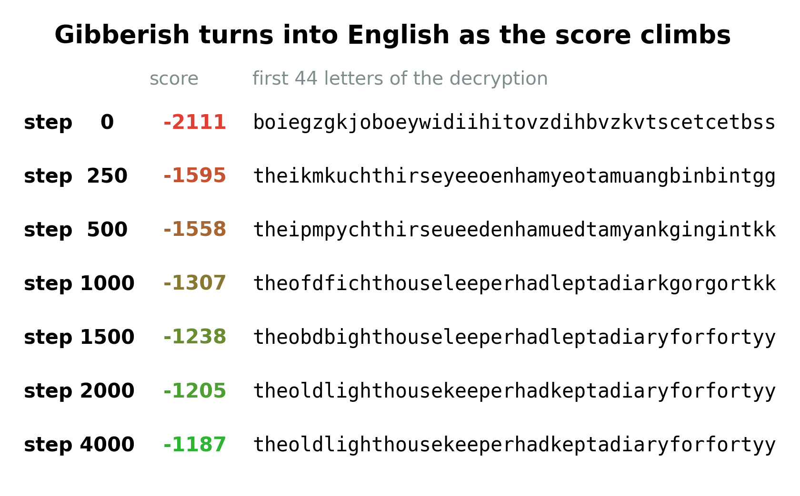
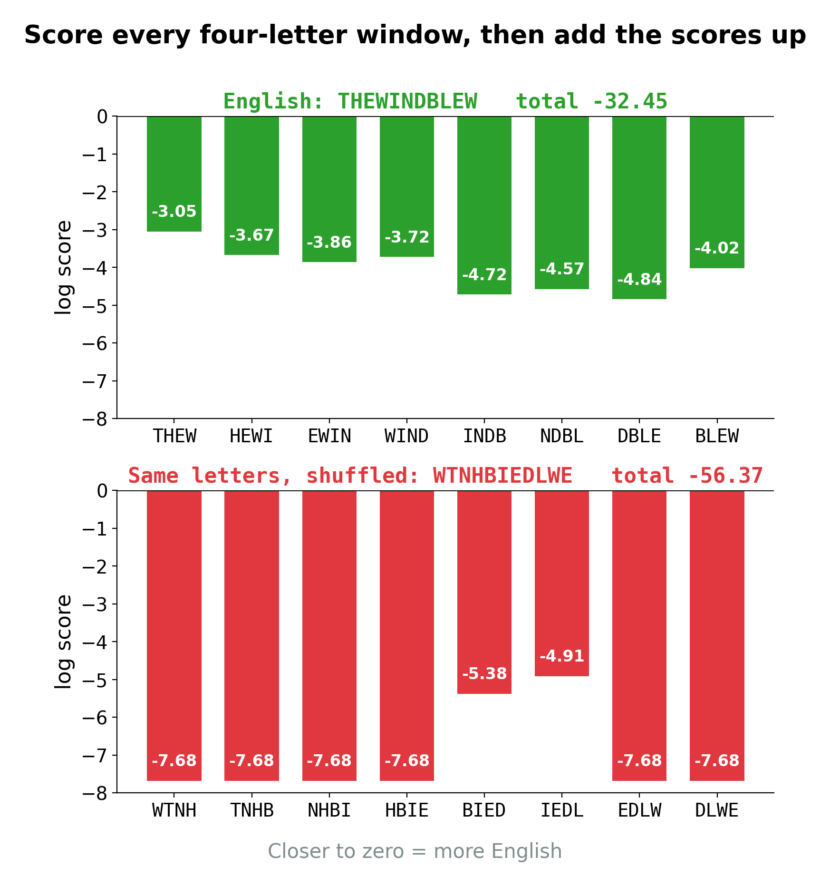
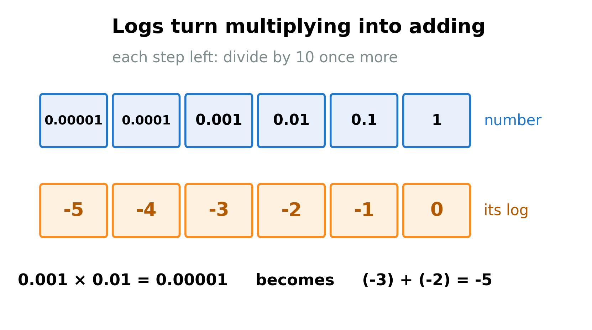
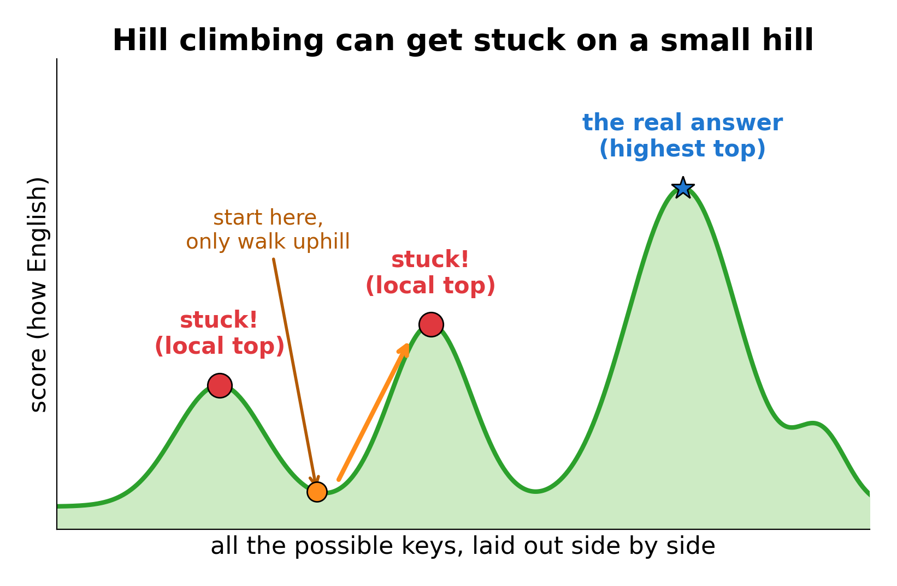
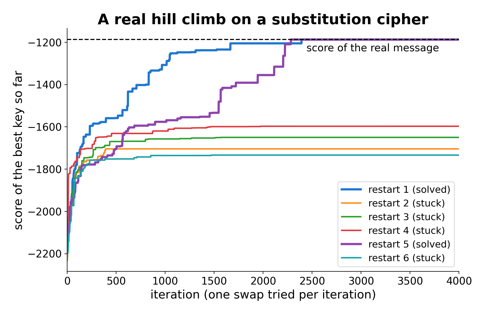
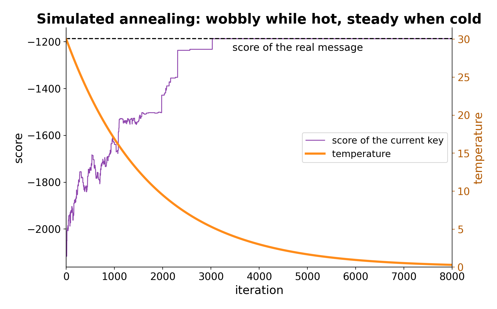

**By the end you can explain exactly how a computer cracks a substitution cipher with no human help: how it scores a guess, how it improves the guess one small change at a time, and why it sometimes gets stuck.**

## The big idea

A simple substitution cipher has more possible keys than there are grains of sand on Earth, so nobody can try them all. But you do not need to try them all. You need two things. First, a **score**: a number that says how much a piece of text looks like English. Second, a way to **improve** a key: change it a tiny bit, and keep the change only if the score goes up. Repeat that a few thousand times and gibberish slowly turns into English. This is called **hill climbing**, because you are always walking uphill on the score. The picture below shows the score along a real run: the decryption starts as nonsense and ends as the real message.



Knowing how this works is the whole point of this guide. Codebreaking websites have a "solve" button that does exactly this. If you know what is inside the button, you know when to trust it, when it will fail, and how to fix it when it does. The method is the skill, not the button.

## Which ciphers it breaks

| Cipher family | Does scoring and hill climbing help? | How |
|---|---|---|
| Simple substitution, keyword substitution | Yes, this is its best use | The key is a scrambled alphabet. A move swaps two letters. |
| Columnar and block transposition | Yes | The key is a column order. A move swaps two columns or slides a run of them. |
| Playfair, four-square | Yes, with care | The key is a 5x5 square. Moves swap letters, rows or columns. Needs simulated annealing and 100+ letters. |
| Vigenère, Beaufort | It works, but there is a faster way | Find the key length first (Guide 04 and Guide 05), then each column is just a Caesar shift. |
| Caesar, affine | Not needed | Only 26 or 312 keys: just try them all and score each one. |
| Hill | Rarely | A crib solves it directly (Guide 09, Two letters at a time). |
| One-time pad | No | Every possible message is equally likely, so the score cannot pick the right one. |

The score part is useful almost everywhere, even when you do not climb: any time you have a handful of candidate decryptions, scoring them tells you which one to read first.

## Why it works

### Step 1: what makes text "English"?

Single letter counts are a start (E is common, Z is rare), but they cannot tell `theoldlighthouse` from `ehtolhgidtlouseh`: both have exactly the same letters. What really marks English is which letters sit **next to each other**. TH, HE and ING are everywhere. QX and JZW never happen.

So instead of counting single letters, count groups of four letters in a row, called **quadgrams**. Take a few big books, slide a four-letter window along every sentence, and count how often each window appears. The table used in this guide was made from about 4.8 million quadgrams in public-domain novels. THAT, THER and WITH are near the top, along with NTHE and DTHE (the end of one word running into "the"). Most of the 456,976 possible quadgrams never appear at all.

To score a piece of text, slide the same window along it and look each quadgram up.



The English phrase scores about -32. The shuffled phrase, made of exactly the same letters, scores about -56. Higher (closer to zero) means more English. Now we need to explain why the numbers are negative, and why we **add** them.

### Step 2: why add instead of multiply?

The quadgram THEW makes up about 0.00089 of all quadgrams in the books, roughly 9 in every 10,000. That number is its **probability**. To get the chance of a whole text, you would multiply the probabilities of all its quadgrams together. For our 297-letter message that means multiplying 294 small numbers. The answer has more than 1,100 zeros after the decimal point. Ordinary computer numbers cannot go below about $10^{-308}$ (a decimal point followed by 307 zeros and then a 1). Anything smaller silently becomes exactly 0, and then every key scores 0 and you can tell nothing apart.

The fix is an idea mathematicians use all the time: the **logarithm**, or **log** for short.



Here is the whole idea. The log of a number counts **how many times you multiply by 10** to get it.

- $\log_{10} 1000 = 3$, because $10 \times 10 \times 10 = 1000$.
- $\log_{10} 1 = 0$, because you multiply by 10 zero times.
- For numbers smaller than 1, you divide instead, and the count goes negative: $\log_{10} 0.001 = -3$, because $1 \div 10 \div 10 \div 10 = 0.001$.
- Numbers in between have logs in between. THEW's probability, 0.00089, is a bit less than 0.001, so its log is a bit less than -3: it is -3.05.

The little 10 in $\log_{10}$ just says "we are counting tens". Now the magic: multiplying two numbers is the same as **adding** their logs. Try it: $0.001 \times 0.01 = 0.00001$. Count the tens: $(-3) + (-2) = -5$, and indeed $\log_{10} 0.00001 = -5$. In symbols:

$$\log_{10}(a \times b) = \log_{10} a + \log_{10} b$$

So instead of multiplying 294 tiny probabilities (and getting a number too small to store), we add 294 logs and get an ordinary number like -1187. Since every probability is less than 1, every log is negative, and the total is negative. A bigger probability means a log closer to zero, so **closer to zero is more English**.

One snag: a quadgram that never appeared in the books has probability 0, and $\log_{10} 0$ does not exist (you would have to divide by 10 forever). So we pretend each unseen quadgram appeared a tenth of a time. In our table that gives a floor of -7.68: about 1 chance in 48 million.

## The grown-up version

### The fitness score

Write the text as letters, and call its quadgrams $q_1, q_2, q_3, \dots$ (the first four letters, then letters 2 to 5, and so on). A text of $n$ letters has $n - 3$ of them. Write $p(q)$ for the probability of quadgram $q$ in the big books. The **fitness** of the text is

$$F = \sum_{i=1}^{n-3} \log_{10} p(q_i)$$

The symbol $\sum$ is a capital Greek S, for "sum". It means: let $i$ run from 1 up to $n-3$, work out $\log_{10} p(q_i)$ each time, and add them all up. It is just a short way to write $\log_{10} p(q_1) + \log_{10} p(q_2) + \dots + \log_{10} p(q_{n-3})$.

Longer texts have more terms, so their totals are bigger negative numbers. To compare texts of different lengths, divide by the number of quadgrams. English text averages about -4 per quadgram. Random letters average about -7.

### Hill climbing

A **key** is whatever the cipher needs: for substitution, a scrambled alphabet saying which plain letter each cipher letter stands for. The **search space** is the set of all keys: for substitution there are $26! = 26 \times 25 \times 24 \times \dots \times 2 \times 1$, about $4 \times 10^{26}$ of them (the "!" is read "factorial"). A **move** is a small change to a key: here, swapping two letters.

1. Start with a random key. Decrypt with it and score the result.
2. Make a move: swap two letters of the key at random.
3. Decrypt and score again. If the score went **up**, keep the new key. If not, undo the swap.
4. Go back to step 2. Stop when thousands of moves in a row have not helped.

The final key is a **local maximum**: no single swap can improve it. If you are lucky it is the real key.

### Local maxima and random restarts

Picture all possible keys spread out as a landscape, where the height of the ground is the score. Hill climbing is a walker in thick fog who can only feel the slope under their feet and only ever steps uphill.



Every hilltop feels like the top, because every step from it goes down. A small hilltop is a **local maximum**: a key that looks right "nearby" but decrypts to nonsense. The tallest peak, the real key, is the **global maximum**. The simplest cure is to **restart**: run the climb again from a different random key, several times, and keep the best result.

### Simulated annealing

A smarter cure is to let the walker take a few downhill steps, especially early on, so they can walk off a small hill and find a bigger one. When blacksmiths **anneal** metal they heat it and let it cool slowly, so the atoms can shuffle into a strong arrangement before they freeze in place. **Simulated annealing** copies that.

It keeps a number called the **temperature**, $T$, which starts high and is lowered a little after every move. A better key is always kept. A worse key is sometimes kept, with a chance that depends on how much worse it is and on how hot it is. Write $\Delta$ (the Greek capital "delta", meaning "change") for the new score minus the old score. For a worse key $\Delta$ is negative, and the chance of keeping it is

$$P = 10^{\Delta / T}$$

For example, at $T = 30$ a move that is 30 points worse has $\Delta / T = -1$, so $P = 10^{-1} = 0.1$: it is kept 1 time in 10. Later, at $T = 3$, the same move has $\Delta / T = -10$, so $P = 10^{-10}$: practically never. Hot means adventurous; cold means careful. By the end it behaves like plain hill climbing.

## A worked example

Here is the start of a ciphertext made with a simple substitution (297 letters in all, spaces and punctuation removed).

```
ZITGS RSOUI ZIGXL TATTH TKIQR ATHZQ ROQKN YGKYG KZNNT QKLTC
TKNFO UIZIT VKGZT RGVFZ ITVTQ ZITKZ ITLIO HLZIQ ZHQLL TRQFR ...
```

**Step 1. Score the ciphertext as it is.** Read as if it were plain English, it scores -2160.2. That is -7.35 per quadgram: gibberish, as expected. The real message (which the computer does not know) scores -1186.9, or -4.04 per quadgram.

**Step 2. Climb.** The program starts from a random key (score -2110.5) and tries one random swap per iteration. Here is one real moment of the run, at iteration 1000, when the score is -1307.0 and the decryption begins like this:

```
theofdfichthouseleeperhadleptadiarkgorgort...
```

Some moves it might try:

| Swap these plain letters | New score | Change | Kept? |
|---|---|---|---|
| k and y | -1288.3 | +18.7 | yes |
| g and f | -1286.7 | +20.3 | yes |
| l and k | -1302.9 | +4.1 | yes |
| e and t | -1764.0 | -456.9 | no |

Swapping e and t would wreck every THE, so the score falls off a cliff. Swapping g and f turns `gorgort` into `forfort`, part of "for forty", and the score jumps.

**Step 3. Watch the score.** The program ran 6 climbs (restarts), 4,000 iterations each. Two of them reached exactly -1186.9 and read `theoldlighthousekeeperhadkeptadiaryforfortyyears...`. The other four stopped on lower hills, between -1597 and -1734.



One of the stuck climbs ended on `ewaobtbhdwewoulacaapanwitcapeithingfonfon...`, scoring -1597.1. Look closely and you can see pieces of English (`ing`, `with`), but in the wrong places. No single swap fixes it: it would need several swaps at once, and each one alone makes the score worse. That is a local maximum.

**Step 4. Try annealing.** The same ciphertext, with simulated annealing (temperature lowered smoothly from 30 to 0.3 over 8,000 iterations), solved it in one go. In the picture you can see the score wobble down as well as up while it is hot.



To compare fairly, the program then gave each method 30 fresh random starts of 8,000 iterations. Plain hill climbing found the message 8 times out of 30. Simulated annealing found it 22 times out of 30. Neither is magic; both are just walkers in fog with different rules.

## How it extends to other ciphers

The beautiful part is that only two things change from cipher to cipher: **what a key looks like** and **what a move is**. The score stays the same.

- **Columnar or block transposition.** The key is an order of columns, such as 3-1-4-0-2. Moves: swap two columns, or lift a run of neighboring columns and put it somewhere else (a run that is already in the right order should move as one piece). Try each possible width in turn (Guide 07, Transposition detective work).
- **Playfair.** The key is a 5x5 square of letters (Guide 09). Moves: swap two letters, swap two rows or two columns, or flip the square. The landscape is very bumpy, so annealing works much better than plain climbing, and it needs about 100 letters or more.
- **Anything new.** If someone invents a cipher you have never seen, ask: what is the key, and what is a small change to it? If you can answer both, you can climb.

> **In the app:** The app has no hill climber: in [Substitution](https://apps.thorwhalen.com/cryptology/#/workbench/substitution) you do by hand what it does. Try a change to the key, and keep it if more of the text reads as English.

## When to try it

- You have identified a cipher with a key too big to try in full (substitution, transposition, Playfair).
- You have at least about 100 letters. Around 200 or more is comfortable.
- You have a few candidate decryptions and want the computer to rank them: score them all.

**When not to:** when the key space is small (just try every key), when a smarter method exists (IoC for Vigenère, a crib for Hill), and when the text is very short.

## Traps and tips

- **Short texts fool the score.** With 40 letters, a wrong key can score better than the right one. The real message is the highest score only when there is enough text for the patterns to show.
- **Unusual text scores badly.** A message full of names, foreign words, or a deliberate trick (like never using the letter E) is less "English" than the books. The climber may then prefer a wrong key. If a solve is nearly readable, finish it by hand.
- **Nearly right is a great place to be.** A decryption like `theoldlichthouse` tells you exactly which swap to make next. Humans are very good at the last few letters.
- **Restart, restart, restart.** If the result is not readable, the climb probably stopped on a small hill. Run it again from a new random key before you suspect the cipher type.
- **Compare like with like.** Only compare totals for texts of the same length, or use the average per quadgram.
- **Strip everything but letters** before scoring, or make sure spaces and punctuation are handled the same way everywhere.
- **A score that never gets near English** (stuck around -6 per quadgram whatever you do) usually means the cipher type is wrong, not that you need more restarts.

## By hand or by computer

This guide is about the methods computers use, so the honest answer is: do one or two steps by hand to see the idea, then let the program run thousands. Do each job by hand once, on a short text, so you know what it involves; then hand it over (the chapter *Brain, pencil or computer?* explains why[^g08-why]). Times are rough, for a practiced reader and a ciphertext of about 300 letters.

| Job | By hand | Learn with | Just do it |
|---|---|---|---|
| Score one text with quadgrams | 20 minutes or more | n/a | CrypTool 2[^g08-cryptool2] |
| One hill-climbing step: swap two letters and rescore | 5 to 10 minutes | Substitution[^g08-substitution], substitution sheet[^g08-sheet-substitution] | n/a |
| A full hill climb or simulated annealing | thousands of steps: impossible by hand | n/a | quipqiup[^g08-quipqiup], Guballa[^g08-guballa-sub], CrypTool 2[^g08-cryptool2] |

[^g08-why]: [Brain, pencil or computer?](https://apps.thorwhalen.com/cryptology/#/guides/00-brain-pencil-or-computer), the chapter before Guide 1.
[^g08-cryptool2]: CrypTool 2, a free learning environment with real attacks (Windows): [cryptool.org/en/ct2](https://www.cryptool.org/en/ct2/).
[^g08-substitution]: Substitution, in the cryptology app: [apps.thorwhalen.com/cryptology/#/workbench/substitution](https://apps.thorwhalen.com/cryptology/#/workbench/substitution). You choose the letters; it fills in the text.
[^g08-sheet-substitution]: Substitution key and partial decrypt, a spreadsheet: [apps.thorwhalen.com/cryptology/#/tools/sheet-substitution](https://apps.thorwhalen.com/cryptology/#/tools/sheet-substitution), to copy into Google Sheets or download for Excel.
[^g08-quipqiup]: quipqiup, a substitution solver: [quipqiup.com](https://quipqiup.com/).
[^g08-guballa-sub]: Guballa's substitution solver: [guballa.de/substitution-solver](https://www.guballa.de/substitution-solver).

## Try it yourself

1. Using the idea "count the tens": what is $\log_{10} 100$? What is $\log_{10} 0.0001$? Use logs to find $0.01 \times 0.001 \times 0.1$.
2. The quadgrams of THEWIND are THEW (-3.05), HEWI (-3.67), EWIN (-3.86) and WIND (-3.72). What is the fitness of THEWIND? What is its average per quadgram?
3. In simulated annealing with $P = 10^{\Delta/T}$: at temperature $T = 10$, what is the chance of keeping a move that is 20 points worse? What about at $T = 20$? At $T = 40$?
4. A friend runs a hill climber on a 30-letter substitution cipher and gets a perfectly readable but wrong answer. How is that possible?

> **In the app:** [Substitution without word breaks](https://apps.thorwhalen.com/cryptology/#/ex/substitution-blocks/1) is the kind of text a hill climber is built for. Solve one by hand, and notice which steps you would hand to a computer.

## Answers

1. $\log_{10} 100 = 2$ (two tens). $\log_{10} 0.0001 = -4$ (divide by 10 four times). For the product, add the logs: $(-2) + (-3) + (-1) = -6$, so the answer is $0.000001$.
2. $-3.05 - 3.67 - 3.86 - 3.72 = -14.30$. There are 4 quadgrams, so the average is $-14.30 \div 4 = -3.575$, about -3.58: very English.
3. At $T = 10$: $\Delta / T = -20 / 10 = -2$, so $P = 10^{-2} = 0.01$, or 1 in 100. At $T = 20$: $-1$, so 1 in 10. At $T = 40$: $-0.5$, so $P = 10^{-0.5} \approx 0.32$, about 1 in 3.
4. A short text has few quadgrams, so many different keys can turn it into something English-looking. With only 30 letters there may be a wrong key whose decryption scores higher than the real message, and the climber has no way to know which one the sender meant. More text, or a crib, settles it.

## Words to know

- **Quadgram**: a group of four letters in a row, such as TION.
- **Fitness (score)**: a number saying how English a text looks; here, the sum of the logs of its quadgram probabilities. Closer to zero is better.
- **Probability**: how often something happens, as a fraction of all the times it could.
- **Logarithm ($\log_{10}$)**: how many times you multiply (or, if negative, divide) by 10 to get a number.
- **Key space (search space)**: the set of all possible keys.
- **Move**: a small change to a key, such as swapping two letters.
- **Hill climbing**: keep making moves, keeping only the ones that raise the score.
- **Local maximum**: a key that no single move can improve, but that is not the best key.
- **Random restart**: starting the climb again from a new random key.
- **Simulated annealing**: hill climbing that sometimes keeps worse keys, more often while the "temperature" is high.
- **Temperature**: the number in simulated annealing that controls how often worse moves are accepted. It starts high and falls.

## Going further

- Video: [Hill Climbing Algorithm & Artificial Intelligence](https://www.youtube.com/watch?v=oSdPmxRCWws), Computerphile, 7 minutes (the idea in general).
- Video: [Basics of Cryptology, Part 8: Hill Climbing](https://www.youtube.com/watch?v=RB5rDdEAF7U), Cryptography for Everybody (CrypTool), 22 minutes (for strong readers and adults).
- [Practical Cryptography: quadgram statistics as a fitness measure](http://practicalcryptography.com/cryptanalysis/text-characterisation/quadgrams/) (with a downloadable quadgram table)
- [Practical Cryptography: breaking a substitution cipher by hill climbing](http://practicalcryptography.com/cryptanalysis/stochastic-searching/cryptanalysis-simple-substitution-cipher/)
- [Wikipedia: Hill climbing](https://en.wikipedia.org/wiki/Hill_climbing)
- [Wikipedia: Simulated annealing](https://en.wikipedia.org/wiki/Simulated_annealing)
- [Wikipedia: Logarithm](https://en.wikipedia.org/wiki/Logarithm)
- Simon Singh, *The Code Book* (1999), for the history of the ciphers these methods break.
- [The National Cipher Challenge](https://www.cipherchallenge.org/) for practice ciphertexts of every kind.
