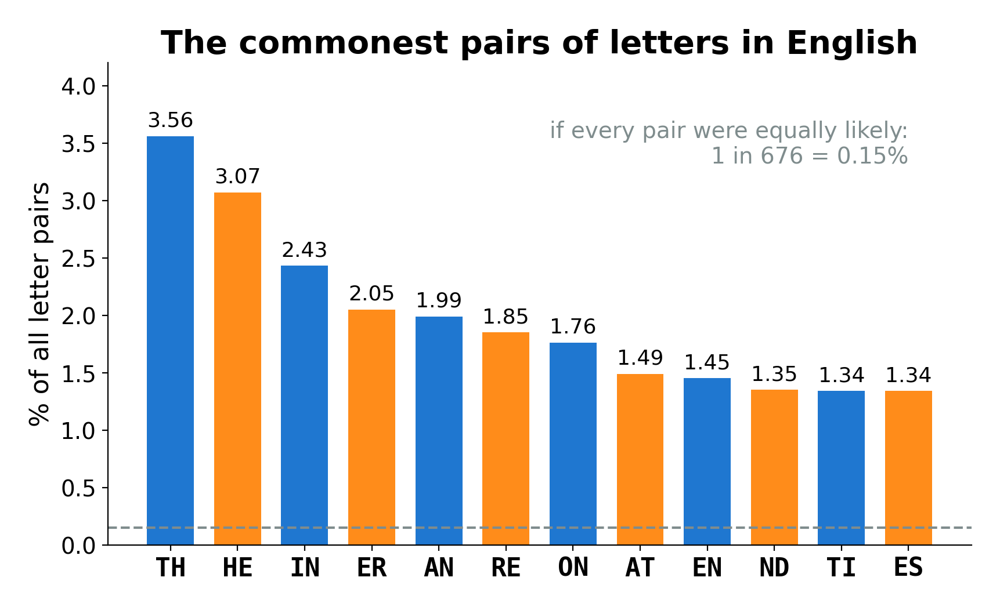
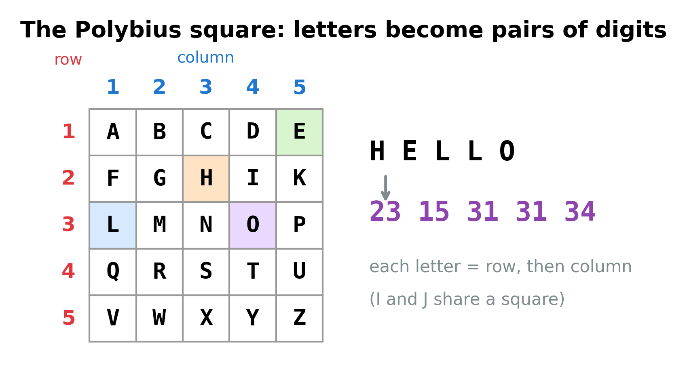
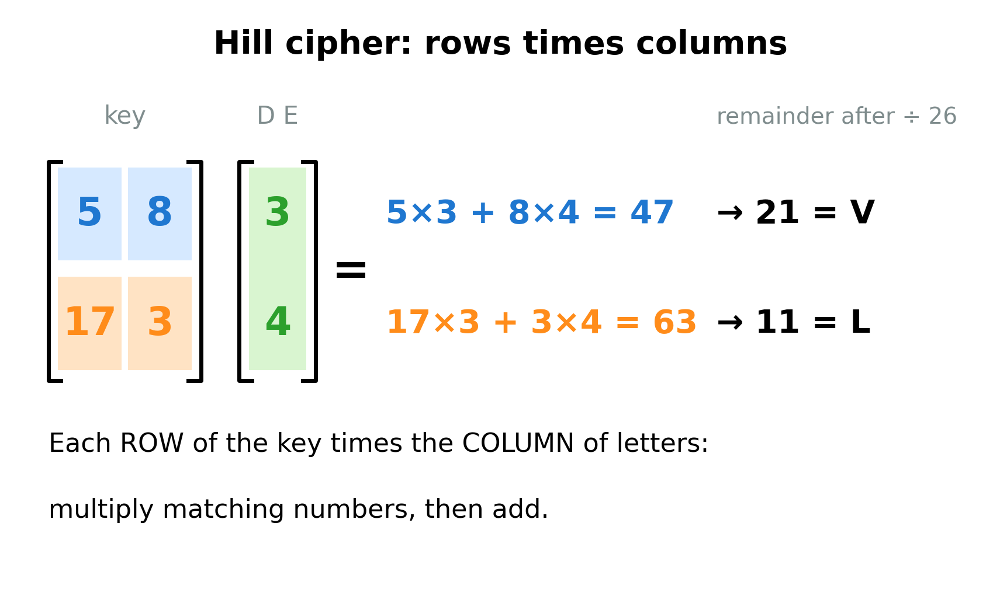
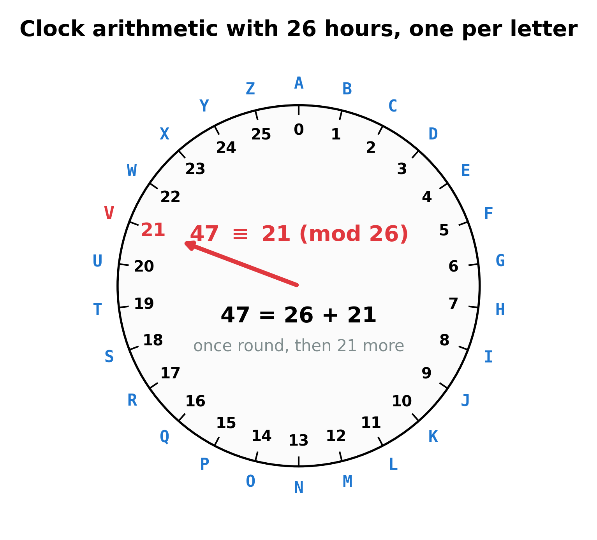
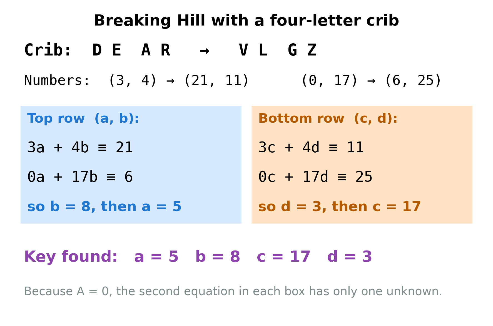

**By the end you can recognize a Playfair or a Hill cipher just by counting, and you can break a Hill cipher from four letters you can guess.**

## The big idea

Most simple ciphers change one letter at a time, so E always turns into the same thing, and counting letters gives the game away. **Polygraphic** ciphers ("poly" means many, "graph" means letter) change letters in groups, usually pairs. Now E turns into different letters depending on its partner: the E in HE and the E in ER are encrypted differently. Counting single letters stops working. But pairs of letters have their own fingerprint, because some pairs are far more common than others.



TH is more than twenty times as common as an average pair. A cipher that works on pairs is really a substitution on pairs instead of letters, and that is where you attack it. Each of these ciphers also leaves its own set of **tells**: small rules it can never break, which you can check by counting.

## Which ciphers it breaks

| Cipher | Do these methods help? | How |
|---|---|---|
| Polybius square | Yes | Each letter becomes two digits. Turn each pair back into one symbol, then use frequency analysis (Guide 02). |
| ADFGVX | Partly | A Polybius square followed by a columnar transposition: undo the transposition first (Guide 07), then the square. |
| Playfair | Yes | Check its tells. Then use a crib, reversed pairs, and pair frequencies, or a computer search (Guide 08). |
| Four-square, two-square | Partly | Similar tells to Playfair, similar attacks. |
| Hill (2x2) | Yes | Check its tells. A four-letter crib gives four equations: solve them for the key. |
| Caesar, Vigenère, substitution | No | They work one letter at a time: see Guides 02 to 05. |
| Transposition | No | Letter counts look like plain English (Guide 07). |

## Why it works

### The Polybius square: letters as coordinates

Write the alphabet in a 5x5 square. There are 26 letters and only 25 spaces, so I and J share a square (J is the rarest letter, and you can usually guess it back from the context). Number the rows and columns 1 to 5. Now every letter has an address: row first, then column.



On its own, Polybius is just a substitution wearing a disguise: each letter always becomes the same pair of digits. Group the digits in pairs, give each pair a symbol, and count. The tells: only the digits 1 to 5, and an even number of them.

The square becomes important because it **hides inside other ciphers**. The **ADFGVX** cipher, used by the German army in 1918, used a 6x6 square (26 letters plus 10 digits), with rows and columns labeled A, D, F, G, V and X instead of numbers. Those six letters were chosen because they sound very different in Morse code. Each letter became two of them, and then the whole string was scrambled by a columnar transposition. Tell: a ciphertext made of only the letters A, D, F, G, V and X. Other ciphers built on the square include bifid and the Nihilist cipher.

### Playfair: a square that encrypts pairs

Playfair was invented in 1854 by Charles Wheatstone and named after his friend Lord Playfair, who promoted it. It was used by the British army in the Boer War and the First World War. It uses a 5x5 square too, but filled from a **keyword**. For the keyword LANTERN: write its letters without repeats (L, A, N, T, E, R), then the rest of the alphabet in order, skipping letters already used and merging J into I.

```
L A N T E
R B C D F
G H I K M
O P Q S U
V W X Y Z
```

**Preparing the message.** Take the letters only (J becomes I) and split them into pairs. A pair may never be two of the same letter, so if a pair would be doubled, put an X between them. If one letter is left over at the end, add an X. "The balloon will rise at noon" becomes:

```
TH EB AL LO ON WI LX LR IS EA TN OX ON
```

Look at WI LX LR: "will" has a double L, so an X goes between the Ls. In "noon", the double O gets an X.

**Encrypting each pair.** There are three rules, depending on where the two letters sit in the square.


1. **Rectangle.** If the letters are in different rows and columns, they mark two corners of a rectangle. Replace each letter with the other corner **in its own row**. TH becomes AK.
2. **Same row.** Replace each letter with the one to its right (wrapping from the end of the row back to the start). AL becomes NA.
3. **Same column.** Replace each letter with the one below it (wrapping from the bottom back to the top). LO becomes RV.

The whole message encrypts to `AK AF NA RV QL XH NV RG KQ LN ET QV QL`. To decrypt, do the opposite: left instead of right, up instead of down, and rectangles stay the same. The receiver gets `THEBALLOONWILXLRISEATNOXON` and simply ignores the extra Xs.

### Spotting Playfair

The rules force some patterns, and they are the tells.

- **Even length.** The message always ends up in whole pairs.
- **No doubled pair.** Split the ciphertext into pairs from the start: no pair is ever two of the same letter (like `EE`), because the plaintext pairs never are, and the rules never turn two different letters into two equal ones.
- **At most 25 letters, usually no J.** J was merged into I.
- **No letter encrypts to itself.** In a pair, the first ciphertext letter is never the first plaintext letter, and the same for the second.
- **Reversed pairs.** If AB becomes XY, then BA becomes YX. In our message ON became QL, so NO would become LQ. English has common reversed pairs (ER and RE, ES and SE, ON and NO), so look for a ciphertext pair and its reverse that are both common.
- **Index of coincidence in between.** Pair encryption smooths out the counts a little: the index of coincidence (the chance that two letters picked at random match, Guide 04) is lower than English's 0.067, but higher than a Hill cipher's.


**Breaking Playfair.** With a crib (a word you expect in the message), you can work out which letters share rows and columns, and rebuild the square bit by bit. Without one, the strongest method is a computer search: the key is the square, a move swaps two letters (or two rows, or two columns), and the score is the English score of the decryption. That is exactly the method in Guide 08 (Scoring and hill climbing), and Playfair needs its simulated annealing version and about 100 letters or more.

## The grown-up version: the Hill cipher

The Hill cipher, invented by the mathematician Lester Hill in 1929, turns encryption into arithmetic. You need two ideas: multiplying a matrix by a pair of numbers, and clock arithmetic.

### Letters as numbers

Number the letters from zero: A = 0, B = 1, C = 2, and so on up to Z = 25. Starting at zero makes the arithmetic tidy.

### Matrices: rows times columns

A **matrix** is a box of numbers. The Hill key is a 2x2 matrix, four numbers in two rows and two columns. We write it with square brackets, and give the four numbers names:

$$K = \begin{bmatrix} a & b \\ c & d \end{bmatrix} = \begin{bmatrix} 5 & 8 \\ 17 & 3 \end{bmatrix}$$

The pair of plaintext letters is written as a column of two numbers. To multiply the matrix by the column, take each **row** of the matrix and the **column** of letters, multiply the matching numbers, and add.



$$\begin{bmatrix} 5 & 8 \\ 17 & 3 \end{bmatrix} \begin{bmatrix} 3 \\ 4 \end{bmatrix} = \begin{bmatrix} 5 \times 3 + 8 \times 4 \\ 17 \times 3 + 3 \times 4 \end{bmatrix} = \begin{bmatrix} 47 \\ 63 \end{bmatrix}$$

But 47 and 63 are not letters. We need to bring them back between 0 and 25.

### Clock arithmetic: mod 26

Imagine a clock with 26 hours, one for each letter. Counting 47 hours around it, you go once all the way round (26) and then 21 more, landing on 21, which is V. Mathematicians write this as

$$47 \equiv 21 \pmod{26}$$

and read it "47 is congruent to 21, mod 26". The symbol $\equiv$ means "lands on the same place on the clock", and "mod 26" says the clock has 26 hours. In practice: **divide by 26 and keep the remainder**. $63 = 2 \times 26 + 11$, so $63 \equiv 11 \pmod{26}$, which is L. Negative numbers go backward round the clock: $-1 \equiv 25$, because one step back from 0 is 25.



So the pair DE encrypts to VL. In symbols, with plaintext pair $(p_1, p_2)$ and ciphertext pair $(c_1, c_2)$:

$$c_1 \equiv a p_1 + b p_2 \pmod{26}, \qquad c_2 \equiv c\, p_1 + d\, p_2 \pmod{26}$$

### Undoing it: inverses

To decrypt, you need a second matrix that undoes the first. On the 26-hour clock, "dividing" means multiplying by an **inverse**: the inverse of 3 is 9, because $3 \times 9 = 27 \equiv 1$. Only numbers that share no factor with 26 (so not even, and not 13) have an inverse. Here is the full list, worth copying onto a card:

| number | 1 | 3 | 5 | 7 | 9 | 11 | 15 | 17 | 19 | 21 | 23 | 25 |
|---|---|---|---|---|---|---|---|---|---|---|---|---|
| inverse | 1 | 9 | 21 | 15 | 3 | 19 | 7 | 23 | 11 | 5 | 17 | 25 |

For a matrix, the number that matters is its **determinant**, $ad - bc$. The key can be undone only if the determinant has an inverse. Then the undo matrix is

$$K^{-1} \equiv (ad - bc)^{-1} \begin{bmatrix} d & -b \\ -c & a \end{bmatrix} \pmod{26}$$

(swap $a$ and $d$, flip the signs of $b$ and $c$, and multiply every entry by the inverse of the determinant).

### Spotting Hill

- **Even length** (for a 2x2 key; a 3x3 key gives a multiple of 3).
- **Flat letter counts.** The index of coincidence is near 0.04, much flatter than English and flatter than Playfair.
- **All 26 letters can appear**, including J, and doubled pairs are allowed.
- **Repeats only in step.** The same plaintext pair, starting at an odd position (counting from 1), always gives the same ciphertext pair. So repeated pairs in the ciphertext line up on pair boundaries.

## A worked example: breaking Hill with a crib

You intercept this message, which you believe is a Hill cipher:

```
VL GZ WS UD NQ PB XV DH VF GZ YL MP VL ZL BP MP QV PB UP IK UT MS AP
```

**Step 1. Check the tells.** 46 letters: even. Doubled pairs are allowed in Hill, and repeats are on pair boundaries: VL appears twice, as do GZ, PB and MP. With only 46 letters the single-letter counts say little (P comes up 7 times, but that is mostly because PB and MP each appear twice), so the even length and the repeated pairs are the best clues. Everything fits Hill.

**Step 2. Guess a crib.** The message looks like a letter to an agent, and letters often begin with "dear". So guess that the first four letters DEAR became VLGZ. In numbers:

- D E is $(3, 4)$, and became V L, which is $(21, 11)$.
- A R is $(0, 17)$, and became G Z, which is $(6, 25)$.

**Step 3. Write the equations.** Use the formulas above, once for each crib pair. The top row of the key, $a$ and $b$, makes the first letter of each ciphertext pair:

$$3a + 4b \equiv 21, \qquad 0a + 17b \equiv 6 \pmod{26}$$

The bottom row, $c$ and $d$, makes the second letter of each pair:

$$3c + 4d \equiv 11, \qquad 0c + 17d \equiv 25 \pmod{26}$$

**Step 4. Solve for b and d.** Because A is 0, the second equation in each row has only one unknown. $17b \equiv 6$: multiply both sides by the inverse of 17, which is 23. $b \equiv 6 \times 23 = 138 = 5 \times 26 + 8$, so $b = 8$. Check: $17 \times 8 = 136 = 5 \times 26 + 6$. Yes. In the same way, $17d \equiv 25$ gives $d \equiv 25 \times 23 = 575 = 22 \times 26 + 3$, so $d = 3$. Check: $17 \times 3 = 51 = 26 + 25$. Yes. (If you don't have the inverse table, you can just try $b = 0, 1, 2, \dots$ until $17b$ leaves remainder 6.)

**Step 5. Solve for a and c.** Put $b = 8$ into the first equation: $3a + 32 \equiv 21$, so $3a \equiv 21 - 32 = -11 \equiv 15$. Since $3 \times 5 = 15$, $a = 5$. Put $d = 3$ into the other: $3c + 12 \equiv 11$, so $3c \equiv -1 \equiv 25$. Multiply by 9 (the inverse of 3): $c \equiv 225 = 8 \times 26 + 17$, so $c = 17$. Check: $3 \times 17 = 51 \equiv 25$. Yes.



So the key is

$$K = \begin{bmatrix} 5 & 8 \\ 17 & 3 \end{bmatrix}$$

**Step 6. Build the undo matrix.** The determinant is $ad - bc = 5 \times 3 - 8 \times 17 = 15 - 136 = -121$. On the clock, $-121 + 5 \times 26 = 9$, so the determinant is 9, and its inverse is 3. Swap $a$ and $d$ and flip the signs of $b$ and $c$, then multiply by 3:

$$K^{-1} \equiv 3 \begin{bmatrix} 3 & -8 \\ -17 & 5 \end{bmatrix} = \begin{bmatrix} 9 & -24 \\ -51 & 15 \end{bmatrix} \equiv \begin{bmatrix} 9 & 2 \\ 1 & 15 \end{bmatrix} \pmod{26}$$

**Step 7. Decrypt.** The third pair is WS, which is $(22, 18)$:

$$9 \times 22 + 2 \times 18 = 234 = 9 \times 26 + 0 \equiv 0 = \text{A}, \qquad 1 \times 22 + 15 \times 18 = 292 = 11 \times 26 + 6 \equiv 6 = \text{G}$$

AG. The fourth pair UD, $(20, 3)$, gives $186 \equiv 4$ (E) and $65 \equiv 13$ (N): EN. Carrying on through the whole message gives `dear agent the papers are hidden inside the clock tower`. The crib was right.

**What if the crib's place is unknown?** Slide it along the ciphertext, starting only at odd positions (1, 3, 5, ...) so it lines up with the pairs. Each position gives four equations. If they have no solution, or the key has no inverse, or the decryption is gibberish, move on.

**The grown-up shortcut.** Put the two crib pairs side by side as the columns of a matrix $P$, and the two ciphertext pairs as the columns of a matrix $C$. Then $C \equiv K P$, so $K \equiv C P^{-1}$. That is the same calculation as Steps 3 to 5, done all at once, and it works for any crib whose matrix $P$ has an inverse.

## When to try it

- **Polybius:** the ciphertext is only digits 1 to 5, or only five or six different letters (such as A, D, F, G, V, X).
- **Playfair:** even length, no doubled pair at the pair boundaries, no J, index of coincidence a bit below English.
- **Hill:** even length (or a multiple of 3), flat counts, J and doubled pairs present, and a good guess for a word in the message.

**When not to:** an odd length rules out Playfair and 2x2 Hill. A doubled pair at a pair boundary rules out Playfair. Letter counts that look exactly like English mean a transposition (Guide 07).

## Traps and tips

- **Count pairs from the very first letter.** The tells are about pairs 1-2, 3-4, 5-6, and so on. A doubled letter across a boundary (the 2nd and 3rd letters, say) means nothing.
- **Short texts.** In 30 letters, a substitution cipher might have no doubled pair just by luck. The no-doubles tell gets convincing at around 80 letters or more.
- **The Xs.** After decrypting Playfair, remove the X between doubled letters and at the end. But some messages really contain X (as in "box"), so read carefully.
- **I or J?** A Playfair or Polybius decryption shows I where the sender wrote J: "IUST" is "just".
- **Check every step on the clock.** One slip in a remainder ruins the whole Hill key. After solving, re-encrypt the crib with your key to check it gives the ciphertext.
- **Even determinants are impossible.** If your Hill key comes out with an even determinant (or 13), it cannot be a real key: the crib or its position is wrong.
- **Choose cribs with an A.** Since A = 0, a crib containing A makes some equations very simple, as in the worked example.

## Try it yourself

1. Decode this Polybius message (standard square, as in the picture): `22 34 34 14 31 45 13 25`.
2. Which of these could be Playfair? (a) `QWERTYUIOPLKJ` (b) `MNBVCCXZLKAS` (c) `HGFDSAPOIUYT`.
3. Encrypt the pair HI with the key $K = \begin{bmatrix} 5 & 8 \\ 17 & 3 \end{bmatrix}$.
4. With the keyword LANTERN, ON encrypts to QL. Without using the square, what does NO encrypt to?
5. Can these be Hill keys? (a) $\begin{bmatrix} 2 & 4 \\ 1 & 3 \end{bmatrix}$ (b) $\begin{bmatrix} 3 & 2 \\ 5 & 7 \end{bmatrix}$

## Answers

1. 22 = G, 34 = O, 34 = O, 14 = D, 31 = L, 45 = U, 13 = C, 25 = K: "good luck".
2. (a) No: it has 13 letters (odd), and it contains a J. (b) No: split into pairs, MN BV CC XZ LK AS, and CC is a doubled pair. (c) Yes, it could be: 12 letters, pairs HG FD SA PO IU YT, no doubled pair, no J.
3. H = 7, I = 8. Top: $5 \times 7 + 8 \times 8 = 99 = 3 \times 26 + 21$, so 21 = V. Bottom: $17 \times 7 + 3 \times 8 = 143 = 5 \times 26 + 13$, so 13 = N. HI becomes VN.
4. LQ: reversing a plaintext pair reverses its ciphertext pair.
5. (a) No: the determinant is $2 \times 3 - 4 \times 1 = 2$, which is even, so it has no inverse. (b) Yes: $3 \times 7 - 2 \times 5 = 11$, and 11 has an inverse (19).

## Words to know

- **Polygraphic cipher**: a cipher that encrypts groups of letters (usually pairs) together.
- **Digraph**: a pair of letters, such as TH.
- **Polybius square**: a 5x5 grid that turns each letter into a row number and a column number.
- **ADFGVX**: a 6x6 Polybius square labeled A, D, F, G, V, X, followed by a columnar transposition.
- **Playfair**: a cipher that encrypts pairs with a keyword square, using the rectangle, row and column rules.
- **Hill cipher**: a cipher that multiplies pairs of letter numbers by a matrix, mod 26.
- **Matrix**: a rectangular box of numbers.
- **Mod 26 (modular arithmetic)**: arithmetic on a 26-hour clock: keep only the remainder after dividing by 26.
- **Congruent ($\equiv$)**: landing on the same place on the clock.
- **Inverse (mod 26)**: the number you multiply by to get 1 on the clock.
- **Determinant**: for a 2x2 matrix, $ad - bc$; the key can be undone only if this has an inverse mod 26.
- **Crib**: a word you guess is in the plaintext.
- **Tell**: a pattern a cipher always or never produces, which helps you recognize it.

## Going further

- [Practical Cryptography: Playfair cipher](http://practicalcryptography.com/ciphers/classical-era/playfair/)
- [Practical Cryptography: Hill cipher](http://practicalcryptography.com/ciphers/classical-era/hill/)
- [Practical Cryptography: ADFGVX cipher](http://practicalcryptography.com/ciphers/classical-era/adfgvx/)
- [Wikipedia: Polybius square](https://en.wikipedia.org/wiki/Polybius_square)
- [Wikipedia: Playfair cipher](https://en.wikipedia.org/wiki/Playfair_cipher)
- [Wikipedia: Hill cipher](https://en.wikipedia.org/wiki/Hill_cipher)
- [Wikipedia: Modular arithmetic](https://en.wikipedia.org/wiki/Modular_arithmetic)
- Simon Singh, *The Code Book* (1999), for Playfair and ADFGVX in war.
- [The National Cipher Challenge](https://www.cipherchallenge.org/) for practice ciphertexts.
